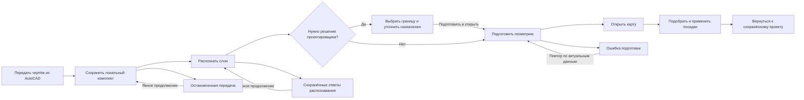

# Продукт и пользовательский путь

## Состояния подготовки и продолжения

Green Atlas помогает проектировщику получить и сохранить обоснованный вариант посадок

| Зона | Ответственность и владелец состояния | Результат и восстановление |
|---|---|---|
| Ожидание передачи | Native-shell показывает этап из защищённого журнала, время текущего ожидания и отмену; web-документ остаётся смонтированным | Готовый проект открывается через общую политику ухода; потерянный ответ проверяется чтением журнала |
| Распознавание | Серверное задание сообщает первый проход, проверку конфликтов и сохранение; UI наблюдает через TanStack Query | Счётчики относятся к текущему этапу; остановка прекращает анимацию и сохраняет полученные ответы |
| Подготовка геометрии | Задание подготовки и подтверждённые версии проекта | Завершение автоматически открывает карту, в том числе после возврата на экран; ошибка оставляет явное восстановление |
| Карта и размещение | Применённый горизонт и план принадлежат проекту; предпросмотр и формы — своим контроллерам | Применение записывает план и историю; повторное открытие использует локальную геометрию |

Команда плагина «Открыть в Green Atlas» сохраняет намерение открыть редактор
между техническими этапами. После распознавания и подтверждённого сохранения
назначений приложение продолжает подготовку и открывает карту. Уже готовый
расчётный снимок используется повторно. Проектировщик вмешивается, когда нужно
выбрать границу, уточнить роль или рассмотреть неполные данные

Ручное изменение настроек приостанавливает автоматическое продолжение:
основная кнопка применяет весь выбранный набор и доводит его до карты.
После отмены или ошибки повтор остаётся явным действием. Обычный просмотр
исходных данных сохранённого проекта не запускает подготовку

Начало ожидания не является оценкой срока завершения. Процент показывается только
при известном объёме этапа. Ошибка, отмена и завершение — терминальные состояния
без движущегося индикатора. Исходные DWG и рабочая база не перезаписываются проверками

## 1. Подготовить проект

Открыть чертёж в AutoCAD и проверить доступность внешних ссылок.
Запустить Green Atlas через плагин. Если приложение запрашивает решение,
проверить спорные назначения и расчётную границу, затем подготовить карту.
Ожидание сохранения, подготовки геометрии и открытия не требует отдельных кликов.

Сопоставление определяет смысл объекта, но не исправляет его геометрию.
Замечания к чтению и контурам рассматриваются отдельно.
Подробнее: [[03 Модули/Работа с CAD и DXF|подготовка CAD]].

## 2. Найти места

Выбрать существующий рабочий участок или нарисовать новый.
Указать породу, размер, количество, горизонт расчёта и способ размещения.
Сервис строит область поиска и проверяет предложенные позиции.

Схема показывает основной цикл проверки. Подбор заканчивается при достижении
количества, исчерпании кандидатов или бюджета поиска. Частичный результат
не означает, что свободных мест на территории больше нет.
Подробнее: [[03 Модули/Проектирование посадок|алгоритм подбора]].

## 3. Проверить и сохранить

Рассмотреть места на карте и замечания к ним. При необходимости изменить
вариант. Подтвердить посадки. Перед записью сервис проверяет актуальность
плана и исходных данных.

Геометрическое замечание связано с позицией на карте. Ошибка актуальности
требует нового предпросмотра, а не перемещения растения.
Сохранённые посадки доступны при повторном открытии проекта.

## Работа с неполным исходником

| Ситуация | Действие |
|---|---|
| Не определено назначение слоя | Выбрать подходящий тип и подтвердить решение |
| Есть предложение восстановления контура | Рассмотреть геометрию с окружением и принять либо отклонить предложение |
| Объект доступен только как линия | Проверить его назначение; линия может учитываться без площади |
| Не прочитан объект или внешняя ссылка | Восстановить исходные данные либо принять явно неполный расчёт |
| Результат устарел | Повторить подготовку или предпросмотр по актуальным данным |

Подтверждение исключения слоя отключает его учёт. Оно не является способом
исправления неизвестной геометрии.

## Результат

В локальном проекте сохраняются участки, растения, решения и история.
Выпуск использует сохранённый план и CAD-архив проекта через отдельное
задание AutoCAD Core: [[03 Модули/Проверка и выпуск|проверка и выпуск]].
