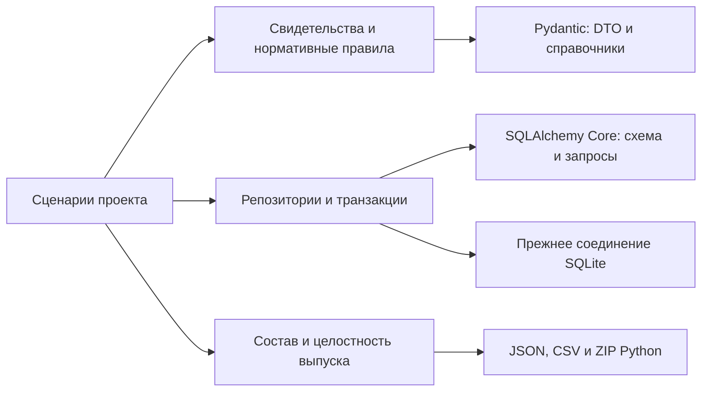

# Общая архитектура

## Граница системы

AutoCAD интерпретирует CAD и восстанавливает поддерживаемые области.
Плагин передаёт согласованное состояние чертежа локальному приложению.
Green Atlas хранит проект, определяет ограничения и рассчитывает посадки.

После подготовки проверки отдельных позиций выполняются локально.
Новая подготовка и редактирование CAD-геометрии требуют AutoCAD.

## Модули

| Модуль | Ответственность | Результат |
|---|---|---|
| CAD-плагин | Чтение объектов, блоков и XREF; сборка контуров | Захват с геометрией, происхождением и замечаниями |
| Приём и desktop | Запуск приложения, проверка версии и целостности передачи | Проект, связанный с исходным захватом |
| Исходные данные | Назначения слоёв, расчётная граница и решения пользователя | Сохранённые основания расчёта |
| Подготовка геометрии | Построение и сохранение расчётного снимка | Области, отверстия, линии, точность и пропуски |
| Геометрия и правила | Измерения и зоны ограничений | Проверка позиции, область поиска и объяснения |
| Планирование | Очередь кандидатов, соседство и предпросмотр | Предлагаемый план |
| Проверка и хранение | Контроль ревизий и применение изменений | Сохранённый план и история |
| Интерфейс | Отображение и взаимодействие | Карта, формы, замечания и 3D |
| Распознавание слоёв | Предложение категорий по обезличенным признакам захвата | Назначения и замечания для подготовки |

Описание модулей: [[../README|оглавление]].

## Поток данных

Захват AutoCAD → назначения и решения → подготовленная геометрия →
ограничения → предпросмотр посадок → сохранённый план.

Подготовленная геометрия одновременно используется для измерений, области
поиска и оценки полноты. Упрощённые контуры карты не подменяют расчётные данные.

## Общие программные контракты

- ProjectLiveGeometry выбирает актуальный сохранённый снимок проекта.
- PreparedStore хранит снимок и проверяет его целостность.
- PreparedGeometryEngine выполняет локальные измерения.
- PreparedProjection предоставляет общее представление геометрии потребителям.
- PlacementPolicy применяет правила проверки.
- Сценарий сохранения проверяет ревизию проекта и основания предпросмотра.

Если подходящего снимка нет, подготовка обращается к AutoCAD.
Для готового снимка идентификатор процесса AutoCAD не является основанием
актуальности. Изменение чертежа, назначений или правил требует обновления
соответствующих производных данных.

## Границы ответственности

Библиотечный механизм отвечает за формат и инфраструктуру. Сценарий владеет
порядком действий, подтверждением изменения и значением свидетельства.
Транзакция не передаётся сериализатору или компилятору SQL.

Чтение DWG/DXF не переносится в модуль планирования. Интерфейс не выбирает
собственные правила расстояний. Автоматическая посадка вызывает общие сервисы
планирования и сохраняет результат через подтверждение изменений.
Совместимость со старыми проектами не становится резервным
парсером для нового CAD-входа.

Владельцы данных: [[02 Архитектура/Данные и интеграции]].
Ограничения реализации: [[00 Обзор/Текущее состояние]].

## Размещение кода по обязанностям

Подкаталог выделяет целый сценарий или адаптер. Он не добавляет сервис,
хранилище или промежуточный слой вызовов. Корень домена содержит общие
контракты, порты и координатор; внутренние потребители импортируют владельца
напрямую. Совместимость не поддерживается пустыми файлами со старыми импортами.

| Домен backend | Подкаталоги и границы |
|---|---|
| `native_query` | `capture` принимает захват, `archive` собирает CAD-архив, `live` взаимодействует с AutoCAD. `preparation` владеет снимком, `measurement` измеряет, `search` строит область поиска, `policy` применяет правила. `display` готовит представления, `transport` запускает и контролирует worker. |
| `dxf_import` | `source` допускает и собирает источник, `layers` интерпретирует слои, `review` обрабатывает адресные решения, `native` принимает native-геометрию. `legacy` сохраняет существующее чтение старых данных; нового входа импорта здесь нет. |
| `geometry` | `checking` проверяет позиции, `networks` интерпретирует инженерные ограничения, `viewport` формирует данные отображения. Геометрия viewport не подменяет проверяющий модуль. |
| `planning` | `changes` проверяет и применяет изменения, `search` строит очередь кандидатов, `patterns` формирует ряд и другие схемы посадки, `recommendation` подбирает вариант по цели. |
| `cad_import` | `archive` хранит комплект, `references` разрешает ссылки и идентификаторы, `boundary` содержит контракт границы. Прежние конвертеры и инспекторы находятся в `legacy`. |
| `cad_intake` | `assets` обслуживает принятый источник и паспорт; `inspection` изолирует диагностику и worker. |

Переезд модулей меняет имена импортов и команды worker, но не сохраняемые
контракты, формат проекта или алгоритм. Архитектурные проверки обходят вложенные
сценарии и контракты; список проверяемых Ruff/mypy модулей сохраняет прежний
охват. CAD-ratchet переносит имена существующих связей взаимно однозначно,
без разрешения дополнительных зависимостей от парсера.

Перевод бизнес-ошибок HTTP принадлежит `http_errors.BusinessErrorRoute` и
использует точку расширения существующего FastAPI. Ошибки зависимостей,
проверки запроса и native/security-роутеров сохраняют собственные границы.
Download-методы сохраняют более узкую границу чтения файла.
Основание выбора: [[06 Исследования и решения/Источники и решения|источники по границам HTTP и React]].

## Причины отказов и публичные сообщения API

Ожидаемый отказ хранит типизированную причину `FailureReason` и параметры
`FailureParams`, без текста исключения. Публичные объяснения активных сценариев
импорта, посадок, выпуска и распознавания находятся в
`apps/api/app/shared/messages.ru.json`. Параметры проверяет существующий
Pydantic `TypeAdapter`; каталог включается и в автономную сборку runtime.
Доменные проверки сохраняют прежний порядок и основания.

`http_errors` переводит известный отказ в 400, отсутствующий ресурс в 404,
конфликт версии в 409. Непредвиденное исключение возвращает 500
`INTERNAL_ERROR` с идентификатором диагностики. Исходное исключение и стек
остаются в локальном журнале. Сырые `str(error)` и параметры исключения не
публикуются. Ошибки полей 422 переводятся по структурированным причинам
Pydantic, с сохранением пути поля и численного ограничения.

Фоновый импорт передаёт известный отказ отдельной проверяемой квитанцией:
причина и параметры, отсутствие проекта либо конфликт его версии. Родитель
восстанавливает тип отказа; неизвестная ошибка остаётся диагностикой локального
процесса. Журнал фоновых операций сохраняет адресное объяснение конфликта
версии проекта или плана. Отмена операции имеет прежний приоритет.

Адресный результат геометрической проверки сохраняет собственный контракт:
`PositionRejected` сохраняет результат проверяющего модуля, а
`ChangeSetRejected` несёт результат кандидата, включая конкретную причину
ограничения. `SourceAreaGroupRejected` сохраняет адресный результат проверки
области; сырой диагностический ответ worker в HTTP-сообщение не попадает. Его нельзя подменять общим сообщением об отказе операции.
Политики расчёта, расстояния и форматы проекта этим изменением не меняются.
Это ограниченный срез: информационные подписи, тексты нормативного проверяющего
и диагностика прежних CAD-путей пока остаются у существующих владельцев.
