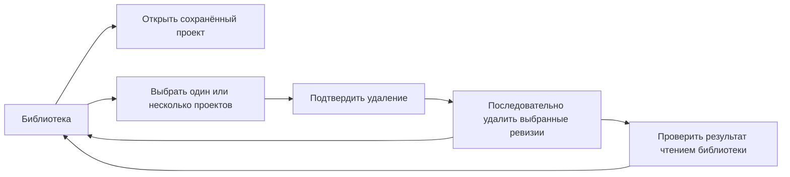
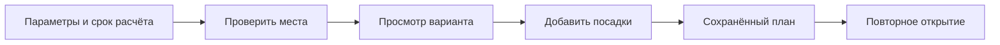
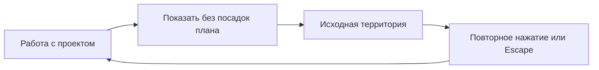

# Интерфейс и представления

## Назначение

Предоставить доступ к исходным данным, участкам, посадкам и замечаниям.
Интерфейс отображает результаты расчёта, но не определяет собственные
геометрические или нормативные правила.

## Вход и результат

Вход: состояние проекта, представления геометрии, план, предпросмотр
и статусы операций.

Результат: команды пользователя и отображение ответов API.
Пользовательский выбор не считается сохранённым до успешного ответа сервиса.

Индикатор ожидания отображается только для активной операции. Завершение,
ошибка, отмена или прерывание убирают его, даже если последнее сообщение
сервера содержало неопределённый прогресс. Стадия, прошедшее время, счётчики,
причина ошибки и доступные действия остаются видимыми.

## Основные области

### Библиотека проектов

| Зона | Ответственность | Компоненты |
| --- | --- | --- |
| Верхняя шапка | Название библиотеки и новый проект | Button, Text |
| Панель выбора | Выбрать все, снять выбор, удалить выбранные | Button, IconButton |
| Строки проектов | Сохранённое состояние, переход и отдельное меню действий | ScrollTable, Checkbox, Menu |
| Подтверждение | Состав удаления, ход операции и восстановление ответа | Dialog, Progress |

Шапка, панель выбора и названия колонок сохраняют положение, прокручиваются
только строки. Открытие принадлежит названию проекта и пункту меню; удаление
находится в контекстном меню либо в панели выбранных проектов. Оно требует
отдельного подтверждения. Выбор — временное состояние библиотеки; список
проектов хранится только в TanStack Query. После обновления каталога выбранными
считаются только ещё существующие проекты.

Удаление последовательно отправляет существующий DELETE с зафиксированной
версией каждого подтверждённого проекта. Счётчик меняется после успешного
ответа, строка исчезает только после подтверждения. Первый отказ или потерянный
ответ останавливает оставшиеся удаления. Восстановление читает каталог без
повторения DELETE и не продолжает пакет автоматически. Подтверждённое удаление
с ошибкой чтения позволяет выход, но следующее удаление ждёт обновления каталога.

Короткие анимации меню, диалогов, панели выбора, выделения и прогресса показывают
смену состояния без задержки команд. При системном уменьшении движения они
отключены. Заголовки крупных секций исходных данных и групп участков/посадок
закрепляются в пределах своей секции; названия колонок закреплены в полном
прокручиваемом списке слоёв. Вложенные списки проверки остаются в обычном потоке.

| Область         | Задача                                            |
| --------------- | ------------------------------------------------- |
| Исходные данные | Назначения слоёв, граница и замечания к геометрии |
| Карта           | Просмотр объектов, выбор участка и размещение     |
| Предпросмотр    | Сравнение предложенных и сохранённых посадок      |
| Замечания       | Причина, затронутый объект и доступное действие   |
| 3D              | Производное пространственное представление плана  |
| Справочник      | Выбор растений и их параметров                    |

Начальная ширина ресурсов проекта — 260 px, правого инспектора — 300 px.
В узком окне панели временно сжимаются; выбранные пользователем размеры
сохраняются и возвращаются при расширении окна. Сетка способов размещения
содержит две колонки и две строки равной высоты при любой ширине инспектора.
Длинное название не увеличивает только одну карточку.

В параметрах и результате подбора нет отдельной команды проверки произвольной
точки. Разбор отклонённых позиций сохраняет адресные причины, измеренные
отступы, подсветку исходной точки и проверку её переноса вместе с соседями
из текущего варианта. Общая проверка ручных посадок остаётся прежней.

## Продолжение сохранённого проекта

Карта и сохранённый план доступны для просмотра независимо от наличия
подготовленного расчётного снимка. Отсутствующий, повреждённый, устаревший
или неподдерживаемый снимок и ожидающая подготовка объединяются в одну
кнопку «Подготовить расчёт» в заголовке. Пояснение кнопки содержит конкретную
причину и сообщает, что карта доступна для просмотра. Кнопка открывает
исходные данные через общую политику выхода из редактора; сама она
не запускает AutoCAD и не меняет проект. Адресные замечания остаются
в исходных данных.

Ошибка чтения актуальной версии проекта имеет отдельное действие
«Повторить чтение». Отсутствие расчётного снимка не скрывает такую ошибку
и не подменяет проверку актуальности.

## Исходные данные и выпуск

В установленном Mac-комплекте 0.1.76 это представление включено в ресурсы
`Green Atlas.app/Contents/Resources/Web`. Обычное окно приложения использует
эти ресурсы; изменение исходников или `apps/web/dist` само по себе его
не обновляет. Переход из редактора через «Исходные данные» и переключение
таблицы проверены в установленном приложении на существующем проекте.
Обновление 0.1.76 сохраняет квалифицированный API комплекта 0.1.75 без изменений,
включая поправку чтения паспорта до подготовки снимка. Новый допуск расчёта
по доступным данным из параллельной рабочей ветки в него не включён. Политика
готовности интерфейса в этой сборке согласована с этим API.

Подготовка исходных данных имеет три пункта навигации: «Геометрия», «Слои»
и «Сведения». Граница расчёта выбирается внутри геометрии. Идентификаторы
протокола прежние: `02`, `03`, `04`; запрос перехода к прежнему разделу `01`
открывает геометрию и выбор границы. Навигация, заголовок и нижние действия
сохраняют положение, прокручивается содержимое документа. Переключение раздела
не теряет введённые назначения и поиск.

Просмотр сохранённого исходника и его подготовка используют общий
`SourceReviewLayout` с теми же тремя разделами и внутренними опорами.
Действие шапки редактора «Открыть назначения слоёв» ведёт на
`/setup?section=layers&edit=assignments`: сразу открыта форма назначений, сначала очередь проверки,
а при её отсутствии — все слои. Действие доступно и после подтверждения всех
слоёв. Этот вход читает состояние распознавания без запуска первого прохода,
не сохраняет назначения и не запускает подготовку. Изменения остаются локальным
черновиком до явного применения; возврат к плану и другие переходы сохраняют
защиту несохранённых изменений и неизвестного исхода записи.
Обычный просмотр исходных данных сохраняет действие «Изменить назначения»
для перехода в форму. Намерение редактирования отделено от `?open=editor`,
которое продолжает сценарий открытия после импорта.
Возврат «К плану» находится в шапке. Сведения о полноте загружаются только
при открытии «Сведения», там же доступно скачивание исходного DXF.
Замечания чтения и собранные области находятся в «Геометрии»; ограничения
расчёта сохраняются. У проекта в режиме только чтения действия редактирования
нет. Изменение физических назначений по-прежнему требует подготовки нового
расчётного основания.

В разделе слоёв одна таблица с представлениями «Проверить» и «Все слои».
Распознанный тип описывает чертёж, роль задаёт участие в расчёте. Выбор роли
и действие «Принять» меняют локальный черновик; сохранение подтверждает общий
сценарий подготовки. Принятая строка остаётся на месте до повторного входа
в представление проверки. Счётчики и основания распознавания доступны через
единую кнопку «Распознавание» в хедере. Её попап объединяет статус, счётчики
черновика и основания; техническая причина раскрывается внутри него.
Поиск доступен в представлении «Все слои».
Над прогрессом текущего пакета показывается `Слой <имя>` и число остальных
слоёв пакета. Подпись не повторяет действие из заголовка; без имени показывается
короткое название этапа.

Геометрия разделяет выбор границы, задачи геометрии объектов и полноту исходника.
Повторяемые действия используют общий ActionRow, раскрытия используют Disclosure;
разделители проходят на всю ширину. Интервал между группами и безопасный отступ
контентного скроллера перед футером составляют 24 px.
Окна проверки используют общий Dialog с контролами 36 px, отдельными header,
body и footer; плотные действия очереди имеют явный компактный размер 32 px.
Справка по клавиатуре открывается в попапе 320 px у контекстной иконки
Keyboard и не уменьшает область геометрии. Escape закрывает сначала справку.
Выбор границы представлен строками имени и площади; пояснение открывает popover
в заголовке. Причины недоступности контуров, замечания к файлу и адресные
пропуски сохраняются в собственных раскрытиях. У разделов, таблицы, заголовка
и футера общие внутренние опоры: 24 px, а при ширине менее 720 px — 16 px.
Info размещается перед стрелкой раскрытия; весь заголовок сохраняет ширину,
а стрелка остаётся на общей правой опоре соседних разделов. Клик по Info
открывает только справку. Нативные области прокрутки сохраняют место для полосы
при смене содержимого; у общего ScrollArea ширина уже постоянна.
Стандартное свойство `scrollbar-width: thin` согласует ширину полосы и её резерв
в WebKit приложения; стили `::-webkit-scrollbar` служат только для старых движков.
Значения в раскрытии слоя опираются на колонку типа; подписи — на колонку
имени. На узком экране колонка раскрытия сохраняет ширину 36 px, сведения
переходят в одну колонку. Поиск и вкладки имеют высоту 40 px; focus-линия
поиска лежит на нижней границе панели.

Паспорт читается и до нативной подготовки CAD. Отсутствие сохранённого снимка
возвращает паспорт со статусами `not_ready` и `blocked` и исходной причиной
в ограничениях. Счётчики отображения остаются сведениями карты, классы
не объявляются проверенными и не используются в расчёте. Повреждённый,
устаревший и неподдерживаемый снимки сохраняют явный отказ чтения. Загрузка
и повтор после отказа расположены на внутренних опорах раздела; выполнение
дополнительно видно по нижней полосе заголовка.

Одно раскрытие строки содержит сведения о слое и параметры инженерной сети.
Параметры располагаются первыми, изменение значения снимает их подтверждение.
Когда обязательные сведения заполнены, отдельный флажок подтверждает их
по указанному источнику в черновике. Он не отправляет самостоятельную запись:
данные сохраняются общим действием подготовки. Принятая роль сети сама по себе
не подтверждает ось, способ прокладки или нормативный отступ.

«Отменить действие» восстанавливает полное предыдущее назначение, включая
инженерные сведения и связи осей. История принадлежит текущему исходнику
и локальному черновику; смена исходника или подтверждённое сохранение заканчивает
её. Нижние действия используют общую высоту 36 px. Вкладки и поиск используют
`Tabs` и `TextInput variant="ghost"` из `@green/ui`; предметная композиция
не переписывает их состояния локальными стилями.

Когда назначения слоёв и граница подтверждены, основная кнопка «Подготовить
карту» запускает одну операцию: подготовку расчётного снимка и карты с переходом
в редактор после сохранения результата. Отдельная подготовка чертежа остаётся
для незавершённых исходных данных, которые ещё требуют проверки перед расчётом.

### Пропуски и конфликты

После подготовки проекта пропуски геометрии показываются один раз в спокойном
диалоге с раскрываемым списком слоёв. «Понятно», крестик и Escape сохраняют
локально только факт просмотра. Диалог не требует согласия и не изменяет
классификацию, основания проверки или состояние исходника. При возвращении
к этому проекту он не повторяется; у другого проекта свой факт просмотра.

Общие замечания о покрытии не дублируются в заголовке, результате подбора,
списке проверок и инспекторе растения. Паспорт сохраняет состав пропусков,
причины и адреса объектов. Конкретные столкновения, неизвестность в выбранной
точке и ошибки операции остаются в рабочем интерфейсе.

### Срок расчёта и просмотр роста

| Область | Владелец состояния | Назначение |
|---|---|---|
| Горизонт расчёта | Серверный план в TanStack Query | Единый срок проверки всех инструментов |
| Движение шкалы | Локальный компонент | Черновик до завершения жеста |
| Просмотр роста | Состояние редактора | Год отображения без изменения расчёта |
| Просмотр уведомления | localStorage по ID проекта | Не повторять общую информацию |
| Конфликт посадки | Локальный проверяющий модуль | Причина и адресное исправление |

Специальная шкала использует готовый Slider BaseUI через `@green/ui`:
управление мышью и клавиатурой, крупный год, отметки 5, 10, 20 и 40.
Карта отображает одну полупрозрачную зелёную крону по верхней границе прогноза.
При выборе одного растения добавляется нейтральный контур рабочей корневой зоны
по нижней границе прогноза. Тот же радиус используется для корневых зон в 3D.
Контрол показывает «Диаметр корневой зоны» одним числом: удвоенный рабочий
радиус, а для нескольких растений — наибольший из их рабочих диаметров.
Биологические диапазоны исходного прогноза сохраняются в данных. Минимальные
и максимальные кольца разных цветов убраны; диапазон кроны остаётся в числах.

Год просмотра роста хранится в состоянии редактора текущего проекта и используется
картой, прогнозом, 3D и выпуском. Переход к исходным данным того же проекта
сохраняет горизонт; открытие библиотеки или другого проекта сбрасывает его.
Временные настройки карты и выбор объектов заканчиваются при уходе с карты.

Паспорт сначала показывает данные, требующие проверки. Учтённые классы
доступны во второй вкладке. Состав слоя, основания ограничений и сведения
о файле раскрываются по запросу. Полноширинные границы разделяют зоны,
а подписи и значения используют общие оси содержимого. Паспорт показывает
сохранённые основания и не подтверждает назначения вместо формы слоёв.

Форма выпуска показывает тип пакета, прогноз и действие сборки. Основания
запрашиваются для финального выпуска; смена компоновки не отменяет проверок
актуальности и полноты плана.

## Компоновка панелей редактора

`WorkspaceHeader`, `WorkspaceExplorer`/`ProjectLayers` и общий `ResultsDock`
используют принятые представления прототипа через компоненты сервиса и токены
Tailwind. Владельцы источника, плана, истории, черновика и ограничений действий
остаются прежними. Наблюдение распознавания вынесено в feature hook; общий статус
источника открывает подготовку и не запускает AI. Подтверждение записи опирается
на `writeOutcome`, а повтор чтения не повторяет команду сохранения.

У шапки ряд 48 px, контролы 32 px, пиктограммы 16 px. Статусы занимают постоянные
слоты и раскрывают подробности; выполняемая операция мерцает своей иконкой.
В левой панели общая опора контента 16 px, групповой интервал 16 px и безопасный
отступ 24 px перед футером. Поиск и действие исходных данных заполняют свои
полосы. Выбор слоя независим от видимости; фильтр временно раскрывает результаты,
а после очистки восстанавливается прежнее раскрытие групп. Видимость группы
применяется также к её слоям вне текущего поиска.

Нижние вкладки разделяют полосу 48 px с равными отступами 8 px и опору контента
16 px. Статусы и история Undo/Redo принадлежат полосе, строки проверок имеют
постоянные колонки адресного действия и раскрытия. Детали замечаний остаются
смонтированы при переключении вкладок и закрытии панели. Каждая адресная кнопка
передаёт прежние object IDs; предупреждение исходника не подменяется успешной
проверкой плана, а неизвестное измерение не заменяется нулём. Размер панели
по-прежнему ограничивается реальным окном и сохраняется в модели workbench.
Нижняя и боковые панели используют общий `ResizeHandle`: область захвата 8 px,
центральная ручка 32 × 2 px и одинаковые состояния наведения, захвата и фокуса.
Нейтральная граница 1 px принадлежит лаяуту панели и проходит через центр ручки.
Карта и правый инспектор не входят
в эту итерацию.

## Карта

Легенда открывается иконкой `List` через `@green/ui` и панелью Popover.
Она показывает только обозначения видимых слоёв; Escape и клик снаружи
закрывают панель. Подписи, статусы и уведомления не заканчиваются точками.

Исходные объекты, сохранённый план, временный вариант и выделение представлены
раздельно. Облегчение геометрии для масштаба экрана не меняет расчётную геометрию.
Обзор исходного чертежа декоративен: его контуры не участвуют в выборе объекта
или расчёте посадки. Контуры подложки хранятся в локальных векторных путях
и рисуются на canvas. Толщина линий сохраняется при масштабировании без
ожидания ответа сервера. Тысячи контуров не создают отдельные элементы страницы.
Жесты карты не выделяют текст.
Простые сегменты и небольшие кольца в обзорной подложке не отправляются
на повторное топологическое упрощение при каждом открытии области.
Перетаскивание карты обрабатывает один жест: основной кнопкой в режиме
«Выбрать» или «Перемещать», средней кнопкой или с зажатым пробелом. Во время перемещения
не запускаются поиск объекта под указателем и обновление его свойств.
Запрос охватывает видимую область с запасом в четверть экрана по краям.
Фильтрация скрытых слоёв работает с текстом SVG до подготовки векторных путей.
Подложка пересобирается при изменении её содержимого или видимости слоёв,
а не при каждом обновлении состояния интерфейса.
При открытии редактора камера сразу центрируется на выбранной рабочей
территории. Повторное создание карты сбрасывает отметку о предыдущем
центрировании: новая камера не должна оставаться на координатах `(0, 0)`
при чертеже в другом месте. Первый запрос геометрии не зависит от
отложенного кадра фонового WebView.

Наведение на контур не доказывает наличие либо отсутствие площади в расчёте.
Категория, расчётное представление и замечания определяются данными проекта,
а не внешним видом линии.

В проектном виде здания имеют плотную серо-синюю заливку, покрытия —
тёплую каменную, газоны — травяную, существующая растительность —
тёмно-зелёную, вода — голубую. Заливки непрозрачные; контуры темнее
соответствующей площади. Инженерные сети показаны синими линиями,
отдельно от коричневых технических объектов. Видимость линий не меняет
их участие в расчёте.
Легенда и все способы отрисовки используют общую палитру.
Газоны и дороги сохраняют прежние светлые цвета; остальные категории
используют обновлённую палитру. В проектном виде газон рисуется ниже
остальных заливок, существующая растительность выше них, линии и подписи
поверх заливок. Этот порядок общий для детального CAD-представления,
обзорных SVG/Canvas и геометрии OpenLayers. Исходный порядок режима
«Геометрия AutoCAD», видимость слоёв и расчётная геометрия сохраняются.
Незамкнутая линия не получает заливку только из-за назначения слоя.
Режим «Геометрия AutoCAD» сохраняет отдельное исходное представление.

Цвет газона обозначает тип покрытия, а не разрешение посадки.
Доступные места определяет расчёт ограничений.

## Сравнение территории до и после

Проектировщик открывает сохранённый проект и включает кнопку «Показать без
посадок плана» в контролах 2D-карты. Она сразу показывает исходную территорию
без посадок плана; повторное нажатие возвращает текущий вид и редактирование.
Дополнительный свитч «До/После» не появляется, ширина полосы остаётся постоянной.
Исходная растительность чертежа остаётся
частью территории; отдельного сценария её вырубки в текущем контракте карты нет.

| Зона                  | Ответственность                                     | Владелец                                 |
| --------------------- | --------------------------------------------------- | ---------------------------------------- |
| Контролы карты        | Один тогл исходной территории и возврат            | `MapPlanComparison`, `usePlanComparison` |
| Карта                 | Одна камера, исходная территория и сохранённый план | OpenLayers adapters                      |
| Черновики и выделение | Сохранить работу для возврата                       | Существующие контроллеры и editor-store  |

Режим сравнения хранится у смонтированного редактора проекта. План остаётся
в TanStack Query; копия плана или вторая карта не создаются. При переключении
не выполняются CAD-подготовка, AI-запросы, применение или отмена изменений.
Масштаб, положение и выбор подложки одинаковы для обеих сторон. При желании
пользователь перемещает карту и меняет масштаб уже внутри сравнения.

Черновые посадки, прогноз роста, выделение и подсветки редактора скрыты.
Подпись «Черновик не включён» появляется, если есть незавершённая работа.
Инструмент, формы, выделение и черновик возвращаются после повторного нажатия
или Escape. Панели остаются на своих местах, но их редакторские команды
недоступны во время сравнения. Запись, восстановление результата операции
и активный жест рисования блокируют вход в сравнение.

Приёмка: открыть сохранённый план, оставить неприменённый вариант, переключить
тогл исходной территории, проверить одинаковую камеру, вернуться
к прежнему варианту без новой записи. После перезапуска проект открывается
в обычном режиме редактирования; сохранённый план доступен для нового сравнения.

## Переход между картой и 3D

Вход в 3D переносит текущую камеру карты. Возврат в 2D переносит камеру
сцены обратно; повторный вход сохраняет актуальный кадр. После первого
открытия сцена остаётся смонтированной, пока открыт проект, и скрывается
в режиме 2D. При смене проекта новый редактор начинает с 2D и собственной
камерой; поздний ответ предыдущего проекта не подменяет его снимок.

Во время анимации обзора или наведения на растение плоскости отсечения
охватывают исходную и целевую позиции камеры. Ближние настройки применяются
после завершения перехода: дальняя камера не получает отсечение в несколько
сотен метров, пока ещё находится в километрах от сцены. Экспорт в Blender
сохраняет фактическую позицию и согласованный с ней диапазон отсечения,
в том числе при нажатии «Рендер» до следующего кадра анимации.

`useWorkspaceSceneSession` отвечает за этот переход и чтение сцены.
Фаза видимости и входной кадр хранятся у существующего редактора, снимок
принадлежит TanStack Query. Прогноз роста сохраняет общего владельца с картой
и выпуском; для чтения сцены изменение горизонта объединяется задержкой
160 мс. Формы посадки и защита незавершённых изменений остаются у своих
контроллеров. Когда помощник показывает предложение на карте, 3D скрывается
без переноса камеры: область предложения определяет новый кадр.

### Управление сценой и обратная связь

Композиция над канвасом в 2D и 3D использует общие `CanvasControlSlot` и
`CanvasControlGroup` из `shared/ui/CanvasControls`: первый задаёт положение,
второй — единую поверхность и плотность группы. До края канваса 16 px,
между группами 8 px. Compact-контрол 32 px вместе с padding 4 px и границей
1 px с каждой стороны образует внешнюю полосу 42 px. Группы используют radius
`control` 4 px, белую поверхность и нейтральную границу без тени. Равенство
внутренних контролов само по себе не означает выравнивания внешних поверхностей;
проверяется весь юнит. Основания — согласование группы из
[Carbon Button](https://www.carbondesignsystem.com/building-blocks/core/components/button/guidelines)
и связь элементов общей границей из
[NN/g Common Region](https://www.nngroup.com/articles/common-region/).

Инструменты редактирования занимают `topLeft`, управление представлением —
`topRight`. В 3D `SceneReview` объединяет «Окружение», «Рендер» и переключатель
2D/3D в одной полосе; встроенный переключатель не создаёт вложенную рамку.
Внутренние контролы используют ghost без дополнительных рамок. Селект подложки
сохраняет ширину 96 px и padding 8 px вокруг видимых label и шеврона; в 3D
его место вместе со слотом легенды занимает «Окружение». Рендер — иконка камеры.
Сегменты 2D/3D имеют высоту 32 px, ширину по содержимому с padding 8 px и
промежуток 4 px. Текущее значение выделяется нейтральной подложкой; включённое
сравнение — мягким синим акцентом. Сравнение напрямую скрывает посадки плана
без добавления контролов и сдвига строки. 3D остаётся видимым, но недоступен
до выхода из сравнения. Вся полоса сохраняет одну строку и правую опору.
В `bottomRight` находится одна группа камеры с масштабом, обзором, наведением
на выбранные участки и посадки, а в 3D также с уличным ракурсом. Действие участков
представлено иконкой `LandPlot` с подписью «Показать выбранные участки (N)»
в tooltip и aria-label; оно показывается только при наличии выбранных участков.
Нижний отступ камеры сохраняется при смене режима. В просмотренном
[Craft Whiteboard](https://mobbin.com/screens/33758096-ed8d-41f9-af6d-e56f1099b90f)
общий toolbar частых инструментов отделён от масштабирования; использовано
это наблюдение о группировке, без переноса всей композиции или вывода об
эффективности пользователей.

На низком канвасе вертикальные полосы прокручиваются в пределах доступной
высоты и сохраняют ширину 42 px; scrollbar скрыт, прокрутка и перевод фокуса
остаются доступны. Камера резервирует место верхней полосы и её переноса,
а горизонт роста — обе боковые полосы даже на узком канвасе. Поверхности
не накладываются друг на друга при раскрытии результатов.

`SceneReview` размещает сообщения под полосой представления. `SceneStatus` разделяет
ошибку запуска renderer и ошибку чтения сцены: «Повторить» вызывает соответственно
повтор запуска или повтор запроса снимка. При совпадении ошибок сообщение и
действие относятся к renderer. Доступный предыдущий прогноз сохраняется во
время запроса и его ошибки, с явными подписями показанного и запрошенного года;
без готовых моделей интерфейс не утверждает, что снимок уже показан.
Привязка причины и действия к операции соответствует
[Carbon Notification](https://www.carbondesignsystem.com/building-blocks/core/components/notification/guidelines).

`SceneEnvironmentControl` показывает счётчики в popover, а пояснение состава —
в раскрытии «Сведения о подготовке». Popover шириной до 320 px выравнивается по
внешнему краю группы с расстоянием 8 px: смещения `alignOffset=-5` и
`sideOffset=13` компенсируют padding 4 px и border 1 px вокруг триггера.
Граница разделов проходит на всю ширину, контент имеет inset 16 px, а группа
ghost-действий — inset 4 px и высоту контролов 32 px. Разделы задают
`border-0 border-t border-solid`, сбрасывая лишние боковые и нижние границы.
Локальный `scrollbar-gutter: auto` у этого popover убирает пустой резерв 11 px
справа без прокрутки; общая политика других раскрытий не меняется. Компонент
сохраняет доступ к подробностям во время работы, но не позволяет повторить
подготовку одновременно с текущей. Пока сцена
или её запрошенный горизонт не готовы, прошлое окружение не объявляется новым
готовым результатом. Ошибка окружения и её повтор доступны непосредственно
над сценой. Диалог `SceneRenderControl` отделяет стадию и результат от раскрытия
«Состав и допущения»: завершённый PNG и начатое задание можно открыть во время
новой загрузки сцены, новый рендер требует готового текущего состава. Вариант
диалога `wide` ограничен 960 px и доступной шириной окна во всех состояниях,
поэтому появление результата не меняет ширину открытого диалога. Вторичные
сведения раскрываются по запросу по принципу
[NN/g Progressive Disclosure](https://www.nngroup.com/articles/progressive-disclosure/).

Окно просмотра рендера использует явный `Dialog bodyInset="none"`: область
изображения владеет внутренним размещением, а шапка и нижняя полоса проходят
на всю ширину общей оболочки. Их отступы и оси контролов согласованы; вложенной
рамки у изображения нет. Стандартный `bodyInset="default"` сохраняет `p-4`
для остальных диалогов. Масштабирование и сведения о кадре описаны в
[[Рендер сцены]].

`SceneForecastControl` располагает горизонт в общем слоте `bottomCenter`;
`GrowthHorizonControl` владеет подписью, значением и шкалой 0–40 лет с шагом 1.
Поверх сцены `viewport` остаётся доступным в одном ряду 42 px с padding 4 px:
«Рост», шкала и постоянный слот текущего значения 64 px. Ширина до 384 px
ограничена местом до навигации. Граничные подписи 0 и 40 лет скрываются при
доступной внутренней ширине компонента менее 240 px, освобождая место шкале; выбранный год и доступный
диапазон сохраняются. В инспекторах `embedded` не добавляет карточку и оставляет
подробную шкалу с промежуточными отметками. Общий Slider сохраняет клавиатуру
и разделение предварительного изменения/завершения жеста; основание
структуры — [Carbon Slider](https://www.carbondesignsystem.com/building-blocks/core/components/slider/guidelines).
Модель прогноза, вычисление размеров растений и сохранение расчётного горизонта
остаются у прежних владельцев.

Вертикальный `MapToolbar` сохраняет свои группы и общие `IconButton`, но локально
использует `scrollbar-gutter: auto`. Это убирает пустую полосу справа без
переполнения (11 px в проверенном WebView), сохраняя прокрутку при недостатке
высоты. Общая политика резервирования полосы остальных областей не меняется.

## Замечания

Повторы группируются по общей причине. Счётчики плана и выбранной посадки
используют одну группировку. Различающиеся измерения сохраняются
в раскрываемых подробностях, а не размножают одинаковые сообщения.

## Программные границы

Страницы координируют сценарии, функциональные компоненты реализуют действия,
предметные модели хранят UI-состояние.
Общие компоненты packages/ui не читают CAD и не рассчитывают отступы.
API-типы поступают из общего OpenAPI-контракта.

В `packages/api-client` Orval 8.40.0 закреплён как зависимость разработки и
генерирует HTTP SDK. Общим контрактом типов остаётся `schema.d.ts`;
`schemaTypes.generated.ts` связывает SDK с ним и с четырьмя прежними входными
типами: `PlanObjectCreate`, `PlacementCheckRequest`, `BuildingScreenRequest`
и `PlacementMaskRequest`. Их разрешённые пропуски полей со значениями по
умолчанию сохраняются. Фасад клиента по-прежнему нормализует ответы для UI.

SDK использует существующий `transport/request`: он сохраняет `If-Match`,
отмену и проверку эпохи локального сервиса перед принятием ответа. Минутные
лимиты чтений и объяснения ошибок принадлежат политике транспорта. Бинарные
скачивания фасад строит через сгенерированные URL-помощники; соответствующие
обёртки SDK не входят в публичный фасад. Новое хранилище состояния или фреймворк
генерация не добавляет.

`pnpm generate:api` и `pnpm --filter @green/api-client generate` вызывают один
`scripts/generate-api.mjs`. `pnpm check:api` запускает его режим проверки,
который сравнивает OpenAPI, схему типов, SDK и алиасы с текущим API. Эти
сгенерированные файлы не правятся вручную.

Доставкой событий карты владеет `attachMapInputEvents`: он объединяет
движения указателя в один вызов за кадр и снимает собственные OL/DOM-подписки
при закрытии карты. Уход указателя и начало перемещения отменяют отложенное
наведение. Уход также убирает уже показанную подсказку; закреплённый нажатием
выбор остаётся доступным. Создание карты, источники и правила попадания по объектам
остаются в существующем OpenLayers-адаптере. Рисование, выделение рамкой
и перенос группы сохраняют собственные обработчики и отмену.

Диалоги замыкания, собранных областей, разбора линий и отчёта AutoCAD используют
общие размеры Dialog, контролы 36 px и предметные PreparationReviewViewport,
PreparationReviewActions. Загрузка, результат и ошибка занимают согласованные
слоты, а header/footer остаются доступными при прокрутке тела. Запрет закрытия
во время записи и неизвестного результата показывается disabled у крестика;
проверки исходника, подтверждения и восстановления записи сохраняются.
Справка о клавишах открывается по запросу и не занимает постоянную полосу.
Все управляющие иконки этих экранов принадлежат Lucide. Статический вид задаётся
Tailwind и именованными токенами темы, координаты и цвет CAD остаются данными.
Табы паспорта и слоёв используют общий размер 40 px.

Индикация загрузки действий подготовки учитывает инициатора общей записи.
«Открыть без расчёта» показывает загрузку своего сохранения и перехода;
основная кнопка показывает только собственное сохранение или расчёт.
Автосохранение распознавания и восстановление ответа не включают индикаторы
соседних кнопок. Общие запреты повторной записи и ухода сохраняются.
В разборе объектов индикатор принадлежит конкретной мутации: назначению,
принятию области или отмене выбранного объединения.
Рекомендация в карточке границы остаётся после выбора, поэтому строки не
исчезают и соседние карточки не сдвигаются. Длинные названия продолжают
переноситься; выбор и блокировка сохраняют состав карточки.

## Ошибки и ограничения

В подготовке активное распознавание видно в шапке и полосе по её нижней границе.
Один попап в хедере объединяет подробный этап, счётчики черновых назначений,
причины проверки и восстановление. Кнопка «Слои» сохраняет короткую подпись
при смене этапов: работа, завершение и проблема различаются иконкой, полный
статус доступен в попапе и объявляется для экранного диктора. Счётчик
«Распознано» отделён от принятых назначений. Кнопка доступна и после
завершения; повторная info-иконка в заголовке слоёв не создаётся. Техническая
причина отказа раскрывается системным Disclosure внутри этого попапа. В рабочем пространстве
«К слоям» открывает соответствующее действие через общую политику ухода.
Завершение первого прохода не показывает готовность всей операции:
до сохранения результата отображается текущий этап без выдуманного процента
оставшихся уточнений. Сводка «Определено» использует только предложения слоёв,
вошедших в сохранённый checkpoint `completed_layer_ids`; неотработанная часть
каталога и ручной черновик не подменяются. После подтверждения назначений свежим
чтением проекта сводка показывает «Принято». Во время первого прохода «Проверить»
считает только уже обработанные слои с неопределённой ролью; оставшаяся часть
каталога не становится очередью ручной проверки. Автоматическая запись сохраняет
состояние загрузки во время чтения результата. Потерянный ответ автоматически
подтверждается одним дополнительным чтением исходника, назначений и версии,
без повторного PUT. Если эти сведения не совпали или чтение недоступно,
остаётся восстановление, а не успешное завершение. При повторном открытии
состояние перечитывается.
Категория `cad_reference` принимается автоматически только с высокой уверенностью,
без запроса уточнения и при точном совпадении native-счётчиков объектов и контекста.
Неполная геометрия, неизвестные классы или физическая проекция оставляют слой на
проверке; прежняя подсказка роли не подтверждает исключение. Исходные объекты и
видимость при принятии контекста сохраняются.
Наблюдение с карты использует отдельный GET статуса и не запускает AI.

После расчёта карта открывается только по свежему состоянию проекта.
Промежуточное чтение видно как «Открываем подготовленную карту». Если оно
не удалось, «Повторить открытие карты» повторяет только чтение. Физическая
подготовка чертежа отдельно возвращает к проверке слоёв.

Чтения списка, проекта, карты, распознавания, операций и известного выпуска
имеют минутный предел одного запроса. При ошибке пользователь получает
действие восстановления соответствующего чтения. Сохранение и выпуск не
повторяются из-за таймаута чтения. После восстановления локального сервиса
активные чтения обновляются, черновики сохраняются в своих контроллерах.

Сборка выпуска видна и в его окне, и в кнопке «Собираем пакет…» на карте.
Кнопка возвращает к выполняющемуся выпуску; закрытие его окна не отправляет
новый запрос и не скрывает выполняющуюся работу.

- Ошибка запроса не должна выглядеть как успешное сохранение.
- Устаревший предпросмотр требует повторного запроса.
- Время подготовки зависит от исходника; доступность карты не равна готовности расчёта.
- 3D не служит независимым подтверждением полноты или точности.
- Известные недостатки форм и отображения перечислены в
  [[00 Обзор/Текущее состояние|статусе возможностей]].

Порядок работы: [[01 Продукт/Продукт и пользовательский путь]].

## Владельцы взаимодействия и ресурсов

| Сценарий | Владелец | Граница состояния |
|---|---|---|
| Изменить параметры и получить предпросмотр | `useWorkspacePlacementDraft` | Прежние формы и независимые поколения отменяемых запросов; результат не применяется автоматически. |
| Выбрать объект или начать жест на карте | `attachMapPicking` и `attachMapInputEvents` | Прежние источники OpenLayers и callbacks; подписки и отложенные события очищаются при выходе. |
| Подвинуть камеру или перейти между 2D и 3D | `createViewportHandle`, `SceneCamera`, `useWorkspaceSceneSession` | Одна камера каждого renderer; передача кадра и отложенный fit отменяются при размонтировании. |
| Показать, выбрать или пересобрать растения | `ScenePlantLayers` | Экземпляры, GPU-picking и outline принадлежат сцене; общие assets не освобождаются вместе с экземпляром. |

Координаторы соединяют этих владельцев и сохраняют прежний публичный контракт.
Смена владельца не меняет очередность слоёв, семантику клика, сохранение плана
или сравнение до/после. Уход из проекта очищает подписки и отменяет запросы;
поздние результаты не восстанавливают сброшенный предпросмотр.

OpenLayers-адаптеры сгруппированы в `geometry`, `interactions`, `overlays` и
прежний `performance`. Feature размещения содержит `pattern`, `brush`,
`single` и `inspection`; у каждого сценария собственные `model` и `ui`.
Общая публичная точка feature сохраняется, внутренних файлов-переадресаторов
для старых путей нет.

## Границы и смешанный слой 0 в подготовке исходника

Таблица разделяет физическую роль и намерение подготовки границы. Категория
`surface_boundary` с неподтверждённым `ignore` отображается как «Граница для
замыкания». Такая строка не требует выдуманного физического класса и считается
отдельно от принятых назначений. Подтверждённое исключение и физическое
назначение сохраняют свой смысл. Намерение не заменяет проверку нативного
результата по ключу подготовки и исходнику.

Для смешанного слоя 0 доступен существующий разбор объектов чертежа.
Пользователь назначает роль выбранному экземпляру, применяет либо отменяет
черновик. До применения защищены смена объекта, слоя и уход. Назначение не
подтверждает площадь открытой кривой: объединённая область по-прежнему требует
проверки AutoCAD. Линейная интерпретация доступна каноническим кривым AutoCAD,
включая замкнутую полилинию. Для HATCH, REGION, SOLID и 3DFACE это действие
отключено; назначение физической роли и справочная интерпретация доступны.

Адресная запись и восстановление сверяют цепочку экземпляров, handle, SHA
геометрии, SHA захвата, роль и ревизию. Потерянный ответ требует чтения текущего
состояния без повторного POST. Повторное открытие показывает сохранённую роль;
отмена решения снимает только override выбранного объекта. Неизвестные объекты
сохраняются в адресных замечаниях исходника.

## Рендер из текущей сцены

3D подготавливает и показывает окружение: объёмы зданий, покрытия, бордюры и существующие деревья. «Выбрать уличный ракурс» показывает маркеры положения камеры и направления, сектор кадра и явное подтверждение. Высота — 1,7 м; Shift привязывает направление с шагом 45° к осям чертежа, отдельное действие выравнивает горизонт. Кнопка «Рендер» передаёт именно показанный подготовленный состав и текущую камеру в локальный Blender. Предпросмотр использует локальные облегчённые модели из тех же вариантов Botaniq, PBR-карты покрытий и общие меши фасадов и бордюров. Варианты, размеры и повороты согласованы с Blender; финальный PNG получает более детальное оформление. Рендер доступен после загрузки моделей и материалов, а ошибки ресурсов показаны явно. Результат открывается в GA и сохраняется с данными происхождения. Контракт, условия подключения карты, ограничения данных и хранение описаны в [[Рендер сцены]].

Обзор CAD может охватывать километры, тогда как газон и подставка разделены миллиметрами. 3D использует логарифмическую глубину, включая шейдер выбора растений, чтобы поверхности не проступали друг через друга на дальних ракурсах. Это настройка отображения: отметки, контуры и исходные данные не сдвигаются.

Контуры покрытий и их линейных границ приходят в 3D без независимого упрощения соседних объектов. Поэтому дуги дороги, газона и бордюра не расходятся в разные хорды с просветами. Сохраняются координаты выбранного снимка, настоящие отверстия и разрывы; точность исходника этим не повышается. Те же контуры используются при подготовке рендера. После обновления API исправление требует новой загрузки сцены и подготовки окружения, сохранённые результаты не пересобираются.

Подготовка отличает замкнутую линию бордюра от площадного покрытия: у газонного островка показывается окантовка, а не бетонная крышка. На одном основании подтверждённый газон вырезается из заполняющих поверхностей асфальта и мощения. Непрерывные цепочки бордюра сохраняют стыки на поворотах, а доказанные повторяющиеся раздельные штрихи целого native-блока остаются графикой 2D и не экструдируются в отдельные камни, включая углы и зоны без подтверждённого покрытия. Общие меши этой подготовки используют 3D и Blender; обновление не сдвигает исходные координаты и не меняет сохранённые задания. После изменения кода новая политика применяется через «Обновить окружение в этом ракурсе».

В исходном 3D до завершения подготовки плоские контуры зданий показываются отдельным слоем под газоном и дорогой, без записи глубины и теней. Это устраняет совпадающее заполнение CAD-штрихов на поверхности газона; контуры остаются видны вне покрытий. Известные объёмы зданий сохраняют обычные тени и глубину. Данные исходника и расчётные зоны не меняются.

При обновлении окружения предыдущая подготовленная сцена сохраняется до загрузки ресурсов замены. UI показывает этап и прошедшее время. Ошибка оставляет прежний состав доступным; смена версии проекта его инвалидирует. Дальние модели Botaniq теперь объёмные и используют те же материалы, что ближние; горизонтальные снимки кроны больше не создаются. Подробности: [[Рендер сцены]].

## Быстрый 3D и сохранение изображения

Просмотр и рендер разделены. Редактор заранее читает лёгкое представление с готовыми Botaniq-моделями и материалами; переход 2D → 3D не запускает Blender или подготовку полного пакета. Геометрия просмотра сохраняется между запусками. После получения лёгкого представления редактор монтирует неактивный скрытый просмотр в 2D: загрузка модуля, декодирование готовых моделей и сборка поверхности завершаются до переключения. Камера и активный режим меняются только при действии пользователя. Уличный ракурс задаётся теми же маркерами, а подробная сборка выполняется только кнопкой «Рендер». При разных началах координат API переносит выбранную камеру в систему полного снимка.

Карточка загрузки над канвасом убрана. Статус 3D размещён в постоянном слоте главной шапки, активность показана единственной полосой под ней. Один владелец операции напрямую отображает состояние через portal, без синхронизации двух копий loading/error. Ошибка прекращает полосу и сохраняет доступный повтор. PNG рендера распознаётся оболочкой Mac как скачиваемый файл и открывает системное сохранение.

## Обратная связь операций и устойчивость канваса

У каждой операции есть одно основное место ожидания. Проверка мест и предшествующая запись расчётного горизонта относятся к одной команде usePatternPreview. Открытая панель инструмента показывает один прогресс с настоящей фазой и измеренными счётчиками; кнопка остаётся занятой без второго спиннера. Когда панель скрыта, обратная связь переходит в шапку. workspaceFeedback вычисляет владельца из существующих команд и видимости панелей, не хранит копию loading/error. Статус записи остаётся доступным; защита ухода, unknown и восстановление не ослаблены

В открытом окне выпуска или рендера основной прогресс принадлежит окну. После скрытия состояние возвращается в шапку. Ошибка рендера не объявляет исправную 3D-сцену сломанной. Закрытие окна не отменяет задание, повторное открытие не создаёт новый рендер. Время после скрытия считается от первоначального запуска. Button.loadingIndicator отключает лишь повтор графики; loading по-прежнему сохраняет aria-busy и блокирует повторную отправку

Над готовой картой не появляются отдельные карточки ожидания записи или проверки. Фоновое обновление проекта и объектов выбора не превращается в глобальное ожидание. Замечания геометрии, причины запрета посадки и восстановление после ошибок сохраняются. Пока загружается модуль 3D, прежняя карта видима, переключение назад доступно, а состояние показывается в постоянном слоте шапки

Варианты схем размещения имеют высоту компактного контрола 32px. Колонки адаптируются к ширине панели, название остаётся одной строкой; полное имя и недоступность сохранены для клавиатуры и доступности. Во время перетаскивания горизонта CSS временно подавляет выделение текста в сервисе. События мыши и нативный range не отменяются; pointer capture, отпускание и клавиатурные команды принадлежат библиотеке. Прогноз просмотра остаётся локальным, расчётный горизонт записывается прежней явной командой проверки мест

При изменении левого, правого или нижнего дока 2D-камера сохраняет соответствие мировых координат экранным пикселям, масштаб и поворот. Изменяется лишь центр открытой области, чтобы новые части карты появлялись со стороны освободившегося места. Изменение лаяута не вызывает fit. Явные команды фокуса и первоначальное центрирование сохраняются

Основание разделения обратной связи: [Carbon Loading](https://www.carbondesignsystem.com/building-blocks/core/components/loading/guidelines) и [Carbon Inline loading](https://www.carbondesignsystem.com/building-blocks/core/components/inline-loading/guidelines). Регрессии проверяют передачу между локальной панелью и шапкой, независимые операции, отмену при записи горизонта, повтор без дублирования рендера и экранную опору при обычном и повёрнутом виде. Сборка и модульные тесты не заменяют визуальную проверку конкретного установленного пакета

При активации скрытого просмотрщика drawing buffer обновляется после видимого лаяута, затем запрашивается кадр. Это устраняет зависимость первого кадра WebKit от доставки ResizeObserver.

Рабочие участки в 2D показываются заметной прозрачной площадью с непрерывным синим контуром и белой подложкой. До создания плана выбранные черновые области входят в представление выделения; после создания используется сохранённый выбранный scope. При рисовании контур пунктирный, невыбранные области нейтральные. Заливка находится ниже маркеров посадок, отверстия и расчётные координаты не изменяются. Незамкнутые исходные линии не объявляются площадью

Ожидание рендера использует обычный диалог с высотой по содержимому: текущий этап, время от запуска, один индикатор, отмена и скрытие. Широкое окно предназначено для полученного PNG и сохраняет интерактивный просмотр/скачивание. Подпись под плотностью удалена, значения и алгоритм плотности сохранены. Выделение площадью в 3D является отдельной запланированной доработкой, не подтверждённой этим изменением в 2D

Редактор использует один инспектор действий над выделением. Локальный выбор
снимается крестиком или Escape; в 3D снятие не возвращает пользователя в 2D
Cmd/Ctrl+A выбирает посадки, поиск и диалоги сохраняют собственную обработку
Space и средняя кнопка перемещают карту независимо от посадочного инструмента
Незавершённые вершины рисования сохраняются, навигационный клик не становится
отложенным запросом посадки. Основная кнопка перемещает карту между одиночными
кликами в инструментах дерева, кустарника, заливки и копирования

Шапки доков и панелей имеют равный внешний inset8px и ряд48px с compact32px
У назначения породы одна зона действий без вложенного футера и двойного inset
Каталог сохраняет поиск, сведения, материал и существующую проверку замены
Выпуск использует компактную форму: состав раскрывается, прогноз занимает
одну строку, обязательные основания финального пакета и блокировки сохранены
Эти изменения интерфейса не меняют источник, расчётную геометрию или план

При первом открытии чертежа и 3D состояние загрузки остаётся видимым до
готовности изображения. Шапка содержит текущий этап и прошедшие секунды,
её полоса связана с тем же состоянием. Загрузка не создаёт подложку, сетку
или отдельный индикатор в канвасе, в том числе при открытии нового вида
Обновление сохраняет уже показанную сцену. Для 3D готовность фиксируется
после кадра GPU, а не после получения данных или моделей. ETA и процент
не подменяются декоративной анимацией, если процесс их не сообщает
Нижняя шапка использует часы с годом и треугольник со счётчиком, смысл
счётчика и ошибки проверки остаются в доступном названии и подсказке

Обновление области 2D после масштаба и перемещения тоже принадлежит
статусу вида. Pending начинается при постановке нового viewport запроса,
включает ожидание завершения жеста, fetch и порционный разбор геометрии
Готовность доставки публикуется после renderSync текущего поколения
Старый ответ не завершает новый процесс. При доступном кешированном
покрытии без запроса загрузка не появляется. Полоса и этап находятся
в шапке, уже видимая карта сохраняется без перекрывающей подложки

Лассо выбирает посадки непрерывным обводом при зажатой основной кнопке мыши
Кисть сохраняет промежуточные точки того же жеста. Свободное рисование учитывает
зажатую кнопку на событиях движения, а не только кнопку, изменившую состояние
Space и средняя кнопка по-прежнему перемещают карту без выделения и новых штрихов
Shift добавляет посадки к выбору, Alt/Ctrl/Cmd убирает их; отпускание завершает контур

## Контрольная точка 0.1.121: подготовка сцены

Подготовка сцены начинается при открытии 3D. Изменения плана, геометрии и года
прогноза в режиме 2D не запускают новые запросы сцены. При следующем открытии
3D используется актуальное состояние проекта. Первый переход может занимать
больше времени, поскольку предварительная подготовка в фоне не выполняется.

При возврате в 2D камера и уже открытый просмотр сохраняются. Начатое чтение
может завершиться и остаться в кеше; быстрое переключение режимов не запускает
второе такое же чтение. Отказ подготовки с HTTP 409 или 422 не повторяется
автоматически для того же основания. Показанная кнопка повтора остаётся
доступной; изменение версии основания позволяет выполнить новый запрос.
