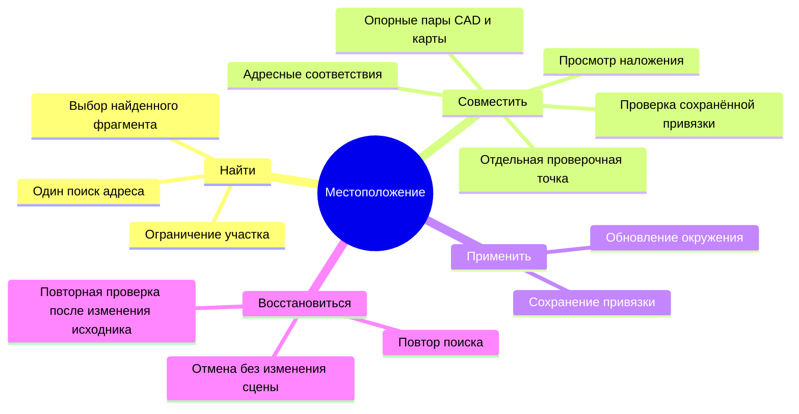

# Местоположение и внешняя карта

Модуль находит улицу, совмещает внешнюю карту с подготовленной геометрией CAD
и сохраняет основание для зданий окружения в [[Рендер сцены|3D и рендере]].
Местоположение необязательно для открытия проекта и проектирования посадок.
Функция добавлена в исходники; наличие в установленном пакете проверяется отдельно.

## Сценарий

Кнопка «Местоположение» доступна в подготовке исходника, а в 3D — в меню
«Окружение». В диалоге одно поле адреса выбирает конкретную улицу из подсказок DaData.
Загрузка зданий OSM и проверка совмещения запускаются после выбора.
При достаточном основании открывается наложение; иначе — ручная корректировка.
Команда «Применить»
сохраняет привязку и запрашивает обновление 3D. Предыдущее окружение остаётся
видимым до готовности нового. Закрытие формы не применяет черновик.

| Зона | Ответственность |
|---|---|
| Вход из исходника или 3D | Открыть необязательные настройки местоположения |
| Поле адреса | Выбор конкретного адреса из DaData |
| Схемы карты и CAD | Участок улицы, контуры зданий, номерные опорные точки, масштабирование |
| Проверка совмещения | Предложение автоматически либо расчёт по выбранным парам |
| Нижняя часть диалога | Применение результата или закрытие без изменения сцены |

## Данные и ответственность

DaData Suggest возвращает выбранную улицу, её идентификатор ФИАС и точку WGS84.
После выбора выполняется уточняющий запрос `count=1`. `qc_geo` характеризует
уровень найденного объекта, а не погрешность в метрах. Координаты города или
отсутствующие координаты требуют ручного указания точки поиска. DaData использует
координаты OSM и не считается независимой проверкой карты.

Overpass ищет именованные дорожные отрезки около точки улицы. Связанные отрезки
объединяются по общим узлам OSM. Несвязанные варианты остаются отдельными;
пользователь выбирает нужный. Это ограниченный локальный поиск, а не гарантия
загрузки всей улицы любой длины. Для большого участка нужно выделить фрагмент.
Полоса строится в метрах, её прямоугольник используется для загрузки зданий;
после загрузки сохраняются целые здания, пересекающие полосу.

Подготовленные контуры CAD и проверенная семантика нативного захвата остаются
локальными. Модуль не читает DWG/DXF повторно и не вызывает AutoCAD. Автоматическое
совмещение использует уникальные адресные соответствия с учётом улицы. Когда
данных недостаточно, пользователь выбирает опорные пары на двух схемах и
отдельную проверочную пару. Масштаб, поворот и перенос проверяются по отклонениям,
пространственному расположению точек и метрическим единицам. Результат остаётся
картографической привязкой для изображения и не становится геодезическим основанием.

Автоматическая проверка может повторно использовать действующую сохранённую
привязку (`saved_frame`). На выбранном участке должны однозначно совпасть
не менее трёх разных зданий OSM с контурами CAD. Используются существующие
проверки пересечения: покрытие каждого контура не менее 65%, отношение площади
пересечения к объединению не менее 50%, отсутствие конкурирующего здания.
Повторные контуры CAD не увеличивают число свидетельств одного здания OSM.
Старая привязка с другим координатным основанием или недостаточным подтверждением не принимается;
сценарий возвращается к адресным соответствиям или ручным точкам.

Такой результат сохраняет прежнее преобразование и прежние значения погрешности.
Это проверка наложения, а не новый расчёт по опорным точкам: `control_pairs`
пуст, `inlier_count=0`, `holdout_rmse_m=null`, `new_fit_or_holdout=false`.
Основание сохранённой привязки и конкретные совпавшие здания записываются
в происхождение результата. Пользователь просматривает наложение и явно
применяет его. Здания, хотя бы частично выходящие за допустимую область привязки,
целиком исключаются из наложения и окружения; число исключённых зданий сообщается.

Внешние высоты и соседние здания обрабатывает существующий модуль рендера.
Приоритет: `height`, затем оценка по `building:levels`. Отсутствие высоты
сохраняется как отсутствие данных; условный объём рендера не объявляется измеренным.
Overture в этот сценарий пока не подключён.

После применения оба потребителя используют один утверждённый снимок улицы:
сопоставление высот и окружение получают те же целые контуры зданий, теги
и происхождение, которые были просмотрены в выбранной полосе. Здания,
пересекающие её границу, сохраняются целиком; допустимая область преобразования
по-прежнему ограничивает их использование. Камера может уменьшить видимый
набор, но не расширяет полосу и не запускает новый запрос OSM.

## Состояние и сохранение

Локальный backend хранит неизменяемые черновики улицы и привязки с контрольными
суммами, ссылку на текущий черновик и применённый transform. Черновики связаны
с проектом, SHA исходника и геометрической ревизией. Поле поиска, четыре пары точек
и временное выделение принадлежат UI. Три пары задают преобразование,
четвёртая проверяет его независимо. «Следующая пара» явно переключает пару;
выбор другой пары возвращает карту к её маркеру.
Закрытие или смена адреса с незавершёнными точками требуют подтверждения.
При отказе от отмены остаются прежние точки и карта.
Ввод нового адреса отменяет прежний поисковый запрос; поздний ответ не
подменяет текущий сценарий. Повторное открытие читает точную принятую пару
черновика и привязки, даже если позднее был выполнен неприменённый поиск. Только явное применение
атомарно заменяет привязку после повторной проверки ревизии проекта.

Непосредственно перед записью SHA исходника и геометрическая ревизия проверяются
ещё раз под защитой транзакции репозитория. Изменение основания между проверкой
и записью отклоняет применение и сохраняет прежнюю привязку. При обновлении
окружения той же ревизии последняя готовая сцена остаётся видимой до готовности
новой, в том числе после ошибки; к другой ревизии эта подготовка не переносится.

Применённая привязка относится к координатному основанию неизменяемого захвата
AutoCAD, а не к общей ревизии расчётной геометрии. Изменение рабочих участков
или расчётных ролей не переносит исходные координаты и не сбрасывает сопоставление.
Новые записи закрепляют SHA захвата, пространство `cad_wcs_metres` и контрольную
сумму параметров системы координат. При смене исходника или координатного
основания прежняя привязка не используется. Черновики и явное применение
по-прежнему проверяют текущую ревизию под защитой транзакции.

Старые применённые сопоставления восстанавливаются чтением принятых черновика
и совмещения: проверяются SHA обоих файлов, ссылка на снимок, идентификаторы,
исходный захват, прежняя ревизия, преобразование и погрешности. Повторный запрос
DaData или OSM не нужен. Для старой записи без явного координатного основания
допускается только прежнее пространство WCS в метрах с локальной либо
неуказанной системой координат. Произвольная привязка без принятых свидетельств
остаётся привязанной к своей геометрической ревизии. Исходные файлы и значения
погрешности не переписываются; восстановление не является новым расчётом точек.

После подтверждённого применения UI сбрасывает кеш 3D для всех горизонтов
этого проекта. Последняя сцена остаётся видимой до обновления; повторный вход
не возвращает окружение, построенное до применения. Дисковый кеш сцены
учитывает код проверки координатной привязки и принятого снимка.

Привязка хранится в `<database>.renders/georeferences`, черновики — в
`<database>.renders/locations`. Поиск улиц и загрузка зданий имеют отдельный
локальный кеш. Исходная геометрия, план посадок и их ревизии не изменяются.
При замене захвата CAD прежнее основание не применяется к новому исходнику автоматически.

В файле привязки `location.snapshot` закрепляет неизменяемый черновик через
идентификатор и SHA-256 по схеме `green-atlas.location-draft-reference/1`.
Общий загрузчик рендера проверяет контрольную сумму, координатное основание
и исходную ревизию принятых свидетельств.
Если объявленный снимок отсутствует, повреждён или относится к другому
координатному основанию, новая подготовка
завершается ошибкой без сетевой подмены данных. Последнее готовое окружение
той же ревизии сохраняется. Старые файлы привязки без метаданных местоположения
сохраняют прежний путь загрузки; привязка с метаданными местоположения, но без
ссылки на снимок, требует явного повторного применения.

## Настройка и ошибки

Используется API-ключ DaData Suggest. Секретный ключ стандартизации не нужен.
Ключ читает локальный backend из `DADATA_API_KEY` либо приватного JSON
`{"api_key":"..."}` вне проекта и пакета. На macOS это
`~/Library/Application Support/Green Atlas/Location/dadata.json`, на Windows —
`%LOCALAPPDATA%/Green Atlas/Location/dadata.json`, на Linux —
`~/.local/share/green-atlas/location/dadata.json`. Для отдельного профиля путь
задаётся `GREEN_ATLAS_LOCATION_SETTINGS`. В POSIX файл доступен только владельцу.
Ключ не передаётся браузеру и не включается в черновики.

Недоступность DaData/OSM, превышение размера области, неоднозначная улица,
отсутствие геометрии и несовпадение контрольных точек показываются отдельно.
Пользователь может повторить запрос или уточнить участок. Ошибка не заменяет
прежнюю привязку пустыми данными.

## Источники

- [DaData Suggest](https://dadata.ru/api/suggest/address/).
- [DaData: координаты и происхождение](https://dadata.ru/api/geocode/).
- [Overpass QL](https://wiki.openstreetmap.org/wiki/Overpass_API/Overpass_QL).
