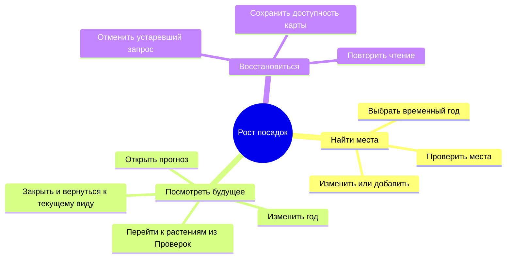

# Проектирование посадок

## Назначение

Сформировать вариант размещения растений в выбранном участке
и передать его пользователю для проверки.

## Вход и результат

Вход: рабочий участок, порода либо поручение подобрать её, размер, количество, способ размещения,
подготовленные ограничения и сохранённые посадки.

Результат: найденные позиции, число размещённых растений, причина остановки
и замечания. Предпросмотр сам по себе не изменяет сохранённый план.

## Сохранение рабочих участков

Правка участка сохраняет ручные посадки, историю и квитанцию изменения.
Переименование или добавление независимого участка не запускает полную
перепроверку растений, если прежние замечания имеют актуальное основание
и проверяющий модуль доказал независимость результата от этой правки.
Версии проекта и геометрии изменяются по прежнему контракту; версия плана
и его ручные поля сохраняются. Вычисляемые статусы могут измениться, когда
изменение покрытия действительно устраняет или создаёт нарушение.

Подготовленный CAD-проверяющий модуль использует исходную территорию и
препятствия, а рабочие участки ограничивают поиск. Его неизменённые результаты
переносятся только при совпадении идентичности снимка, интерпретации, свидетельств,
правил и посадок. Неизвестный провайдер или валидатор требует полной проверки.
Совместимый проверяющий модуль учитывает объединение рабочих зон: результат
можно сохранить при неизменном объединении либо когда обе области полностью
вмещают нынешние и прогнозные габариты всех посадок. Иначе выполняется полная
проверка, чтобы сохранить замечания о выходе за зону и обнаружить другие
ограничения, ранее скрытые таким нарушением.

Устаревшее или отсутствующее основание всегда требует полной проверки.
Повреждённый снимок не позволяет сохранить изменение. Проверка контуров,
пересечений, повторяющихся идентификаторов и запрет удаления занятого участка
сохраняются. История перебазируется на сохранённые участки: Undo/Redo посадок
не возвращает прежний набор участков. Отмена и повтор сохраняют прежний
консервативный контракт актуальности основания; устаревшие замечания не
становятся проверенными только из-за изменения номера версии.

## Алгоритм

### Сценарий роста

Горизонт от 0 до 40 лет — временный параметр инструмента. Он не записывается
в проект или посадки. В форме размещения изменение года остаётся локальным
до команды «Проверить места». Предпросмотр оценивает новые растения и соседей
на одном выбранном году, используя подготовленную геометрию. «Добавить»
сохраняет растения и проверку текущих условий, без сценарного горизонта.

Отдельный инструмент «Прогноз роста» доступен на карте в 2D и 3D. Шкала
сразу меняет изображение крон и корней; чтение замечаний выполняется с короткой
задержкой и отменой устаревшего запроса. На карте остаётся только компактная
шкала; замечания выбранного года и переход к растениям используют вкладку
«Проверки». Её строка состояния указывает год. До завершения чтения
не отображается результат прежнего года. Выключение прогноза возвращает
текущий вид и текущие замечания.
Просмотр не меняет координаты, статусы, версии проекта или записи истории.
Текущая проверка и прогноз роста получают один внедрённый порт валидатора;
сценарий проверяет отдельную копию плана и учитывает ревизию валидатора в кеше.

GET `/projects/{id}/plan/growth-forecast?year=0..40` возвращает текущие
и выбранные замечания, первый год конфликта и границы доступного прогноза.
Отсутствующий биологический прогноз и адресная неопределённость геометрии
не выдаются за отсутствие пересечений. Общие сведения о неполноте исходника
остаются в существующем уведомлении и паспорте.

Сохранённое поле `Plan.planning_horizon_year` читается для совместимости
исторических проектов. Оно не управляет текущей проверкой. Запись общего
горизонта через API удалена. При просмотре старого плана клиент использует
текущие результаты отдельного чтения, сохраняя рабочую базу неизменной.

| Зона | Ответственность | Владелец состояния |
|---|---|---|
| Форма размещения | Временные условия поиска и явная проверка | Локальный черновик формы |
| Шкала на карте | Общий год просмотра в 2D и 3D | Сессия редактора |
| Вкладка Проверки | Текущие замечания либо временные замечания выбранного года и переход к растениям | Кеш чтения по версии плана, геометрии и году |
| Проверка сохранённого плана | Текущие ограничения и расстояния | Общий локальный проверяющий модуль |

«Изменить» возвращает форму, сохраняя прежние позиции на карте. Изменение
черновика отменяет незавершённую проверку и запрещает добавлять устаревший
вариант. Поздние ответы не подменяют новый результат. Повторная проверка
запускается явной командой. Предпросмотр не записывает проект.

1. Получить область поиска из модуля геометрии и правил.
2. Сформировать очередь пробных позиций.
3. Проверить границу участка и расстояния от препятствий.
4. Проверить соседство с сохранёнными и уже принятыми растениями.
5. Добавить подходящую позицию в рабочий вариант и индекс занятых мест.
6. Исключить из очереди близкие к принятой посадке пробы.
7. Продолжить подбор до условия остановки.

Отклонённая проба не занимает место и не мешает следующим кандидатам.
«Принятые посадки» на схеме включают сохранённые растения и позиции,
уже прошедшие проверку в текущем варианте.

## Завершение поиска

| Причина | Смысл результата |
|---|---|
| Достигнуто количество | Сформирован запрошенный вариант |
| Исчерпаны кандидаты | В проверенной очереди больше нет подходящих проб |
| Исчерпан бюджет | Поиск остановлен по времени или количеству проб |

Схема показывает цикл проверки, но не все условия остановки.
Алгоритм может вернуть частичный результат. Это не доказательство
максимальной вместимости участка и не утверждение об отсутствии других мест.

Свободный поиск читает технический бюджет из общей конфигурации правил.
Регулярные рисунки и маски используют отдельный бюджет альтернативных проб
из конфигурации планировщика. Оба бюджета ограничивают вычисления, а проверка
каждой позиции сохраняет прежние отступы и основания. Очередь временно
откладывает близкие пробы внутри партии; окончательно исключает их только
после принятия посадки. Поиск требует уже созданного плана и не меняет
сохранённые объекты при предпросмотре.

Общий детерминированный семплер находится в `planning/sampling.py`.
Он сохраняет прежние значения seed, порядок случайных проб и округление
координат. Именованные лимиты числа попыток ограничивают только генерацию.
Пробные точки для разрозненных участков не резервируют пространство;
разрешение посадки остаётся у общего проверяющего модуля. Контрольный тест
сравнивает весь упорядоченный результат, а не только первые точки.
Пустая область возвращает пустое предложение сразу, без случайных попыток.
Это относится и к полосе вокруг здания, полностью занятой зонами существующих
посадок; расчёт непустых областей сохраняет прежние координаты.

Подготовленная область поиска уже содержит отступы от препятствий, прогноз
роста и точность исходной геометрии. Заполнение участка и маски используют
одну функцию: дополнительный отступ берётся от рабочей границы `ga_work_zone`,
а не повторяется вокруг каждого отверстия или фрагмента готовой области.
Для ручного участка без подготовленной области отступ применяется к его
собственному контуру. Все предложенные позиции затем проходят общий модуль
проверки. Шаг, полученный из размеров растений, округляется вверх до сантиметра,
чтобы округление не создавало заведомо недопустимое соседство.

Аллеи формируются вдоль линейных ориентиров, свободное заполнение использует
отдельную очередь кандидатов. Методы случайной упаковки не подменяют эти
сценарии: [алгоритм Bridson](https://www.cs.ubc.ca/~rbridson/docs/bridson-siggraph07-poissondisk.pdf)
даёт полезную модель индекса принятых точек для свободного заполнения,
а [линейная интерполяция Shapely](https://shapely.readthedocs.io/en/stable/reference/shapely.line_interpolate_point.html)
применяется отдельно к каждой составляющей линейного ориентира.

Генерация по фасадам и групп возле зданий выделена в
`planning/building_patterns.py`. Она получает готовую область поиска и
контуры, исключает переданные зоны вокруг существующих посадок и предлагает
точки. Рост растений, нормативные отступы и применение плана остаются в
прежнем общем сценарии проверки. Общие смещения групп и ограничение размера
предложения находятся у семплера; модуль фасадов не зависит от диспетчера
рисунков. Контрольные тесты закрепляют координаты, идентификаторы групп и
сообщения ошибок при переполнении предложения.

Предложение возле здания использует общие радиусы дерева и кустарника при
подготовке зон вокруг сохранённых посадок. Явный радиус запроса имеет приоритет.
Для кустарника больше не подставляется радиус дерева: поиск и окончательная
проверка исходят из одного размера растения. Радиус контекста зданий, параметры
групп и технический запас буфера принадлежат конфигурации рекомендаций.
Отсутствующий рабочий участок или контур здания возвращает адресный отказ HTTP
400 с объяснением из общего каталога API. Эти отказы не изменяют проект и не
запускают генерацию кандидатов. Пояснение о проверенных ограничениях и
нерассчитанной видимости фасадов также хранится в каталоге.

## Ручное размещение

Ручная посадка и автоматический подбор используют общий модуль проверки.
Изменение способа ввода точки не отключает известные препятствия и отступы.

## Подбор вида и размещение возле объектов

Экспериментальный сценарий автоматического выбора вида скрыт в рабочем
интерфейсе. Основной путь сразу открывает форму, где пользователь сам выбирает
вид растений, количество и параметры размещения. Оба способа используют
одну подготовленную область поиска. Если после ограничений она пуста,
смена способа выбора вида не создаст посадки.

Сохранённая реализация автоматической посадки принимает один сохранённый
участок, ориентир (здания, дорога или весь участок) и целевое количество.
Пользователь может задать тип растения или оставить автоматический выбор.
Для последнего сервис отдельно строит варианты с деревьями и кустарниками,
сравнивает число проверенных мест и показывает лучший вариант. При равенстве
у здания предпочитаются кустарники, в остальных случаях деревья. Это правило
выбора по вместимости и контексту, а не оценка агротехнических условий.

Предпросмотр использует тот же планировщик и модуль проверки, что и другие
способы посадки. Он не сохраняет план. Сохранение идёт через общий механизм
изменений после явного подтверждения пользователя.

Координатор `planning/patterns/application.py` последовательно проверяет
основание проекта, получает участок и виды растений, формирует кандидатов,
передаёт их общему оценщику и собирает ответ. Эти обязанности разделены
типизированными входами и результатами внутри существующего модуля.
Квоты предложений принадлежат существующему `patterns/generators.py`;
генератор не применяет изменения и не решает нормативную допустимость.
Проверка сохранности сравнивает весь упорядоченный результат, включая
координаты, группы, digest, отказы и трассы.

Автоматическая посадка вызывает типизированные запросы каталога, рисунков и
групп возле зданий через существующие application-сервисы. Чат, текстовый
интерпретатор задач и отдельный механизм сохранения ей не требуются.
Смешанный состав сравнивает варианты с прежней последовательностью seed;
ревизия проекта проверяется между подготовительными вызовами.

Рисунки, автоматический подбор и размещение возле здания передают клиенту
одинаковые `search_domains`. Незавершённая подготовка области сохраняет
счётчик выполненных объектов и автоматически продолжается тем же запросом
предпросмотра. Это чтение подготовленного расчёта, без применения изменений.
До завершения всех рассматриваемых вариантов клиент показывает ход поиска;
кнопка добавления появляется только у готового предложения. Частичный проход
не означает отсутствие мест и не делает завершённый вариант с кустарниками
победителем над ещё не проверенным вариантом с деревьями.

Дерево и кустарник могут использовать один участок и общую ревизию физической
геометрии. Ответ сохраняет обе последовательные записи прогресса; клиент
сравнивает их в порядке рассмотрения вариантов. Отмена прекращает ожидание,
поздний ответ не меняет экран. Ошибка ответа или остановка продвижения
возвращает доступную форму с адресной ошибкой, без повторной записи плана.
Индикатор содержит одну подпись задачи и измеренный счётчик объектов либо
площади. До первого ответа полоса показывает ожидание без выдуманного процента.

При автоматическом выборе вида сервис берёт доступную ревизию из каталога
для указанного участка и типа растения. Затем рисунок «вдоль дороги» или
«вдоль здания» создаёт кандидатов по распознанным объектам, а общий модуль
проверяет каждую позицию. Кустарники можно предложить вдоль контура здания.
Предложение сохраняется только после отдельного подтверждения.

Выбор вида пока оценивает размер участка и свойства каталога, но не ранжирует
породы по близости к конкретному зданию или дороге. Геометрия объектов
влияет на позиции и отказы, а не на первую строку списка пород.

## Применение

Перед сохранением проверяются ревизия проекта, основания расчёта
и изменения плана. Устаревший вариант требуется сформировать заново.
Подробности: [[03 Модули/Проверка и выпуск|проверка и сохранение]].

## Зависимости

- [[03 Модули/Геометрия и нормативы|Геометрия и правила]] предоставляют ограничения.
- Справочник предоставляет конкретную ревизию породы и размер.
- Рабочие участки определяют территорию размещения.
- Сохранённый план определяет существующее соседство.
- Хранилище фиксирует только принятые изменения.

Основной код: candidate_queue.py, candidate_search.py,
pattern_application.py в apps/api/app/planning.

## Контрольная точка 0.1.121: каталоги и шаги поиска

Подбор пород, список доступных схем и каждый следующий шаг поиска читают
компактное состояние подготовленного native-проекта. Координаты всей подложки
для этих запросов не загружаются. Проверки сохранённых файлов и ревизий
сохраняются; паспорт использует проверенную сводку отображения и расчётное
покрытие. Направляющие дорожных и фасадных схем читаются из бинарной подложки
только для нужных видов объектов. Их полные кривые и исходный порядок
сохраняются, чтобы шаг расстановки и результат проверки оставались прежними.
Адресные пропуски объектов и XREF остаются в замечаниях.

Это сокращает повторную подготовку запроса. Само построение ограничений
и проверка пробных позиций по-прежнему зависят от сложности выбранного участка.

## Ранний отказ по сохранённым посадкам

Свободный поиск заранее проверяет точное расстояние до сохранённых посадок
по тем же видам, прогнозам, группам и политике плотности, что общий оценщик.
Доказанно конфликтующие пробы не проходят дорогую проверку геометрии.
Они не резервируют место для следующих проб. Выжившие и принятые кандидаты,
а также ручные изменения сохраняют полную проверку и объяснение. Очередь,
исходное значение генератора и временной бюджет поиска не сокращаются.

Пропуск повторной трассы отказа разрешён лишь провайдеру с явной верхней
границей сетевых кодов и после фактического появления всех этих кодов.
Граница сама не публикует замечание. Это сохраняет общую сводку сетевых
допущений. Неподдерживающий провайдер использует прежний полный путь.
Даже полностью предварительно отклонённая порция проверяет актуальность
и целостность расчётного ресурса на своих границах.

## Поиск промежутков между сохранёнными посадками

Однородное заполнение без рядов по количеству заранее вычитает из области
проб только доказанно запрещённое соседство сохранённых посадок. Для него
используются те же виды, прогнозы, группы и политика расстояний, что в общем
оценщике. Вписанные многоугольники сохраняют допустимую границу расстояния;
ограничение числа объектов оставляет надмножество свободных центров.

Эта область существует только для генерации проб. Исходный участок,
расчётная маска, адресные замечания и сохранённый план не меняются. Отступ
от границы применяется один раз, до вычитания соседства. Каждую найденную
посадку проверяет общий оценщик; смешанные составы и другие схемы сохраняют
прежнюю генерацию. Ошибка производной геометрии возвращает прежнюю область,
а отмена операции распространяется наружу.

## Геометрический поиск заданного количества

Режим `natural/count` рассчитывает варианты под запрошенное N. Он не создаёт
заранее случайный пул из 2048–5000 проб. Главная и поперечная оси полигонов
задают сечения; пересечения с готовой областью центров дают интервалы, число
мест и координаты с заданным шагом. Несколько направлений и положений сечений
предлагают альтернативные раскладки. Адаптивное деление оставшихся фрагментов
ищет дополнительные позиции по запасу до границ и принятых центров. Порядок равных ячеек воспроизводим по seed; в смешанном составе seed также
участвует в выборе растения. Остальные рисунки сохраняют прежние генераторы
и порядок координат.

Рабочий отступ применяется к исходной границе участка ровно один раз.
Подготовленные отступы вокруг препятствий повторно не расширяются.
Однородный состав может исключить доказанно занятые сохранёнными растениями
центры; смешанный состав сохраняет проверку фактического вида и габарита.
Квоту пополняют только допущенные общим оценщиком позиции. После её достижения
поиск исключает целый фрагмент, только если доказана его принадлежность уже
заполненному участку. Вложенная задача определяется по всему габариту растения,
а не по одному центру. Отклонённая или неизвестная позиция не занимает соседство.

Все раскладки одного запроса разделяют 45 секунд и бюджет 100 тысяч
оценённых ячеек. Число вариантов ограничено восемью; фронт одного варианта
содержит не более 16384 ячеек. Техническое разрешение деления 0,01 м не
заменяет точность исходной CAD-геометрии. Конечные варианты, разрешение и
бюджеты не являются доказательством максимальной вместимости произвольного
участка. Незавершённая подготовка области и адресная неопределённость сохраняют
свои отдельные состояния. Общие замечания об исходнике и XREF не снимаются.

Ответ различает суммарно рассмотренные позиции всех вариантов и полные
проверки кандидатов выбранным оценщиком. Второй счётчик не включает итоговую
проверку набора изменений. Внутри поиска полные повторные трассы отказов
освобождаются; точная причина отказа сохраняется. Свидетель каждого нового
сетевого кода остаётся для общей сводки. Без объявленной верхней границы
кодов трассы продолжают читаться. У принятых растений и итогового предложения
сохраняются полные трассы и обычный путь проверки и применения.

Полные рассчитанные раскладки сначала проверяются без адаптивного продолжения
каждой. Если готовая область уже состоит как минимум из N фрагментов, первым
проверяется вариант их внутренних точек. Неполная рассчитанная раскладка может
быть расширена тем же потоком; её принятые центры сохраняются. Это общий выбор
по структуре геометрии, без исключений для отдельных проектов.

На широком компоненте полный рассчитанный набор распределяется также
поперёк главной оси по точным внутренним интервалам. Это сохраняет рисунок
«Без рядов»: свободный широкий участок не превращается в один равномерный
ряд. Все N исходных мест остаются зарезервированными. Сдвиг проверяется
против уже сдвинутых и будущих центров; при отказе или исчерпании бюджета
сохраняется исходное место. Узкий проход не требует поперечных сдвигов.
Дополнительные сечения расходуют общий бюджет, каждое итоговое растение
по-прежнему проходит обычный проверяющий модуль.

## Отмена HTTP-предпросмотра

В текущих исходниках разрыв соединения предпросмотра передаёт сигнал отмены
синхронному расчёту в рабочем потоке. Это относится к схемам, автоматическому
размещению, рекомендациям, экрану здания, кисти, набору изменений, ручной
проверке позиции и прогнозу роста. Тело POST сначала полностью читает FastAPI;
наблюдатель отмены не конкурирует с ним за входные данные.

Расчёт проверяет отмену между операциями и до публикации предпросмотра.
Штатная отмена имеет ответ `499 REQUEST_CANCELLED`, а не внутреннюю ошибку.
Ресурсы и контекст освобождаются после завершения текущего проверяемого шага;
это кооперативная отмена, а не принудительное прерывание любой операции GEOS.
Сохранение и применение плана сохраняют прежнюю атомарную семантику.
Клиентский таймер ожидания партии не увеличен. Эти изменения исходников
требуют пересборки и отдельной приёмки Windows; установленный Mac 130 этим
описанием не объявляется обновлённым.

### Прогресс текущего и базового горизонтов

Естественный поиск сначала готовит область выбранного горизонта, затем общую
базу нулевого года. Пока вторая очередь не завершена, ответ сохраняет готовые
области текущего горизонта на прежних позициях `search_domains` и дополняет их
базовыми областями. Поле `progress_key` связывает очередь с вариантом схемы
и её локальным индексом: добавление или завершение базовых очередей дерева
не перепривязывает прогресс кустарника в объединённом ответе автоподбора.
Счётчики разных очередей не подменяют друг друга. Клиент по-прежнему отклоняет
остановку, откат счётчика или смену ревизии одной очереди. Для старого сервера
без `progress_key` сохраняется прежнее сопоставление по участку и индексу.
Ключ добавляется только при подготовке ответа, кеш геометрии не мигрирует.
Промежуточный ответ не содержит применимого предложения посадок; расчётные
области, геометрия и итоговый ответ не меняются.
