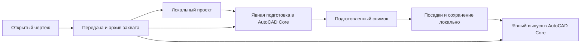

# Подготовка CAD

## Назначение

Получить расчётную геометрию из открытого DWG/DXF через AutoCAD
с сохранением происхождения объектов и причин пропусков.

## Вход и результат

| Вход                                    | Результат                                      |
| --------------------------------------- | ---------------------------------------------- |
| Открытый чертёж, блоки и доступные XREF | Захват объектов и диагностические сведения     |
| Назначения слоёв и решения о контурах   | Подготовленные области, линии и точки          |
| Единицы и параметры точности            | Геометрия, пригодность которой можно проверить |

Потребители результата: геометрический расчёт, карта, диагностика и полнота.

Полный перечень захвата читается потоково через `ijson`: одна запись сразу
проверяется типизированным DTO, затем проверяются все связи итогового перечня.
Сырые байты JSON и второй массив словарей не удерживаются в памяти. SHA считается
по тем же прочитанным порциям, включая завершающие байты; усечённый JSON,
повторные маршруты, неизвестные поля и несовпадения покрытия отклоняются.
Объекты оформления и адресные ошибки сохраняются вместе с остальными объектами.

Бюджеты полного захвата задаются в `native_query/capture/capture_contracts.py`:
до двух миллионов экземпляров, отображение до 2 ГиБ, перечень и индекс экземпляров
до 1 ГиБ каждый, суммарная передача до 8 ГиБ. Отдельная запись перечня ограничена
бюджетом памяти 16 МиБ. Ticket и импорт используют одинаковый бюджет отображения;
крупный импорт остаётся в отдельном процессе. Для native-импорта отключён
фиксированный предел RSS: `LIVE_PROCESS_POLICY.max_memory_bytes=None`.
Прежний порог 6 ГиБ мог остановить корректный захват независимо от доступной
памяти компьютера. Надзор продолжает измерять сумму RSS импортёра и его
потомков и записывает пик, длительность и код выхода в журнал. Превышение
определённого объёма RAM само по себе больше не прерывает импорт.
Отмена, пределы времени и файлов, проверки целостности и атомарная публикация
сохраняются. Отказ операционной системы выделить память остаётся возможен;
отключение произвольного порога не устраняет расход памяти алгоритмом.

Файловый импорт передаёт проверенный снимок проекции с исключительным владением:
после проверки хешей каждая исходная модель освобождается по мере создания
GeoJSON. Обычные вызовы проекции сохраняют входной снимок неизменным. Габариты
слоёв считаются порциями до 256 GEOS-объектов; полные временные геометрии
сохраняются только у слоёв-кандидатов границы, которым нужен анализ контура.
Связывание предложений областей индексирует только запрошенные пути исходных
объектов. Порядок, координаты, атрибуты, предложения, полнота и проверки
целостности не сокращаются. Эти изменения относятся к чтению и проекции;
запись проекта и полное открытие приложения проверяются отдельно.

Новый файловый вход компилирует снимок и сразу строит проект в одном внутреннем
вызове. Между этими шагами снимок не передаётся вызывающему коду. Компилятор
проверяет исходные байты, покрытие, связи и геометрию, вычисляет подписи;
проекция проверяет источник, единицы и зависимости. Повторное вычисление этих
же подписей перед проекцией нового снимка исключено. Обычный вход
`build_project_from_snapshot` проверяет все подписи при каждом обращении,
включая вызовы с передачей владения снимком.

При первом файловом импорте сохранённого захвата из уже прочитанных полей
формируется необязательный `face-inputs.jsonl`: маршрут экземпляра, действующий
и исходный слой, признак авторской области. Координаты и полный граф DTO в него
не входят. Каталог публикуется только после полного допуска снимка; его SHA
передаётся непосредственно в `CadSnapshotProvenance.face_inputs_sha256` и
сохраняется атомарно с проектом. Байтовый и словарный входы не создают каталог.
При повторных или неоднозначных именах корневых ключей JSON сохраняется прежний
путь чтения без каталога.

Перед запросом областей Core архив по-прежнему проверяет исходный захват,
слои, маршруты экземпляров и преобразования. Каталог заменяет только два
повторных просмотра больших коллекций `regions` и `coverage`; порядок и байты
поддерживаемых протоколов запроса остаются прежними. Проверяются полный SHA
каталога из проекта, SHA отображения и файловые отпечатки до и после чтения.
Пропавший, изменённый или несовместимый каталог возвращает обычное чтение,
а отмена прерывает операцию. Ошибка необязательной записи не отменяет импорт.
Старые проекты без независимой квитанции используют прежний путь. Неизменяемая
привязка CAD-архива не расширяется; резервная копия переносит первичные файлы,
а после восстановления отсутствие производного каталога также даёт обычное
чтение. Подготовка межслойных областей в Core по текущим ролям остаётся нужна.

Нормализация покрытия объединяет равные строки `layer`, `entity_type` и `method`
в пределах одного вызова. Временный пул ограничен 4096 значениями длиной
не более 512 символов; адреса объектов, пояснения и геометрия не объединяются.
Значения полей, порядок, проверки и итоговые подписи сохраняются. Пул не живёт
между импортами и не является кешем геометрии.

При проекции native-путей координаты XY передаются в GEOS плотным массивом
NumPy. Обратное преобразование пути или точки использует `get_coordinates`
Shapely; итоговые координаты сохраняют прежнюю точность и структуру GeoJSON.
Для REGION с отверстиями и несколькими частями остаётся библиотечный `mapping`.
Проверка валидности GEOS, выбор между полигоном и линией и перевод единиц
остаются общими для файлового импорта и сохранённых снимков.

В развиваемой ветке новый проект принимается через native-передачу плагина.
Сняты загрузка DXF/ZIP через HTTP, старый мастер выбора CAD-комплекта,
подготовка AOI и браузерное подтверждение pairing. Прежняя передача `/1`
отклоняется до создания проекта; native `/2`–`/5`, включая Windows `/4`,
сохраняются. Обычный запуск открывает библиотеку, а новый проект показывает
инструкцию передачи из AutoCAD.

Сохранённые проекты не мигрируют. Для старого CAD-preview сохранены журнал,
DTO и чтение подложки; новый preview через AOI не создаётся. Legacy reader
нужен существующей проверке привязки оси, writer — выпуску сохранённого
legacy-плана. Эти механизмы не используются как запасной импорт.
Установленный комплект обновляется отдельно от изменений в рабочем checkout.

Новый native-импорт создаёт `Project` непосредственно из проверенного
`CadSnapshot`. Промежуточный `DxfImportResult`, пустая DXF-модель и сборка
через legacy-политику из этого пути удалены. Проверки хешей, покрытия,
единиц, XREF, точности и ограничений объёма сохранены. Общая проекция
геометрии используется также совместимым `apply_cad_snapshot`; второй
расчётный алгоритм не добавлен. Повторное чтение геометрии для привязки
инженерной оси использует тот же прямой путь.

Дочерний native-импорт уже сохраняет полный граф редактора. Завершение передачи
проходит через `ProjectApplication` и владельца импорта. Узкий порт привязывает
`native_session` записью SQLite в payload и компактную проекцию,
проверяя хеш захвата, геометрическую ревизию и CAS в одной транзакции. Геометрия,
свойства объектов, исходные байты, решения пользователя и выпуски не заменяются.
При возобновлении хеш исходника проверяется повторно перед публикацией результата,
в том числе когда сохранённый сеанс уже совпадает и новая запись не требуется.
Повторное открытие уже готового редактора читает компактную проекцию без новой
записи; запреты исходника и проверка версии сохраняются. Если карту ещё требуется
построить, используется прежний полный путь.

Нативные слои `GREEN_ATLAS_TREES` и `GREEN_ATLAS_SHRUBS` больше не получают
ложное предупреждение «только для просмотра» от старой DXF-политики.
Адресные замечания о неполной или исключённой геометрии остаются.
DXF как формат исходного чертежа и выпуска результата не удалён.

Проверены восемь результатов прежнего и прямого импорта: геометрия, слои,
единицы, происхождение и предложения областей совпадают; отличается только
удалённое ложное предупреждение. Файловый и обычный native-входы не создают
`DxfImportResult`. Явная привязка инженерной оси перечитывает неизменный
захват и одобренные области; неподтверждённая исходником ось отклоняется
без записи изменений в план, сведения о проверяющем или решения об областях.
Прямое native-извлечение пока не предоставляет доказательство прямолинейной
оси, требуемое этой привязкой; это прежнее ограничение, сохранённое проверкой.

Неиспользуемый просмотр каталогов и выбор соседнего снимка удалены вместе с
их DTO. Разрешение пути сохранённой CAD-операции и имя её sidecar принадлежат
`cad_intake/inspection/paths.py`. Worker по-прежнему проверяет происхождение,
покрытие, состав XREF и контрольные суммы источников в сохранённых тестах
совместимости. `inspection/worker.py` исключён из разрешённых дочерних запусков
и не принимает новые передачи. Чтение подложки проверяет разрешённый каталог
и подтверждённый manifest.

## Порядок работы

1. Прочитать объекты и экземпляры блоков в контексте открытого чертежа.
2. Зафиксировать источники, внешние ссылки, единицы и отказы чтения.
3. Передать данные приложению с проверкой целостности.
4. Применить назначения слоёв и решения пользователя.
5. Восстановить поддерживаемые составные области через AutoCAD.
6. Сохранить расчётное представление и адресные замечания.

Открытие сохранённого проекта выполняет только локальную загрузку. Промах
кеша, отсутствие inventory-файла или закрытый AutoCAD не запускают новую
подготовку. При отсутствующем, повреждённом или несовместимом снимке сохранённый
план доступен для просмотра; восстановление является отдельным действием
подготовки CAD. Список проектов проверяет наличие снимка, а открытие проверяет
его контрольную сумму, основание и расчётные геометрии до разрешения изменений.

Физическая подготовка архива запускается действием «Подготовить чертёж»
через `POST /api/projects/{project_id}/operations/cad-capture`. Она использует
сохранённый захват и отдельный процесс AutoCAD Core; открытый редактор не нужен.
Общий журнал операций хранит прогресс, отмену и результат. Повторное открытие
возобновляет чтение статуса, потерянный ответ не вызывает повторный запуск.
Подготовка не меняет план, роли слоёв или подтверждения. После неё интерфейс
остаётся на проверке данных. Расчёт посадок отдельно проверяет назначения
слоёв; наличие физического снимка не подтверждает инженерные сведения.

После завершения фоновой операции интерфейс отдельно читает подготовленный
проект. Расчёт карты показывает «Открываем подготовленную карту» до получения
актуальной версии, затем открывает рабочую область. Ошибка этого чтения даёт
действие «Повторить открытие карты», которое не запускает расчёт заново.
Физическая подготовка аналогично ждёт чтения доступности снимка, прежде чем
вернуть управление проверке слоёв. Ответ ушедшего проекта не переключает
текущий экран.

Короткая native-дуга отображается как минимум двумя сегментами. Это сохраняет
третью вершину области, образованной дугой и хордой, вместо двух точек
с замыканием. Погрешность отображения учитывает стрелу дуги и соединение
концов; точная площадь, исходные кривые и происхождение области не меняются.
API продолжает требовать полноценное замкнутое кольцо и отклоняет повреждённый
ответ целиком. Области не исключаются из результата ради успешной подготовки.

Назначение слоя и пригодность геометрии — разные свойства.
Слой «здания» может содержать отдельные линии, составные контуры и детали.
Версия плагина в файле передачи должна входить в список версий локального API
и компилятора снимка. Несовпадение останавливает захват до создания проекта;
пустой экран после такой ошибки не означает потерю XREF. При сборке пакета
проверяется согласование версии нативного плагина с обоими приёмниками.

В `cad_bridge/compiler.py` отдельно проверяются сведения об источнике,
обход AutoCAD и связи объектов; затем нормализуются области, линии, точки
и предложения площадей. `cad_bridge/config.py` владеет схемами, параметром
сравнения разрыва и справочником `PRODUCER_CAPABILITIES`. Возможности обозначены
`ProbeCapability`: XREF, линии и точки, составные области, несколько внешних
контуров и предложения площадей. Пропуски проверенных версий сохранены:
числовой диапазон не означает совместимость. Новые исторические форматы
этот справочник не добавляет. Полный снимок проверяется после нормализации.

Скалярные записи XREF проверяет Pydantic через `probe_contracts.py`.
Строгость сохраняет строки и целочисленный размер без преобразования строк
или дробей. Прежний допуск bool как целого сохранён отдельно; файловый режим
обязательно сверяет его с реальным размером и SHA. Неизвестные поля записи
не меняют её смысл. Регулярные выражения идентичности принадлежат итоговому
контракту снимка, чтобы не менять порядок отказов при нормализации.

Компилятор последовательно проверяет форму записи, уникальность, заявленные
байты, доступность каталога и физическую идентичность файла. Проверка файла
возвращает отдельную проекцию и не меняет входную запись. Live-захват и
отсутствующая ссылка не проходят файловый допуск: их свидетельство относится
к обходу AutoCAD в памяти. Нерешённая ссылка сохраняется адресным пропуском.
Технические отказы XREF имеют enum и отдельный `probe_diagnostics.json`;
прежние диагностические тексты сохранены, публичный русский отказ остаётся
на границе API. Каталог включён в автономный runtime.

Модели XREF не получают полный граф покрытия или координат. Чтение большого
файла остаётся у ijson; контроль его SHA и канонический хеш снимка сохраняются.
Повреждённый статус ссылки в виде списка, объекта или bytearray теперь даёт
отказ допуска, а не случайный TypeError. Такие данные по-прежнему не принимаются.

`cad_bridge/provider.py` использует общие функции сборки объектов карты,
метаданных слоёв, замечаний и происхождения для файлового и обычного входа.
Временный SQLite-индекс связывает покрытие с геометрией при файловом чтении;
его очистка и закрытие потока сохраняются при ошибке или отмене.
Проекция сохраняет исходные double-координаты AutoCAD, переводя единицы в метры
без дополнительного округления. Округление до шести знаков могло превратить
валидный HATCH в самопересекающееся кольцо или схлопнуть короткую линию.
Проверки колец, отверстий, площади, точности и целостности сохранены;
невалидная геометрия остаётся адресным пропуском без автоматического ремонта.
Эвристики выбора границы имеют именованные параметры у владельца;
их значения не изменены и не объявлены нормативными допусками.
Проекция и нормализация геометрии остаются у своих существующих владельцев.
Хеши, точность и представление необязательных полей сохранены.

Адрес экземпляра проверяется последовательно по владельцам объектов,
состоянию XREF и типу родительского блока. Матрицу каждого родителя возвращает
`AcDbEntity::getCompoundObjectTransform`; обязательны успешный статус,
конечные значения и совпадение с `blockTransform` из захвата.
Проверенные матрицы соединяет SDK AutoCAD. Валидный `AcDbCompoundObjectId`
даёт дополнительную сверку полного пути; его отказ внутри динамического блока
не подменяет трансформацию identity. Пользовательские классы родителей,
MINSERT, неправильные владельцы, недоступные XREF и расхождения матриц
остаются адресными отказами. Потомки нативной `AcDbTable` относятся к оформлению:
при обходе признак таблицы передаётся через вложенные блоки. Их адреса, классы,
авторские и действующие слои, подписи и атрибуты сохраняются в перечне и архиве,
но не создают расчётные линии, точки, области и предложения контуров.
Захват и инвентарь используют одинаковый статус `context`. Недоступная ссылка
внутри оформления сохраняет `unresolved` с адресной причиной; неожиданное
расхождение статусов останавливает передачу. Проверка состава, слоёв и статусов
в API остаётся обязательной. Посторонний handle остаётся ошибкой, а матрица
таблицы не используется как расчётная геометрия.
Подготовка архивных областей отдельно сверяет
полученную матрицу с неизменным manifest захвата.

Недоступные подосновы восстанавливаются указанием корректных путей в AutoCAD
на отдельной рабочей копии. Переименование подосновы требует явной таблицы
соответствий; сходство названий не подтверждает идентичность файлов.
Для неассоциативной штриховки штатный `HATCHEDIT` может создать ассоциативную
границу, но её наличие не подтверждает валидность расчётной области.
Нулевые петли и пересекающиеся кольца сохраняются в CAD-архиве и остаются
адресными замечаниями. Проекция не ремонтирует их через `make_valid` без
подтверждения исходного заполнения AutoCAD, отверстий и точности.

JSON захвата записывается без форматных пробелов между полями и значениями.
Строки, escape-последовательности, UTF-8, порядок полей и числовые лексемы
с прежней точностью 17 значащих цифр сохраняются. Координаты и записи объектов
сохраняются полностью; бюджеты передачи задаёт контракт native-захвата. Контрольная сумма
вычисляется для реально записанного файла. Ошибка записи, завершения потока,
атомарной публикации или отмена оставляет прежний опубликованный снимок
и удаляет временный файл. Проверки такого форматирования исполняются без CAD;
приёмка реальной передачи дополнительно проверяет установленный комплект.

`GAOPEN` передаёт сводку текущего захвата в памяти вместе с контрольной суммой
полного файла отображения. Замечания и формирование передачи используют эту
сводку, поэтому координаты не разбираются повторно двумя полными объектными
графами Foundation. Перед замечаниями и публикацией проверяется SHA снимка,
а перед публикацией также исходный файл и весь состав архива. Старые вызовы
без сводки сохраняют прежний путь проверки. Сводка не является отдельным
файлом передачи и не меняет контракты сохранённых проектов.

Окно плагина показывает текущий этап, счётчик реально обработанных записей
и штатную анимированную полосу. Обновление идёт из чтения объектов, создания
inventory, записи отображения и архива. Процент не вычисляется до известного
объёма работы. Прямой показ окна не запускает обработку событий AppKit:
повторный вход в AutoCAD во время чтения базы запрещён. Отмена через AutoCAD
и проверки текущего документа сохранены. Проверка окна без CAD не заменяет
проверку установленного плагина на исходном DWG.

## Подготовка без прежнего сеанса AutoCAD

Архивированный вход связывает DWG рабочего состояния, загруженные подосновы,
отображение, inventory и индекс происхождения объектов. Приёмник проверяет
их контрольные суммы и согласованность до атомарного принятия проекта.
Захват включает несохранённые изменения, доступные в момент передачи.
Исходные файлы не перезаписываются. Временное восстановление имён XREF может
установить DBMOD: предупреждение показывается до передачи, флаг не сбрасывается.

Факты в двух подтверждениях передачи выводятся штатным текстом `NSAlert`:
одна строка «подпись: значение» на каждый факт. Собственная таблица удалена:
её строки были доступны через accessibility, но не видны в окне предупреждения.
AppKit рассчитывает перенос и высоту текста. Счётчики, кнопки и результат
отмены сохранены; пропуски отображения не названы отказом расчётной геометрии.
Проверка настоящих модалок исполняется без AutoCAD через `notice-check`
в `test_delivery_ui.mm`. Исправление включено в установленный Mac-комплект
0.1.73. Три настоящих AppKit-модалки проверены отдельно от новой передачи
из AutoCAD; их проверка не заменяет сквозной проход кнопки плагина.

Mac-плагин и worker 0.1.47 ввели контракт архива
`green-atlas.native-session/2`. Он различает исходный слой объекта и слой
экземпляра после наследования. Принадлежащие вставке атрибуты включены в индекс
с нативным происхождением и преобразованием системы координат владельца.
Приёмник сверяет эти сведения с inventory и покрытием объектов; совпадение
одного количества записей не заменяет проверку адресов, классов и слоёв.

На 10 октября установленный Mac-комплект содержит плагин и worker 0.1.48,
использующие контракт `/3`. Desktop, launcher и installer имеют версию 0.1.75.
Исходный `PackageContents.xml` согласован с версией desktop, поэтому сборка
не требует отдельной подмены версии манифеста. Версию нативного плагина
приёмник проверяет отдельно; она не обязана совпадать с версией desktop.
Обновление 0.1.75 доводит представление подготовки до согласованной композиции.
Нативный плагин и worker сохранены из квалифицированной 0.1.73. API runtime
пересобран с единственной поправкой чтения паспорта без подготовленного снимка;
параллельные изменения допуска расчёта по доступным данным не установлены.
Все 391 запись файлов, каталогов и ссылок установленного комплекта сверены
с готовой сборкой. Повторный запуск открыл библиотеку с 18 проектами;
индекс проектов и счётчики таблиц после установки не изменились.
Сохранность плана и подготовленного снимка проверяется отдельно от индекса.
Сборка и проверки рабочей ветки сами по себе не подтверждают новую передачу
из установленного приложения. Подробности: [[03 Модули/Локальное приложение]].

Кустанайская прошла штатную передачу из меню установленного плагина 0.1.47
в desktop 0.1.55 и открытие нового проекта. После штатного закрытия AutoCAD
явная подготовка архивной копии через Core завершилась за 36,13 секунды.
Подтверждены завершение CAD-задания и восстановление его служебного окружения;
доступен подготовленный снимок из 99 396 объектов, открыта рабочая область.
Все файлы передачи и сохранённого архива совпали по контрольным суммам,
исходный DWG и прежний проект с 326 посадками сохранены.
После холодного запуска видна библиотека; чтение базы подтвердило сохранность
проекта и снимка. Новый проект повторно открыт в GUI; рабочая область
и подосновы загружены без AutoCAD и новой подготовки.
Штатный захват Олимпийской дошёл до приложения; все 37 файлов передачи и
архива сохранились без изменений. Публикация геометрии прервана при нехватке
места для swap; системный журнал подтвердил приостановку AutoCAD.
Новый проект остался пустым. Затем в версии 0.1.55 тот же ticket явно возобновлён при закрытом
AutoCAD и свободных 27,9 ГБ. Ограничение памяти остановило дочерний импортер
при превышении 6 ГиБ; ошибка показана в GUI, геометрия не опубликована.
Прежние проекты не изменились. Повторный захват и увеличение лимита
не выполнялись. Эти отказы предшествовали исправлению файлового входа;
сохранённые ticket и архив использованы при последующем продолжении в 0.1.56.

Узкий кандидат рабочей ветки читает нативный JSON через существующий `ijson`,
считает хеш точных прочитанных байтов и полностью завершает разбор, включая
конец файла. Затем выполняются прежняя нормализация, проверка покрытия,
хешей и точности. Сырой граф остаётся целиком в памяти; это изменение
времени жизни байтов исходника, не потоковая обработка геометрии.
Перед сохранением, после освобождения снимка и промежуточного импорта,
исходник прочитывается для записи и повторно сверяется по размеру и хешу.
Транзакция, контроль версии и хранение исходника не заменены.
Временные индексы компилятора освобождаются после последнего использования.
Проверка отдельной нативной линии принадлежит `cad_bridge/path_admission.py`:
она возвращает типизированную геометрию либо адресную причину исключения из
расчёта. Компилятор сохраняет связи покрытия, предложений областей и общий
допуск. Порядок отказов и контрольные суммы сохранены; временная модель линии
освобождается до проверки полного снимка. Общая функция хеширования записи
принадлежит `cad_bridge/integrity.py`.
Модульные и архитектурные проверки кандидата прошли. Один явно разрешённый
прогон исходников завершился за 195 секунд с измеренным пиком 4,95 ГиБ
при прежних ограничениях 6 ГиБ и 600 секунд. Хеш исходника до и после совпал.
Все 12 сравнений с baseline прошли, включая геометрию, слои, предложения
площадей и сохранённый исходник. Это измерение отдельного Python-процесса;
точный пик памяти установленного импортера не измерялся.
Файловый вход включён в установленный комплект 0.1.56; соответствие frozen-модулей
исходникам подтверждено. Изолированный запуск пустого профиля не проверяет
этот большой вход. После установки база, WAL и SHM сохранились побайтово,
прежние проекты и снимок Кустанайской не изменились.
Фактическое продолжение того же ticket в установленном 0.1.56 завершилось:
геометрия опубликована, GUI открыл тот же проект. Сохранены 459 слоёв,
466 180 объектов нативной геометрии и исходник размером 796 778 085 байт
с прежним хешем. В происхождении сохранены 104 непрочитанных экземпляра;
они не объявлены безопасными. Повторный захват и увеличение лимита не выполнялись.
Явная физическая подготовка новой Олимпийской завершилась за 149,84 секунды.
Подготовленный файл содержит 466 321 запись; хеш файла и хеш содержимого
проверены, исходный DWG, захват и inventory не изменились.
Количество записей подготовленного снимка отличается от числа объектов
отображения; эти показатели описывают разные представления.
Рабочая область и карта открыты в GUI без семантического расчёта. Все 459
назначений остаются неподтверждёнными, граница не выбрана; подготовка этого
не меняет. Одна ручная черновая гортензия сохранена с подтверждением в GUI,
квитанцией применённой операции и историей. Геометрия, расчётные основания,
исходник и подготовленный файл сохранились; замечания о границе и прогнозе
роста остались в плане. Холодное открытие и выпуск этого нового проекта прошли в установленном
комплекте 0.1.56 7 октября.

В новом проекте Кустанайской подтверждена граница, остальные 123 слоя ожидают проверки.
Ответ Core содержит пустые списки выбранных слоёв и новых площадей. Доступность
физического снимка не подтверждает назначения, инженерные сведения или посадки.
На этом снимке в установленном 0.1.56 сохранена одна ручная черновая гортензия
с квитанцией, историей и подтверждением в GUI; все 14 проверок сохранённого
состояния прошли. Первая отклонённая точка действительно была вне нативной
границы, проверка не ослаблялась. Подготовленный файл и исходник сохранились,
замечания о неизвестном назначении слоя и прогнозе роста остались в плане.
7 октября в установленном комплекте 0.1.56 выполнены штатный выход,
холодный запуск через приложение в `~/Applications` и открытие обоих новых
проектов из библиотеки. Карты и сохранённые посадки открылись без нового
импорта и без окна AutoCAD; 85 сравнений планов, координат, истории, квитанций
и подготовленных файлов прошли. Затем каждый проект выпущен одним действием
как черновой CAD-пакет и скачан через GUI. Core повторно открыл новый DWG:
координаты, виды и радиусы посадок совпали с планом. В пакетах сохранены
7 XREF Кустанайской и 32 XREF Олимпийской с исходными контрольными суммами.
Все шесть артефактов каждого выпуска проверены; 169 сравнений файлов
и 74 сравнения сохранности проектов после выпуска прошли. Старый проект
с 326 посадками не изменился. Это техническая приёмка продолжения и выпуска
чернового плана; назначения слоёв и полнота инженерных сведений остаются
отдельной задачей.

После передачи можно закрыть исходный чертёж. Явная подготовка запускает
установленный AutoCAD Core в отдельном профиле на копии архива. Обычное открытие,
расчёт и сохранение плана работают локально по подготовленному снимку.
При изменении физических решений подготовка запускается повторно явно.
Выпуск также использует архив и отдельное задание, без обращения к прежнему PID.
Это требует установленного AutoCAD, но не прежнего открытого документа.

Старый проект без сохранённого архива сохраняет план и локальный снимок.
Выпуск объясняет необходимость новой передачи через обновлённый плагин.
Новая передача не подменяет исходник старого проекта и не переносит посадки
автоматически: сначала нужно подтвердить совместимость нового захвата.

Архив входит в резервную копию профиля вместе с базой и геометрией. Изменение
папки при восстановлении не требует прежних абсолютных путей к файлам.

При создании архивного движка хранилище возвращает проверенный перечень
объектов вместе с разрешёнными путями. Клиент и движок используют одну
неизменяемую модель этого захвата; подготовка и запросы не разбирают каталог
повторно. Модель не хранится в общем кеше файлов. Каждое использование
проверяет физические отпечатки сохранённого комплекта; изменение файла
требует повторной проверки SHA. Отмена чтения и изменение файла во время
разбора не публикуют частичный каталог. При восстановлении профиля меняются
пути, а идентичность исходника, версии и контрольные суммы сохраняются.

Однопроходная подготовка сразу сохраняет проекцию каждого объекта в расчётную
запись. Временные GEOS-объекты при этом не накапливаются во втором кеше;
проверки точности, площади и происхождения проекции остаются прежними.
Повторяющийся поиск посадок использует прежний кеш проекций.
Записи подготовки используют неизменяемый dataclass Pydantic с фиксированными
полями вместо отдельного словаря и набора полей на каждый объект. Кодек,
проверки значений и сохранённый JSON остаются прежними. Индексы габаритов обоих
движков создаются при запросе позиций; подготовка не строит ненужный второй набор
GEOS-объектов. Изменение основания сбрасывает этот индекс перед новым поиском.
Одинаковые неизменяемые свидетельства роли используют общий типизированный DTO,
а адреса объектов остаются отдельными ключами. Решение каждого объекта проходит
прежнюю проверку; различающиеся роли или основания не объединяются.

Паспорт native-редактора читает метаданные без загрузки расчётного снимка.
Готовое покрытие используется только из проверенного текущего движка;
без готовых счётчиков классы не получают статус «проверено». Известные
повреждения и устаревшие основания остаются отказами. Полный паспорт
и расчёты по-прежнему проверяют холодный снимок целиком.

Подготовка раздельно сообщает восстановление областей, просмотр захвата,
проверку и применение ролей, построение индекса. Счётчики соответствуют
записям текущего прохода; число записей захвата не заменяет число расчётных объектов.

На контролируемом Mac-примере ранее проверены вложенные XREF, несохранённые
изменения, завершение исходного Core, повторная подготовка из архива, посадка,
выпуск и холодное открытие. Этот результат относится к тому примеру и прежнему
контракту; он не подтверждает весь новый вход из GUI AutoCAD на реальных улицах.
Для `/2` на отдельном контролируемом native-чертеже проверен 21 экземпляр,
включая атрибут вставки,
повторное открытие архива, подготовка worker 0.1.47, локальное применение посадки
и холодное открытие проекта. Изолированный выпуск того же пакета также прошёл
проверку состава, атрибутов и ссылок. В первом сквозном прогоне выпуск остановился
до команды из-за отказа запуска Core. Этот прогон ещё не принят целиком,
а проверка через private backend не заменяет новый GUI-ticket установленного
плагина. Windows-приёмка нового контракта не выполнена.

При архивировании загруженные XREF сопоставляются по текущему и исходному
имени базы. Работа с временными символами выполняется с парным восстановлением,
как требует [[06 Исследования и решения/Источники и решения#CAD и владение блокировкой|контракт Autodesk]].
Документация API не заменяет проверку состава и преобразований реального архива.

Архивирование заимствует блокировку записи текущего исполнения команды,
если `myLockMode()` подтверждает её наличие. Повторный `lockDocument()`
не вызывается, и блокировка команды не освобождается внутри архива.
Это сохраняет одно состояние для захвата и архива: смена блокировки может
запустить оценку ассоциативных сетей AutoCAD и изменить уже захваченные объекты.
В application context собственная блокировка получается явно; последующая
проверка по-прежнему отклоняет реальные изменения исходника. Блокировка другого
контекста не заимствуется. Watcher и DBMOD не сбрасываются ради успешной передачи.

При живой передаче отображение не подменяет загруженную XREF чтением её файла
с диска. Загруженное состояние и сведения о физическом файле имеют разные
роли: первое задаёт захваченные объекты, вторые подтверждают происхождение
и отсутствие изменений файлов во время передачи. Недоступный файл не даёт
права заменить загруженную базу похожим исходником.

Маршрут экземпляра ограничен 64 элементами. Массив MINSERT пока не поддержан
архивом. В исходниках 0.1.47 перед подготовкой отображения выполняется проверка
тем же нативным обходом, без накопления полного перечня. Она адресно отклоняет
MINSERT, реальный 65-й компонент маршрута и загруженную XREF, чей исходный файл
не предоставляет проверяемого пути и хеша. Листовой объект на глубине 64
и пустой блок на этой глубине допустимы. Отказ содержит маршрут, класс и причину
и не создаёт проект с неполным перечнем. Старое чтение отдельной базы для
совместимости сохранённых проектов этой проверкой не ограничивается.
Проверка SDK и архитектуры не заменяет исполнение этих случаев в AutoCAD.
Отказ целостности не разрешает использовать пропущенных потомков как
проверенную геометрию; сохранённые проекты при таком отказе не заменяются.

## Распознавание слоёв

Сервис сначала предлагает типы по названиям. При подключённой модели Luna
анализирует имена слоёв, контекст подосновы, число и типы объектов.
Координаты и файлы чертежа модели не передаются.
Для новых запросов к OpenAI используется повышенная глубина анализа Luna.
Она может улучшить предложения по названиям, но не восполняет отсутствующие
в чертеже параметры сетей. После распознавания единственный пригодный
замкнутый контур с явным названием зоны работ или проектирования выбирается
автоматически. Если таких контуров несколько, решение остаётся открытым.

Список обрабатывается партиями. Интерфейс показывает число обработанных слоёв,
источник предложений и возможность повторить неудавшийся запрос.
Готовые предложения сохраняются для того же исходника и состава слоёв.
Если все назначения уже сохранены и подтверждены, открытие проекта не
запускает распознавание заново и не показывает ложный прогресс.
После первого прохода отдельный запрос рассматривает только спорные слои.
Он может уточнить категорию или задать короткий вопрос с несколькими
расчётными ролями. Ему дополнительно доступны типы геометрии, число
непрочитанных объектов и размеры охвата слоя без координат. Сохранённый
первый результат повторно не отправляется
целиком. Если второй запрос недоступен, остаются предложения первого прохода.

При новом импорте роли с явным расчётным назначением применяются и сохраняются
автоматически. Для роли инженерной сети достаточно распознать саму сеть:
неизвестный подтип не требует ручного подтверждения слоя. Выбор границы
территории при нескольких пригодных вариантах, сомнительные исключения и
категории без расчётной роли остаются на проверку. Отдельная граница заказа
топографической съёмки при однозначной границе работ остаётся справочной.
Незамкнутый альтернативный контур не участвует в выборе территории, но причина
его непригодности остаётся видимой. Геометрия демонтажа консервативно участвует в ограничениях, пока её удаление
не подтверждено. Слои замечаний из текстов, выносок и круговых меток могут
исключаться как аннотации; слой вопросов с физической линией так не исключается.
Границы растительности и грунта, откосы и внутренние
элементы не объявляются препятствиями только по имени слоя: такое назначение
может ложно сократить пригодную для посадки площадь. Сохранённые предложения используют актуальный классификатор сервиса,
поэтому старая версия перечня ролей в кеше не может превратить описательную
категорию в препятствие. Интерфейс кратко показывает,
сколько слоёв принято и сколько требует решения. Газон не сводится к
существующим деревьям, тротуар сохраняет свой тип. Ранее принятые назначения
не перезаписываются.
Высокая уверенность модели сама по себе не разрешает исключать смешанную
геометрию из расчёта. Для исключения нужен явный смысл названия или состав
объектов только из аннотаций. Вопросы к сетям с линиями остаются на проверке.

Модель выбирает из общего классификатора и кратко объясняет выбор.
Сервис проверяет категории и идентификаторы. Пользователь разбирает спорные
назначения; модель не перезаписывает принятые решения и не задаёт нормативные
отступы, диаметр трубы или напряжение сети по догадке.

Прототип может включать сохранённые предложения OpenAI. Они применяются только
при совпадении хеша чертежа, списка и состава слоёв, модели и версии инструкции.
Интерфейс явно показывает, что ответ сохранённый. Ключ API в такой пакет не
входит. Для другого исходника нужен
настроенный API либо самостоятельное назначение слоёв.

Подтверждённые человеком назначения хранятся в своём проекте. Новый проект
получает предложения общего распознавателя; чужие решения в него не переносятся.
Предложения не исправляют геометрию и не заменяют проверку пропусков XREF.

В интерфейсе сначала выбирается граница проектных работ: она определяет,
внутри какой территории строится карта ограничений. Граница заказа может
охватывать более широкую территорию; наибольшая площадь сама по себе не
является основанием для выбора. Топография обозначает исходную съёмку, а не
приоритет границы. Рабочие участки для посадки задаются позже
на карте. Для спорного слоя сначала выбирается одна из короткого списка
расчётных ролей; подробный тип ищется в компактном выпадающем списке внутри
дополнительной настройки и не раздвигает таблицу. Если в сохранённом проекте
нет каталога распознавания, пустой список не показывается. Группы
незавершённых решений показываются по одной с переходом назад и вперёд;
полный список слоёв доступен отдельно.

Распознанный подробный тип описывает содержимое слоя, но не всегда задаёт
участие его геометрии в расчёте. Для смешанного слоя назначение подробного
типа само по себе не завершает проверку: интерфейс отдельно показывает,
что расчётная роль не определена. Выбор роли применяется ко всем объектам
слоя и влияет на проверку мест посадки; это явно подписано рядом с выбором.
Один и тот же контроль смысла назначения нужен для ручных и модельных решений.

Открытая линия не становится границей расчёта только из-за назначения роли.
Выбор территории допускает контур с проверенной площадью, переданной из
AutoCAD. Старое назначение неподходящей линии показывается как ошибка выбора:
карту требуется подготовить заново после выбора пригодного контура. Если
площадной границы нет, рабочую область можно задать вручную на карте без
ложного назначения линии.

Настройка провайдера: [[05 Эксплуатация/Запуск и эксплуатация]].

Первичная подготовка выполняется действием «Подготовить карту». Если нужно
выбрать границу или разобрать спорные слои, оно открывает нужную секцию.
Если часть объектов не получила расчётной геометрии, рядом с действием
показано предупреждение. Нажатие сохраняет решение работать по доступным
объектам и запускает подготовку; непрочитанные объекты остаются в адресном
отчёте и не считаются проверенными.

Уточнение характеристик сети, автора подтверждения, ссылки на основание или
видимости слоя сохраняется локально. Интерфейс отправляет только изменённые
назначения и заново читает проект с проверкой версии и состояния снимка.
Обязательные назначения проверяются в итоговом проекте: сохранённые слои не
нужно повторять в запросе, а отсутствующие или исключённые обязательные роли
по-прежнему отклоняются.

В первичном native-импорте без подготовленной карты, плана, редактора источника
и привязок осей предусмотрена компактная проекция сохранения назначений.
Для выбранной границы SQLite возвращает только её исходные объекты вместе
с ревизией; проверка native-происхождения и пригодности площади сохраняется.
Запись обновляет назначения и связанные поля состояния через SQLAlchemy Core
и `json_set`, сохраняя полный исходный граф, высоты, CAD-архив и исходные байты.
Конфликт версии или несоответствие сохранённого состояния отклоняет операцию
целиком. Подготовленные проекты и изменения привязок осей используют полный
сценарий сохранения и проверки. Контракт HTTP и формат базы не меняются.

На синтетическом native-проекте со 100 тысячами объектов и 30,5 МБ JSON
сохранение с выбранной границей заняло 0,286 секунды вместо 0,371 секунды;
пиковая память процесса — 574 МБ вместо 744 МБ. Этот замер относится только
к записи назначений. Он не объясняет многоминутное ожидание интерфейса
и не измеряет всю передачу AutoCAD или подготовку расчётной геометрии.

Проверка настоящей передачи 0.1.48 показала, что этот узкий путь после импорта
не включается: `open_source_editor` уже перенёс исходный граф в `geometry`,
создал `source_review` и открыл предварительную карту. Поэтому приведённый
синтетический замер не подтверждает ускорение фактического пользовательского
входа. Он использует полный путь с обновлением ролей и сетевого контекста
объектов. Расширить проверку только ради компактной записи нельзя: одних
назначений слоёв недостаточно для согласованности карты, паспорта и сцены.

После успешного чтения доступного снимка действие «Сохранить и открыть карту»
возвращает пользователя к карте без AutoCAD. Если снимок отсутствует,
повреждён или остаётся проверка источника, действие «Сохранить изменения»
сохраняет уточнение и оставляет пользователя на этапе подготовки. Новая
подготовка требует отдельного явного действия. Изменение роли, категории,
подтверждения назначения или привязок осей требует подготовки физической
геометрии; сохранённый план не выдаётся за пересчитанный результат.

## Восстановление областей

Сборщик ищет связанные кривые и допустимые фрагменты границ.
Объекты не объединяются только потому, что находятся на одном слое.
Для полученной области сохраняется связь с исходными частями.

Проверка 10 октября выявила границу текущего native-сборщика: до поиска
пересечений обычные кривые группируются по родительскому экземпляру и
эффективному слою. Сборщик разделяет пересечения, восстанавливает ограниченные
грани и проверяет площадь через AutoCAD Region, но линии границы покрытия
из соседнего слоя обычно не поступают в эту группу. Отдельный существующий
механизм использует выбранную границу проектирования как замыкающую кривую.

Для общего случая подготовлен изолированный прототип typed companions:
строго распознанные границы помогают замыкать известный физический контур
в том же экземпляре. Прототип не включён в установленный worker 0.1.48.
Перед включением нужен сохранённый рецепт, используемый передачей, подготовкой,
измерениями, ключом снимка и холодным чтением. Отсутствие нового рецепта должно
сохранять прежние запросы `/2` и их ключи. Явное исключение объекта или слоя
не отменяется подбором вспомогательных кривых. Один native selector не заменяет
общую политику участия источника для интерфейса, допуска и локальной проверки.

На проверенной Кустанайской границы растительности и улицы содержат отдельные
линии, а слой красных линий состоит из REGION/HATCH без читаемых кривых.
Поэтому общий алгоритм для кривых не покрывает все три случая. Физический
слой 0 сохранён; для смешанных объектов нужны адресные назначения типа или
группы. Текущий `SourceObjectDecision` задаёт способ использования геометрии,
но не физический тип каждого объекта. Исключение слоя 0 из запроса модели
не означает завершённое автоматическое назначение всех его объектов.

Читаемые линии, не вошедшие в область, остаются линейными объектами.
Замкнутая петля инженерной сети не становится площадью здания.
Предложенные исправления и решения пользователя учитываются при подготовке.

## Ошибки и ограничения

| Ситуация                           | Значение                                                    |
| ---------------------------------- | ----------------------------------------------------------- |
| Недоступная XREF                   | Часть внешнего источника не прочитана                       |
| HATCH без полученной области       | Штриховка не предоставила пригодную площадную геометрию     |
| Линия без площади                  | Доступна кривая, но не подтверждена внутренняя область      |
| Ошибка целостности передачи        | Нельзя доверять пакету данных; требуется повторная передача |
| Устаревшая связь для CAD-коррекции | Требуется открыть исходник и восстановить связь             |

Подтверждение назначения слоя не исправляет HATCH и не загружает отсутствующую
подоснову. Новый CAD-парсер не используется как резервный путь.

## Сохранность

Исходный DWG не перезаписывается приложением. Захват может изменить флаг
несохранённых изменений AutoCAD (DBMOD); это не равнозначно записи файла.
Исправления и подготовка должны сохранять происхождение объектов.

## Зависимости и актуальность

Новая CAD-подготовка требует работающего AutoCAD. Готовый снимок используется
локально. Ключ актуальности описан в
[[02 Архитектура/Данные и интеграции|контракте данных]].

Политика `category-aware-groups/3` учитывает сохранение native-точности и
проверенные SDK-матрицы экземпляров. Снимки прежней политики не используются
как актуальный расчётный вход: план остаётся доступен, подготовка запускается
явно. Старый захват с уже записанными пропусками инвентаря требует новой
передачи из плагина; повторная подготовка не переписывает исходный инвентарь
и не объявляет прежние пропуски исправленными.

Контроль модуля: [[04 Качество и показатели/Качество и показатели]].

## Состав нативного модуля

Состав реально компилируемых исходников сверяется архитектурным тестом
с Mac builder. `xref_dependency.cpp/.h` проверяет нативный статус XREF,
путь и контрольную сумму исходного файла и входит в плагин и query-worker.
Этот модуль не открывает отдельную CAD-базу. Чтение отдельной базы и поиск
файлов для совместимости остаются в `xref_resolver` и не добавляются в worker.
Так ранняя проверка топологии не зависит от отсутствующей реализации helper
во время загрузки CAD-модуля. Неиспользуемая экспериментальная реализация
`native_clearance_jobs.cpp/.h` исключена из рабочего дерева: она не была
подключена ни в один сборщик, не имела вызывающих мест и не входила
в установленный плагин. Реализация сохранена в истории Git и локальном
архиве с контрольными суммами. Это удаление не меняет CAD-протокол
или расчётный путь. Подключение фоновых CAD-задач требует отдельной
реализации, проверки и версии плагина.

## Эксперимент входа через Core, 1 октября 2026

По отдельному поручению исследуется чтение сохранённого DWG и папки его
зависимостей без открытия окна редактора. AutoCAD остаётся установленной
локальной зависимостью и единственным читателем CAD. Эксперимент использует
производственные функции захвата и архивирования; первоначальный процесс
не нужен последующей подготовке и выпуску.

Он запускается отдельными средствами диагностики в частном профиле. Рабочая
библиотека и установленный интерфейс не меняются. Отсутствующие и выгруженные
подосновы различаются; успешное чтение не подтверждает полноту инженерных
сведений. Неоднозначные пути, специальные объекты и неизвестные единицы
не исправляются подстановкой или предположением. Подробности сценария:
`tools/autocad-bridge/diagnostics/README.md`, раздел Core file intake experiment.

Реальное сравнение с восстановленным редактором описано ниже.
Проверка повторного открытия Core-архива сама по себе такое сравнение не заменяет.

## Реальное сравнение редактора и Core, 2 октября

На одном сохранённом генплане установленный плагин Mac 0.1.46 создал архив
основного DWG и семи загруженных XREF. После штатного закрытия редактора
отдельный Core открыл его и завершился с кодом 0. Проверка нашла все 123175
индексированных экземпляров, совпадение классов и исходных слоёв; разница
матриц меньше действующего native допуска. Это проверка чтения архива,
а не выполненная приёмка нового проекта и выпуска.

Прямой экспериментальный импорт через Core воспроизвёл отказ сохранения
архива 83 на ARM64 с тем же нативным бинарником и исходником. Ранее этот
отказ наблюдался на x86_64. Разница CPU не объясняет его сама по себе;
точная причина ещё не установлена. Успешное чтение готового архива и
прямой импорт файла остаются разными проверками.

Backend отклонил передачу: display/inventory включили 504 атрибута блоков,
которых нет в архивном индексе; у 14476 объектов проверка сравнивает исходный
слой с эффективным слоем экземпляра. Такие же различия обнаружены в предыдущем
Core-захвате. Смена первичного CAD-процесса не устраняет этот дефект контракта.
Проверки целостности сохраняются. Native identity и расчётное назначение слоя
должны согласовываться по раздельным основаниям.

На второй независимой основе захват плагина остановился с
`live_source_changed_or_inactive` до создания архива. Точная причина пока
не локализована; нельзя подавлять уведомления об изменениях для допуска.

Разница счётчиков 123679/123175 сама по себе не доказывает различие геометрии
старого плана: на исследованном комплекте она объяснена атрибутами. Старый
сохранённый снимок почти полностью совпал с новым извлечённым представлением.
При этом неизвестные CAD-данные, отсутствие архива прежнего захвата и
подготовленный расчётный ключ остаются отдельными условиями восстановления.
Новый архив автоматически к старому проекту не привязывается.

## Имена файлов macOS и проверка прямого пути

При формировании передачи macOS может представить одно имя двумя канонически
эквивалентными последовательностями Unicode. Например, буква «й» в имени
Кустанайской может состоять из одного символа или из буквы и комбинируемого знака.
Проверка прямого пути сравнивает эти представления средствами Foundation.
При несовпадении байтов дополнительно проверяются сам файл и все родительские
каталоги: символические ссылки не допускаются. Проверки SHA, размера и состава
передачи сохраняются. Переименование исходного DWG для такой передачи не нужно.

Регрессия воспроизведена на настоящем формирователе ticket: старое сравнение
отклоняло составное имя. Проверки охватывают обе формы Unicode, передачу `/5`
плагина 0.1.48, ссылки на файл и родительский каталог, а также изменённый SHA.
Это проверка формирования передачи; прохождение дальнейшего импорта и расчёта
оценивается отдельно.

## Межслойные границы и смешанный слой 0

Явная подготовка сохраняет рецепт вспомогательных границ вместе с SHA захвата.
Границы покрытия, улицы, растительности и красные линии помогают замыкать
физические контуры, но не получают из своего названия роль инженерной сети,
газона или территории посадок. Прежние границы заказа и проектирования
сохраняют функцию отсечения. Подтверждённая граница территории одновременно
остаётся частью локальной проверки принадлежности посадки.

Протокол `green-atlas.archive-face-preparation/3` передаёт физические слои
и вспомогательные границы отдельно. AutoCAD Core извлекает временные границы
из кривых, REGION и HATCH; исходные объекты не меняются. Контур сохраняет
маршруты физических рёбер, вспомогательных объектов и адресных соединений.
Сборка ограничена одним экземпляром блока: разные экземпляры не склеиваются.
Объекты, явно оставленные справочными или линейными, не возвращаются в область
через автоматическое замыкание.

Слой 0 сохраняется целиком и разбирается по объектам. Проверяющий может назначить
конкретному экземпляру здание, дорогу, техническую зону, газон, воду или существующую
растительность, сохраняя назначения соседних объектов. HATCH и REGION допускают
физическое назначение или справочный режим; линейный режим доступен только кривым.
Неизвестные и повреждённые объекты остаются адресными замечаниями.

Подготовленный снимок хранит участие объекта в расчёте и его исходное имя слоя.
Основание проверяется по SHA захвата, ключу геометрии и рецепту. Рецепт публикуется
в проекте после успешной подготовки и проверки версии записи; отмена не заменяет
прежнее основание. Открытие сохранённого проекта читает локальный снимок,
не выбирает новый рецепт и не запускает Core.

## Хранение крупного native-источника

При передаче с полным CAD-архивом отображение сохраняется один раз в допущенном
комплекте проекта. Импорт не создаёт вторую копию JSON в SQLite BLOB и не читает
весь файл в RAM перед сохранением. Это устраняет ограничение SQLite на единичное
значение размером более 1000000000 байт. Схема пользовательской базы не меняется.

CAS сохраняет проект с SHA и размером этого источника. Его канонический адрес
выводится внутри CAD-архивов текущего профиля, включая промежуток до привязки
native-сеанса. Чтение источника и заголовка проверяет файл, привязку, размер и SHA;
отсутствие, подмена и символические ссылки остаются ошибками. Прежние BLOB
читаются по прежним правилам и имеют приоритет перед файловым источником.

Резервная копия сохраняет native-архив уже по SHA источника, даже до привязки
сеанса, и включает семантический файл `semantics.json`. Восстановление в другой
профиль сохраняет идентичность и использует архив рядом с новой базой.

### Повторная проверка неизменного CAD-архива

`NativeCaptureStore` сохраняет только проверенные метаданные четырёх последних
архивов. Каждый доступ перечитывает привязку проекта и проверяет обычный файл,
канонический путь, устройство, inode, размер, mtime и ctime всех входов.
Изменение любого признака требует полной проверки SHA. Первичная проверка
сверяет признаки до и после чтения; символические ссылки не допускаются.
Короткая блокировка защищает только операции LRU, чтение файлов остаётся вне неё.
Кеш не удерживает инвентарь или полный граф геометрии.

После проверки SHA заголовок исходника читается отдельным потоком ijson без
повторного разбора всего покрытия. `NativeFacePreparation` передаёт уже типизированные
объекты в `LiveInventory.model_validate`, сохраняя проверки состава и происхождения
восстановленных областей. Промежуточный полный `model_dump` инвентаря не требуется.

Подготовка сообщает отдельные этапы проверки сохранённых файлов, восстановления
областей, обработки объектов, проверки основания и сохранения расчётной геометрии.
Счётчик объектов относится только к фактическому обходу; неизвестная длительность
проверки файла не превращается в выдуманный процент выполнения.

### Подготовка подтверждённых справочных слоёв

Подтверждённый слой `ignore` сохраняет каждый объект в полном перечне подготовки
с исходным адресом, атрибутами, ошибками захвата и доказательством текущего
назначения. Физическая проекция для такого объекта не создаётся: его участие
уже исключено операторским решением. Покрытие считает исходные маршруты
как контекст, а карта продолжает использовать полный CAD-снимок. Прямой запрос
расчётной геометрии справочного объекта завершается отказом.

Неподтверждённые назначения, индивидуальные решения об объектах, межслойная
топология и вспомогательные границы проходят прежнюю подготовку геометрии.
Адресные пропуски расчётных объектов сохраняются в покрытии и проверках посадок.

Политики `category-aware-groups/3` и `category-aware-groups/4` сохраняются:
оптимизация меняет хранение справочных объектов, а не физический расчёт.
Прежние снимки с полной проекцией проходят прежнюю строгую проверку и остаются
доступными без повторной подготовки. Их байты не переписываются. При смене
`ignore` на физическую роль новый ключ требует соответствующей проекции
и сохраняется отдельным снимком.

### Проверка записи и краткое чтение состояния

Новый расчётный снимок проверяется по ключу, основанию, происхождению и проекциям
до записи. Файл записывается атомарно с синхронизацией данных и каталога;
затем точные байты сверяются по SHA без повторного разбора JSON. Движок получает
ту же типизированную модель после проверки неизменности файла до и после
построения проекций и пространственного индекса. Холодное открытие продолжает
полностью читать и проверять сохранённый снимок.

Краткий запрос проекта `include_geometry=false` возвращает метаданные и
предварительное состояние наличия подготовки, как список проектов. Он не
загружает полный расчётный снимок. Полное открытие рабочей области, чтение карты
и изменения проекта сохраняют проверки расчётного основания. Счётчик объектов
описывает только текущий обход объектов; запись файла и чтение метаданных
показываются отдельными этапами без выдуманного количества или процента.

Записи объектов сериализуются стандартными Pydantic и JSON по одной записи.
Не создаются второй общий словарь записей и одна общая строка их JSON.
Метаданные, включая native-области, записываются отдельным блоком. Поток
сохраняет прежний конверт: SHA содержимого и SHA точных записанных байтов.
Сбой сериализации или отмена до публикации не заменяют прежний файл.

Кодек Pydantic теперь сразу создаёт JSON записи без промежуточного словаря
Python. Готовые записи собираются в ограниченный блок перед записью. Unicode
и обозначение некоторых чисел в новом файле могут отличаться; исходные числа,
порядок записей, поля и маршруты сохраняются. NaN и бесконечность остаются
ошибками сериализации, а не заменяются пустыми значениями.

Проверка перед сохранением проходит все геометрии и адреса, не удерживая
вторую общую коллекцию объектов GEOS. При открытии весь снимок также проверяется
до использования. Проверенные координаты остаются неизменяемыми WKB; геометрии
GEOS создаются для запрошенных объектов и вытесняются из кеша. Лимиты кеша —
4096 записей и 8 МиБ веса WKB с накладным весом записи. Это лимит сериализованных
координат, а не обещание точного физического размера GEOS. Операции кеша защищены
блокировкой. Вытеснение не меняет координаты, отверстия, точность и происхождение.

Холодное чтение после сверки SHA передаёт JSON напрямую типизированному
кодеку Pydantic; промежуточный общий словарь объектов не создаётся. Формат файла
и различение неизвестной схемы и повреждённых данных сохраняются.
Прежний JSON-конверт декодируется Pydantic сразу в байты UTF-8: большая строка
Unicode и её повторное кодирование не нужны. SHA проверяется по тем же байтам;
лишние поля старого конверта допускаются, неверные типы и незавершённый JSON
остаются ошибками чтения.

Повторная явная подготовка сначала читает метаданные проекта и проверяет готовое
локальное основание с выбранным рецептом. Отображение исходника загружается только
при отсутствии подходящего снимка, перед прежней полной native-подготовкой.
Успешная проверка сохраняет только рецепт через CAS; исходные объекты, план и
назначения слоёв остаются в своих сохранённых полях. Ошибки идентичности и отмена
не превращаются в успешное повторное использование.

При холодном чтении одинаковые свидетельства участия объектов хранятся одним
неизменяемым значением внутри этого разбора. Каждое свидетельство сначала полностью
валидируется, ключ учитывает все его поля; адреса и записи объектов сохраняются.
Проверка отмены при чтении свидетельств ограничена интервалом обновления операции,
а не выполняет обращение к журналу для каждого объекта. Между загрузками общего
кеша нет.

Таблицы допустимых сочетаний участия и свидетельств неизменяемы и общие для
валидатора. Проверка каждого свидетельства сохраняется; таблицы не создаются
заново для каждого объекта большого снимка.

Сборка запроса восстановления областей читает полный архивный индекс и исходное
покрытие, сохраняя порядок объектов, авторский слой и все проверки идентичности.
Во время обхода отмена проверяется раз в четверть секунды; журнал операции
не перечитывается для каждого из миллионов объектов. Перед передачей готового
запроса отмена проверяется немедленно. Это ограничивает частоту служебного
опроса, но не объём геометрии или проверяемых исходных данных.

### Одно действие подготовки и открытия карты

Плагин завершает передачу на `/projects/{id}/setup`. Вход в форму, повторное
открытие и завершение распознавания не запускают подготовку геометрии или карты.
Старый параметр `?open=editor` принимается оболочкой для совместимости, но не
означает команду подготовки. Пользователь проверяет назначения и границу;
намерение продолжить возникает только при нажатии основного действия.
Состояние заданий и подтверждённые версии принадлежат API, черновик назначений
и продолжение ручного действия — форме подготовки.

Основное действие подготовки ведёт от записи назначений до открытия карты.
Если native-маршруту требуется отдельный расчётный снимок, оно запускает
`prepare_cad_capture`, читает свежую публикацию, продолжает `calculate_geometry`
и открывает карту после проверки завершения. Подтверждённая запись назначений
переиспользуется, пока её версия и значения совпадают. Для подготовленного
основания отдельный захват не запускается. При допустимом прямом расчёте
`calculate_geometry` сам выполняет нужную физическую подготовку.

Завершение собственного захвата может поднять ревизию без изменения назначений.
Свежая публикация той же операции продлевает имеющуюся квитанцию записи, если
совпадают исходник, сохранённые назначения и текущий черновик. Следующий расчёт
не отправляет второй `PUT` назначений. Чужая операция, другой исходник,
изменённый черновик, отмена или неопределённый результат записи исключают
такое продолжение. После повторного входа без квитанции действует обычная запись.

`map_ready` редактора исходника не доказывает наличие расчётного снимка. Даже
при пустой очереди ручных ролей слои `surface_boundary` могут оставаться
неподтверждёнными и участвовать в замыкании. Если локального снимка нет,
ручное действие сначала подготавливает захват. Если сохранённые назначения
изменились после подготовки, явная операция расчёта по доступным данным
обновляет снимок из того же локального CAD-архива. Текущий снимок переиспользуется;
повреждённый архив и нарушения целостности остаются ошибками. Обычные чтения
и проверка посадок не запускают физическую подготовку.

Сохранение только видимости или метаданных перед первым открытием карты также
продолжает подготовку. При редактировании уже открытой карты такие изменения
сохраняются без повторного захвата. Продолжение после захвата связано с текущим
исходником, черновиком назначений и конкретной операцией. Отмена, смена этих
данных или уход снимают намерение открыть карту; чтение истории его не создаёт.
После завершения проверяется свежий проект. При сетевом `TypeError` чтение
повторяется автоматически до двух раз с паузами 500 и 1000 мс. Повторяется
только `GET`, без новой записи или расчёта; уход из проекта снимает повтор.
Ошибки API и неподтверждённая публикация остаются явными ошибками. После
неуспешных повторов доступно ручное чтение. Граница, которая не допускает
расчёт, оставляет пользователя на проверке исходных данных.

Сценарные проверки находятся в `useSourcePreparation.test.tsx`,
`useSourcePreparation.opening.test.tsx` и `SetupPage.opening.test.tsx`:
проверяются один запуск до карты, повторное использование
записи, отмена, чужое завершение, первое открытие после изменения видимости
и native-основание без снимка при наличии только слоёв для замыкания.

### Владение данными при первом импорте

Новый файловый импорт передаёт редактору владение созданными объектами.
Назначения записываются в их метаданные без второй коллекции Feature и свойств;
координаты не копируются и не упрощаются. Вызовы редактора с внешним владельцем
сохраняют прежнее копирование метаданных. Ошибка или отмена до публикации
не оставляет частично сохранённый проект.

После сохранения CAD-архива привязка сеанса использует результат уже выполненной
проверки перечня объектов. Небольшой ограниченный кеш хранит отпечатки файлов
и SHA, не сам перечень. Проверки хешей файлов сохраняются; изменение файла
отменяет повторное использование. Холодное чтение другим экземпляром хранилища
проверяет перечень, а расчётный потребитель по-прежнему получает все его объекты.

### Повторное использование подсказок и обзора исходника

При проекции native-захвата подсказка типа вычисляется один раз для каждого
слоя и используется его объектами. Проверки состава, адреса и окончательного
назначения сохраняются. `test_autocad_live_import.py` проверяет независимость
числа обращений к справочнику от числа объектов и равенство полного проекта
прежнему результату.

Кеш обзора принадлежит неизменяемому пространственному индексу проекта. Ключ
учитывает точный состав выбранных объектов и разрешение. Если SVG превышает
лимит, кеш сохраняет проверенный отказ и счётчики без большого тела SVG.
Повтор того же запроса не собирает недопустимое тело заново; иной состав или
новая геометрия проходят собственную проверку. Ограничение размера, адресный
отказ `overview_byte_budget` и признак неполного отображения сохраняются.
Этот обзор служит отображению, расчётная геометрия остаётся отдельной.
`test_native_source_overview.py` проверяет повторное использование отказа,
ограниченный вес кеша и отсутствие переноса отказа на другое основание.

При холодном запросе карты native-проекта прежний индекс вытесняется до
распаковки нового полного GeoJSON. Для проверки бюджета используется сохранённый
счётчик `cad_snapshot_provenance.native_geometry`; индекс устаревшей версии того
же проекта также освобождается перед чтением. Малые совместимые индексы остаются
в пределах прежнего бюджета. Активный чертёж загружается целиком; вытеснение
кеша не удаляет исходные объекты и не меняет расчётную геометрию. Эта граница
действует и в редакторе, и после расчёта: завершение подготовки не должно
оставлять старый крупный индекс в памяти во время загрузки следующего чертежа.

`test_viewport_cache_lifetime.py` проверяет освобождение старого индекса слабой
ссылкой до вызова полного читателя, сохранение малого кеша и равенство всех
объектов ответа обычному холодному запросу. Эта проверка подтверждает порядок
владения памятью, а фактический расход памяти большого DWG измеряется отдельно.

При новой физической подготовке native-захвата после проверки отсутствия
готового основания повторно проверяются отмена и ревизия проекта. Затем индекс
отображения этого проекта освобождается до полного чтения геометрии и вызова
Core. Передаётся отдельный callback `geometry_query.discard`: расчётные движки,
индексы проверки посадок, исходные файлы и план он не изменяет. Повторное
использование готового основания не вызывает этот callback и не читает полную
геометрию. Уже выполняющийся запрос карты удерживает свой индекс до завершения.

`test_capture_preparation_operation.py` проверяет освобождение индекса и GEOS
объектов до полного читателя, сохранение геометрии проекта, отсутствие лишнего
чтения при повторном использовании, отмену и конфликт версии до освобождения
кеша. Эта граница снижает одновременное владение двумя графами отображения;
новая подготовка продолжает использовать все прежние проверенные проекции.

Явная физическая подготовка использует `OwnedCapturePreparation`: операция
удерживает метаданные и рецепт, а `ProjectLiveGeometry` владеет отдельным полным
чтением исходной геометрии. После построения независимого расчётного снимка этот
граф и live-движок освобождаются до записи контрольной точки. Рецепт сохраняется
отдельной CAS-записью без замены карты, исходника, плана и назначений слоёв.
Прежние адаптеры с полным `Project` и расчёт карты сохраняют прежнее владение.

`test_capture_source_lifetime.py` проверяет освобождение полного графа и движка
слабыми ссылками непосредственно перед записью, равенство всех записей прежней
подготовке, сохранность исходника в базе, повторное использование готового снимка,
отмену и конфликты ревизии. Проверки целостности и участия каждого объекта
сохраняются; эта оптимизация не исключает справочные объекты и объекты вне участка.

### Компактное удержание большого индекса карты

Если число объектов исходного снимка превышает бюджет кеша объектов viewport,
индекс сохраняет точный JSON каждого объекта и краткие поля отбора. GEOS-индекс
продолжает содержать всю геометрию. Полный GeoJSON декодируется только для
ограниченного окна кандидатов при подготовке ответа. Обзор использует краткие
поля и уже построенную геометрию; он не декодирует весь чертёж заново.
Малые снимки сохраняют прежний путь со словарями.

JSON записывает тот же готовый кодек Pydantic, который использует хранилище
геометрии проекта. Перед удержанием проверяются равенство обратного чтения,
строковое толкование полей отбора и различие отсутствующих значений. Значения
Any, которые изменяются при JSON-преобразовании, остаются прежним словарём.
Это сохраняет совместимость прямых вызовов, неизвестные поля, точность чисел,
Z, отверстия и свойства объекта. Исходный Project не изменяется; сокращается
удержание его вложенных контейнеров после завершения холодного чтения.
Пиковая память самого чтения и GEOS-индекса проверяется отдельно.
Краткие поля тоже берутся из проверенного обратного чтения: исходные строки
и вложенные идентификаторы не остаются ссылками на исходный граф. Слабые ссылки
проверяют освобождение этих значений вместе с контейнерами.

`test_viewport_compact_features.py` проверяет полный паритет ответов, справедливый
отбор, бюджеты, обзор, смену ревизии, совместимость Any и освобождение исходных
контейнеров слабыми ссылками. Счётчик декодирования подтверждает, что отбор и
обзор работают без полного разбора объектов и при повторном запросе карты.

### Потоковое построение карты

Холодный запрос к SQLite-репозиторию закрепляет метаданные, ревизию и открытый
файл выбранной геометрии. `GeometryStore` передаёт объекты через готовый парсер
ijson во временный индекс по одному. Полный Python-граф координат одновременно
с GEOS-индексом больше не требуется. Назначения редактора исходника накладываются
пачками по 256 объектов по прежним правилам, включая справочный контекст.

Индекс становится доступен запросам только после завершения чтения, проверки
сжатых и исходных байтов, SHA, количества объектов и ревизии. Ошибка, отмена
или повтор чтения редких больших чисел освобождают временный результат.
Повторяющиеся ключи JSON сохраняют прежнюю семантику словаря. Все объекты
активного индекса сохраняются; бюджет ответа ограничивает только выдачу карты.
Совместимые читатели без потокового порта продолжают использовать прежний путь.

`test_viewport_streaming.py` проверяет равенство геометрии, метаданных и обзора,
ограниченное время жизни входных объектов, роли, повреждение файла, отмену,
числовой повтор, закрепление ревизии и единственного владельца холодного чтения.
Снижение пика памяти и длительность чтения измеряются отдельно: потоковое
чтение само по себе не гарантирует сокращения времени на машине без дефицита RAM.

Нормализация нативных путей сохраняет уже допущенный `PathGeometry` до общей
проверки снимка. Промежуточное преобразование в JSON-словарь и обратная сборка
координат исключены. Итоговый формат, подписи геометрии, проверка всего снимка
и повторная проверка перед использованием сохраняются. Входные координаты
не разделяют изменяемые контейнеры с итоговым снимком.

При позднем получении границ или фоновом WKWebView начальный viewport публикуется
сразу, без ожидания `moveend` или `requestAnimationFrame` в `createViewportHandle`.
Чтение объектов карты, как и чтение проекта, не обрывается через минуту:
первое построение большого индекса может занимать больше времени. Запросом
владеет текущий viewport; переход, отмена или смена локального сервиса отменяют
его. Поздний ответ отменённого запроса не публикуется, запись и повтор запроса
из-за длительности не запускаются.
После загрузки очередного актуального ответа источники OpenLayers также получают
явную отрисовку. Она не меняет масштаб, положение камеры и состав запроса.
Завершение отменённой или заменённой доставки не перерисовывает новую геометрию.
Это важно для фонового WKWebView, где кадр, запрошенный до ответа API, не
гарантирует отображение полученных позже объектов.

### Чтение расчётного покрытия для паспорта

Паспорт использует те же проверенные проекции и правила участия объектов, что
расчёт посадок. Если готовый движок уже загружен, паспорт использует его.
При отдельном чтении паспорта новый движок принадлежит только этому чтению:
после получения покрытия он не остаётся в кеше расчётных движков.
Ограниченный кеш удерживает только сводку покрытия и её точное основание.

После полной проверки сводка сохраняется в производном кеше
`derived/coverage` рядом с подготовленной геометрией. При следующем запуске
она читается без создания расчётного движка: проверяются контрольная сумма
сводки, весь подготовленный файл, его неизменность во время чтения, исходник,
основания геометрии, правил и решений, а также счётчики объектов по слоям.
Сводка сохраняет все адресные пропуски. Её проверка не подтверждает загрузку
расчётного движка: размещение посадок проходит прежнюю полную проверку.
Версия `COVERAGE_CACHE_POLICY` меняется вместе с правилами покрытия или
валидации проекций, чтобы прежняя сводка не подтверждала новый алгоритм.

Повторное чтение проверяет идентичность исходника, основание геометрии, правил
и решений, состояние подготовленного файла и отпечаток ранее проверенных
байтов. Изменённый, повреждённый или устаревший файл не получает прежнюю сводку.
Чтение не меняет исходные файлы, назначения слоёв и допуск посадок.
При отсутствии, повреждении или несовпадении основания сводки выполняется
полная проверка подготовленной геометрии. Производный кеш не входит в резервную
копию проекта; восстановленный проект проходит эту проверку при первом чтении.
Ошибка записи кеша не отменяет уже рассчитанный результат. Счётчики отображения
для паспорта пока читаются отдельно из сохранённой коллекции карты.
