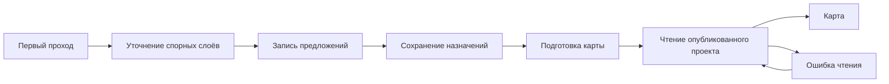

# Распознавание слоёв

## Назначение

Предлагать категории слоёв по обезличенным признакам захвата AutoCAD.
Назначение слоя и проверка геометрии принадлежат обычным сценариям подготовки.

## Вход и результат

Вход: ограниченный набор признаков слоя из проверенного захвата.
Локальные правила работают без внешней модели. Её подключение определяется
конфигурацией среды.

Результат: предложения категорий и адресные замечания. Модель не подтверждает
смысл неоднозначного слоя, глубину сети или нормативные отступы.

Справочник распознаёт именованную линию освещения и ограничивающее ограждение
по полному нативному составу. Это не определяет диаметр или параметры сети.

## Порядок работы

Сначала применяются локальные правила. Для оставшихся слоёв штатные провайдеры
OpenAI, Codex и relay получают категорию, расчётную роль, вопрос и варианты
уточнения одним ответом. Повторный модельный запрос для той же группы убран.
Каждый запрос содержит не более 24 целевых слоёв и компактный каталог
нерешённых слоёв. Локально определённые слои, подтверждённые назначения
оператора и ответы из контрольной точки при продолжении не передаются наружу.
Контекст оставшихся групп фиксируется перед их обработкой: новый ответ
не меняет псевдонимы в пределах одного запуска.
Проверки назначения, физических объектов и границы выполняются локально.
Вопросы по неоднозначным слоям сохраняются для оператора.

Контрольный захват из 124 слоёв: 105 получают локальное предложение,
19 отправляются модели. Исключение локальных слоёв из внешнего каталога
сократило вход с 27562 до 18607 байт. Новый штатный прогон занял 59,38 секунды
против 61,99 секунды с полным каталогом; все 109 автоматически принятых
назначений совпали, 15 слоёв остались на проверку. Вопросы и предложения
по этим 15 слоям изменились. Это единичные замеры и сравнение назначений,
а не измерение экспертной точности. Обработка в два запроса ранее занимала
124,20 секунды на том же входе.

Серверные ответы принадлежат TanStack Query; ручные назначения остаются в форме
подготовки и не заменяются поздним ответом. Подтверждения ролей и запуск расчёта
выполняются обычным сценарием подготовки. Ревизия `.8` входит в ключ кеша;
сохранённый ответ прежнего режима не подменяет новый запуск.

Ревизия `layer-classifier-2026-10-10.9` добавляет локальное распознавание
точных собственных имён границ улицы, площадки, растительности и грунта,
а также красных линий. Префиксы XREF не меняют это правило. Имена соседнего
здания, трубы или подписи не принимаются за такую границу. Физический смешанный
слой 0 с подготовленными объектами не отправляется модели для назначения
единой роли: его объекты и существующие назначения сохраняются.

На том же контрольном входе из 124 слоёв локальная обработка увеличилась
со 105 до 110, число целей модели уменьшилось с 19 до 14. Это распознавание
содержимого: число физических автоназначений осталось 106, число слоёв
на проверку — 18. Новое правило не выбирает территорию и не объявляет линии
заполненным покрытием. Ревизия `.9` входит в ключ кеша; старое назначение
газона для границ или смешанного слоя не переносится в новый запуск.

Итоговая сводка доступна через информационную кнопку раздела слоёв и показывает
подтверждённые назначения и число слоёв для проверки. Общий счётчик завершённой
обработки не приписывается модели: часть назначений получают локальные правила.

Модель сразу получает сводку геометрии: состав
подготовленных примитивов, счётчики контекста, пропуски и размер охвата без
координат. Контейнеры блоков и подписи отделены от физических объектов.
Счётчики контекста сверяются с исходными классами до анонимизации и с
разрешённым составом после неё. Эта сводка не назначает роль и не подтверждает
безопасность территории. Изменение признаков меняет ключ распознавания;
сохранённые назначения оператора остаются в проекте.

Новая схема допуска принимает прежние обезличенные запросы без этой сводки.
Relay без `reply_mode` сохраняет прежний первичный ответ. Новый desktop явно
передаёт `reply_mode: complete`; шлюз требует вопрос и варианты в полной схеме
и проверяет точное соответствие запрошенных идентификаторов. Такой режим
разрешён только для `layer_roles`. Для передачи новых признаков и режима relay
должен быть обновлён вместе с desktop: старый сервер отклонит расширенный запрос.

10 октября установленный сервер с релизом `luna-eeb25a2b` отклонял
`reply_mode` как лишнее поле и возвращал HTTP 422 до обращения к модели.
На VPS установлен отдельный минимальный релиз
`luna-aba5dfb4-complete-20261010` из проверенного кода `aba5dfb4`.
Обновлена только служба распознавания, прежний релиз сохранён для отката.
Настройки доступа, журнал расходов и основной API сохранены. Офлайн-проверка
пакета и настоящий обезличенный запрос полного ответа прошли; сервер вернул
HTTP 200 за 3,86 секунды на одном синтетическом слое с контекстом атрибутов.
Этот замер проверяет цепочку, а не скорость обработки всего проекта.

11 октября отдельный холодный прогон `LayerRecognitionService` на контрольных
124 слоях завершился за 15,716 секунды: 110 локальных предложений и один
полный запрос для оставшихся 14 слоёв. Все идентификаторы результата совпали
со входом, исходные слои и файл не изменились. Использовался настроенный relay,
отдельный тестовый кеш и обезличивание до сети; база проектов не открывалась.
Это замер одного прохода, без экспертного эталона расчётных назначений.
В Mac-комплект 0.1.77 включена локальная политика `.9` и отдельная диагностика
отказа старого сервера. Worker и плагин 0.1.48, Web и правила геометрической
подготовки сохранены из квалифицированного комплекта 0.1.76.

Клиент отдельно распознаёт точный отказ старой схемы по `reply_mode` и показывает
«Сервер распознавания требует обновления». Остальные HTTP 422 сохраняют обычную
обработку. Автоматического повторения или понижения формата запроса нет;
содержимое серверного отказа не переносится в публичное сообщение.

Чат для управления проектом удалён из исходников `green-atlas-dev`.
Он не является зависимостью распознавания. Режим Codex CLI для получения
обезличенных предложений категорий сохраняется отдельно.

Модель API и relay задаётся `MODEL` (`gpt-6-luna`). У режима разработчика
через ChatGPT отдельный `CODEX_MODEL` (`gpt-5.6-luna`): установленный CLI
0.150.1 отклонил `gpt-6-luna` с HTTP 400, а модель из его доступного каталога
ответила по JSON-схеме. Идентификатор провайдера входит в ключ кеша.
Неподдерживаемая модель останавливает только собственный процесс запроса
после явного отказа CLI; интерфейс получает короткую причину из каталога,
без вывода CLI и сведений окружения. Таймаут и общий отказ имеют отдельные
причины; готовые локальные результаты сохраняются.

## Локальные сведения и внешний запрос

### Предметный справочник и состав захвата

`dxf_import/layers/recognition_catalog.json` хранит упорядоченные правила,
префиксы групп, основания и допустимые составы объектов. Pydantic проверяет
категории, регулярные выражения и ссылки на профили при загрузке модуля.
Словарь входит в пакет desktop и пакет relay. Ревизия
`layer-classifier-2026-10-11.10` меняет ключ кеша: старый завершённый ответ
не подменяет новый проход.

Добавлены предметы: выгребные ямы, решётки, пандусы, трамвайные пути,
детские и спортивные площадки. Уширения проезжей части и покрытия из гранитной
плитки требуют собственных площадных объектов HATCH или REGION. Название
соседнего объекта после «за» не меняет предмет. Кромка укреплённой обочины
распознаётся как граница покрытия, а не как его площадь. Собственные имена
границ с префиксом `Топо_` или `КЛ_` получают ту же роль подготовки, что имена
без префикса. Граница заказа описывает охват съёмки и не выбирается автоматически
в качестве участка работ.

Новые физические правила требуют согласованности полного состава слоя,
подготовленных объектов и контекста того же проверенного захвата. Пропуски,
непрочитанные объекты и несовпавшие счётчики сохраняют проверку. Новые
предметные категории нельзя подтвердить одним ответом модели в обход локального
допуска. Труба ПЭ получает общий тип сети без определения назначения,
прокладки или проверенной оси. `ЭН_ВЛ НО` требует полного линейного состава
и сохраняет ограничения сведений о сети; сокращение `ВЛ НО` без электрического
контекста не получает это назначение.

Категория `cad_reference` допускается только для слоёв, в которых все объекты
являются проверенным контекстом подосновы и нет подготовленной физической
геометрии. Объекты, атрибуты и видимость сохраняются. Смешанные слои,
`Defpoints`, штампы, координатные обозначения и выноски с обычными LINE
не исключаются по одному имени. Физический слой 0 сохраняет разбор по объектам.

Коды разделов и предметы различаются. В [требованиях к модели Москвы](https://www.mos.ru/upload/documents/files/6245/Prilojenie1_TrebovaniyakIMOKS_Chast1_ObshietrebovaniyakCIM.pdf)
ГП означает генеральный план; это не назначение всех объектов слоя.
[Схема электроснабжения Москвы](https://www.mos.ru/upload/documents/oiv/tom_3_compressed.pdf)
подтверждает обозначение ВЛ как воздушной линии.
[План градостроительного регулирования](https://www.mos.ru/upload/documents/files/8493/antikor609.pdf)
относит красные линии к границам территорий общего пользования. Проектные
сокращения ДВ и ИТ не имеют подтверждённой универсальной расшифровки в этих
источниках; их наличие само по себе не назначает роль. Предметные правила
являются локальными выводами по имени и составу захвата, а не нормативным
словарём всех имён CAD.

Новый каталог категорий требует согласованного обновления relay. Контрольный
тест старого серверного каталога воспроизводит HTTP 422 до обращения к модели;
актуальный каталог принимает новые категории по прежнему обезличенному формату.
Полнота геометрии и явные назначения оператора при этом не меняются.

Офлайн-проверка на сохранённых метаданных Парковой из 539 слоёв применила
обычную функцию автопринятия UI к новым локальным предложениям и прежним
модельным предложениям остатка. Сводка изменилась с 423 назначений,
18 границ для замыкания и 98 ручных проверок до 456 назначений,
32 границ для замыкания и 51 проверки. Все 423 подтверждённых назначения
сохранены. Это сокращение числа уточнений; экспертная точность не измерена.
Геометрия, база проектов и установленное приложение этим тестом не изменялись.

Плагин 0.1.48 извлекает TEXT, MTEXT и фактические значения ATTRIB при обходе
того же экземпляра, который попадает в inventory. ATTDEF сохраняется отдельно
как значение по умолчанию и не становится фактом экземпляра. Файл
`semantics.json` связан с исходником, отображением и inventory контрольными
суммами. Backend проверяет точное совпадение маршрута экземпляра, файла архива,
класса, слоёв, преобразования и якоря. Новая передача публикует исходник,
геометрию и эти сведения одной транзакцией. Повреждённые сведения не дают
частично опубликованного проекта. Старые проекты скрыто не дополняются.

Локальный отбор допускает только ограниченные обозначения покрытия, материала
и размера. Исходные строки, теги, пути, координаты, handles, имена слоёв и XREF
остаются локально. Модель получает временные идентификаторы `layer-N`, группы
`source-N`, категории подсказок, контролируемые типы объектов, количества,
цвета, размеры охвата и отобранные наблюдения. Свободные основания импортера
и текст предыдущих ответов не пересылаются. Строгая схема допускает лишь этот
набор признаков; проверяется каждый запрос клиента и серверного посредника.

Наблюдение подписи не доказывает принадлежность конкретной трубе или области.
Диаметр без единиц и основания измерения остаётся обозначением; DN учитывается
как номинальный размер. Тип прокладки, глубина и наружный размер сети не
подтверждаются моделью и не меняют нормативные отступы. Непрочитанные строки,
превышения лимита и неполные сведения сохраняют адресное состояние полноты.

## Сохранение и продолжение распознавания

`checkpoints.py` сохраняет намерение запуска до первого запроса и принятые
группы предложений вместе с вопросами. Ответ публикуется в
состоянии задачи после атомарной записи с fsync. Ключ включает захват,
провайдера, версию инструкций и полный набор признаков обоих проходов,
включая основание семантических сведений. Ручные назначения в ключ не входят.

Чтение после перезапуска не запускает модель. Явное «Продолжить» отправляет
только оставшиеся группы и их контекст. Сохранённые ответы не возвращаются
во внешний каталог. При окончательном отказе запроса
локальная разметка и принятые группы остаются доступными, задача
показывает ошибку, а завершённый кеш не создаётся. Не принятый процессом ответ
нельзя восстановить из checkpoint. Повреждённая запись требует явного запуска
заново. Полный атомарно сохранённый результат имеет приоритет над checkpoint.

Временный отказ соединения до отправки запроса или явный временный HTTP-отказ
модели допускает три автоматических повтора на всю задачу с ожиданиями 2, 5 и
10 секунд. Успех одной группы не сбрасывает этот лимит. Во время ожидания
задача остаётся выполняемой, счётчики сохраняются и передаётся состояние
«Восстанавливаем соединение». Повторяется только текущая незавершённая группа;
уже полученные группы и уточнения не отправляются снова. Закрытие сервиса
прерывает ожидание сразу и запрещает следующий запрос.

Отказ бюджета, доступа, настроек, схемы или проверки ответа не повторяется.
Потеря ответа после отправки запроса также требует явного продолжения: клиент
не знает, завершила ли модель предыдущую работу. После исчерпания трёх
повторов сохраняется обычное приостановленное состояние и ручное продолжение.
Каждый внешний повтор проходит прежнее резервирование бюджета; отказанный
или неоднозначный запрос не освобождает резерв.

`useLayerRecognition` различает чтение статуса и запуск. Потерянный ответ
команды требует GET состояния, без повторного POST. Поздний ответ связан со
своим проектом и исходником. Локальные запросы используют `networkMode: always`;
внешняя доступность модели проверяется отдельно.

Отказ модели сохраняет точные ответы первого прохода. DTO и событие SSE
передают `completed_layer_ids` из устойчивой контрольной точки того же входа:
локальный отбор не обязан совпадать с первыми N слоями каталога. Не записанный
ответ не включается в список. При чтении проверяются идентичность исходника,
провайдер, полный каталог и согласованность счётчика с идентификаторами.

В состоянии `failed` интерфейс принимает только предложения из этого списка,
сохраняя прежние проверки категорий, исключений и пригодности границы.
Необработанные слои остаются для проверки. Старый ответ без точного списка
не разрешает частичного автопринятия; подтверждённые назначения и ручной
черновик имеют приоритет. При окончательном отказе результат остаётся `failed`,
а продолжение требует явного действия. Ошибка чтения или неизвестный результат команды
не разрешают применять старый ответ из кеша.

Рабочее пространство наблюдает задачу через отдельный
`GET /source-layer-review/status`. Он возвращает существующую задачу, точный
готовый кеш или сохранённое незавершённое состояние; без них возвращает `null`.
Этот маршрут не запускает модель и не продолжает уточнение. Совпадение исходника,
полного основания и версии обязательно. Первичный маршрут review подготовки
сохраняет прежнюю возможность начать распознавание и не используется как
пассивный наблюдатель карты.

Предложение категории «Подписи» проверяется по положительным количествам
известных классов CAD и после чтения кеша. Слой только из подписей, размерных
классов или атрибутов допускает исключение. Примесь LINE, LWPOLYLINE, INSERT
или неизвестного класса требует проверки; явное имя «Подписи» не отменяет
состав слоя. Подтверждённое ручное назначение сохраняется.

Полный запрос модели, включая инструкции и схему, ограничен 64 КиБ до
резервирования бюджета и сети. Слишком большая группа делится до отправки,
сохраняя весь каталог. Сетевой сбой, отказ бюджета и неверный ответ не вызывают
такое деление. Автоматический повтор ограничен описанными временными отказами.
Если даже один слой не помещается,
задача останавливается с сохранённой разметкой. Ответ проверяется по точному
набору временных идентификаторов, уникальности, категориям и допустимым ролям.

Обе опубликованные платформы содержат готовые предложения для Кустанайской.
Mac 0.1.45 дополнительно содержит клиент серверного распознавания, но требует
отдельной настройки URL и токена. Windows 0.1.42 этого клиента не содержит.
Наличие серверного кода в рабочем dev не означает настроенный доступ
у организаторов. Codex CLI остаётся отдельным режимом разработчика
и не требуется для основного демонстрационного сценария.

Ручное получение предложений во внешнем инструменте не является встроенной
интеграцией приложения. При недоступности модели нельзя представлять
статическое предложение как выполненный внешний запрос.

Доступность: [[00 Обзор/Текущее состояние]].
Общие контракты: [[02 Архитектура/Данные и интеграции]].

## Причины отказов провайдера

Отказы бюджета, настройки, размера запроса, ответа и checkpoint имеют
типизированные идентификаторы и отдельный русский каталог сообщений.
HTTP-код провайдера передаётся как проверяемое число. Шлюз передаёт
`green-atlas.recognition-failure/1`: известный код отказа, признак временного
сбоя и необязательный HTTP-статус. Текст ответа модели, ключи и серверные
настройки в этот контракт не входят. Клиент дополнительно проверяет
допустимость повтора по коду, поэтому бюджетный отказ не станет временным
из-за ошибочного признака. Старый общий HTTP 503 не отличает отказ бюджета
от сбоя сети и автоматически не повторяется: требуется обновление шлюза.
Непредвиденная ошибка
показывает общее сообщение распознавания, а исходное исключение остаётся
в локальном журнале. Схема запросов, бюджет, деление групп и сохранение
принятых ответов сохраняют прежние проверки.

Этот контракт и автоматическое восстановление проверены в исходниках
офлайн-тестами. 12 октября на VPS установлен минимальный релиз
`luna-retry-d74ad2da58d0-20261012`. Проверены точный состав пакета и хеши,
импорт 45 модулей, три автономных сценария контракта, HTTP 200 проверки
здоровья и HTTP 401 без токена. Обновлена служба `green-atlas-luna`;
прежний `luna-catalog-c86e6b35fdd8-20261011` сохранён для отката.
Обращений к внешней модели и передачи CAD-данных при обновлении не было.
Установка и проверка desktop учитываются отдельно от серверного релиза.

## Видимое состояние и переход к карте

Интерфейс показывает этап задачи из API: ожидание запуска, первый проход,
уточнение спорных слоёв или запись предложений. Счётчик уточнений относится
только ко второму проходу. Полный счётчик первого прохода не означает завершение
распознавания. Для ответа без сведений об этапе показано ожидание результата,
без предположения о записи или оставшемся времени.

В подготовке кнопка хедера сразу показывает чтение статуса или запуск, затем
текущую фазу и её счётчик. Она раскрывает popover и во время работы; полоса по
нижней границе хедера остаётся дополнительным индикатором. Для завершённой
задачи используются `processed_count` и `total_count` первого прохода;
счётчик последней записи `1/1` не подменяет итог проекта `124/124`.
Завершение снимает анимацию, итог остаётся доступен. Отсутствие задачи у проекта
с уже сохранёнными назначениями не означает ожидание распознавания.
Во время запроса имя первого слоя и число остальных берутся из фактического
`active_layer_ids`. Таймеры отдельных слоёв и предполагаемый срок завершения
не показываются. При записи и завершении имена текущего пакета снимаются.
Ожидание ответа пакетной модели обозначается «Ждём ответ модели». При отказе
popover показывает остановку и точный счётчик; причина и длительность доступны
в раскрытии «Подробности». Основная сводка разделяет принятые назначения,
границы для замыкания и слои для проверки. Ниже находятся «Проверить слои»
или «Открыть слои» и, при остановке, явное продолжение. Действия имеют равные
ширины и высоту 36 px в общей сетке; при нехватке места идут одной колонкой.
Полоса прогресса не выходит за ширину содержимого из-за длинного имени слоя.
Нулевая длительность не занимает отдельную строку. Доступные предложения
не выдаются за полный успех модели.
Дополнительные заголовки, поясняющие абзацы и давность последнего ответа убраны.
Время работы компактно вычисляется по серверным `started_at` и `finished_at`.
Сбой чтения, остановка и завершение снимают индикатор выполнения.
Ручные изменения слоёв сохраняются у формы подготовки. Одна таблица используется
для представлений проверки и всех слоёв; выбор типа и роли не создаёт отдельную
форму подтверждения группы. Принятая строка сохраняет положение до повторного
входа в проверку, а введённый поиск сохраняется при смене раздела.

Инженерные сведения раскрываются вместе с данными слоя. Их подтверждение
явным флажком меняет только черновик и записывается общим сохранением.
Правка любого параметра снова требует подтверждения по указанному источнику;
принятие роли слоя не устанавливает физические свойства сети. Локальная отмена
восстанавливает весь снимок назначения и не пересекает замену исходника или
подтверждённую запись.

Завершённые предложения и запись назначений имеют разные состояния. Список
скрывается только на время фактической записи или чтения её подтверждённой
версии. Ошибка чтения прекращает ожидание: список доступен для просмотра,
редактирование ждёт явного актуального чтения. Подтверждённая запись при этом
не повторяется. При неизвестном результате записи индикатор сохранения
снимается сразу по состоянию общего сценария подтверждения, независимо от
отложенного уведомления mutation.

Каждый терминальный результат учитывается по собственной ревизии в пределах
открытого экрана. Новые предложения того же захвата могут дополнить назначения;
прежняя попытка не повторяется после чтения, ручной черновик имеет приоритет.
Ошибка предыдущей попытки не блокирует новую ревизию после восстановления.
Для ответа без времени завершения ключ включает категории и назначения слоёв.

Ожидание HTTP-ответа сохранения назначений ограничено 30 секундами. Отмена
запроса не означает отмену серверной записи: интерфейс показывает неизвестный
результат и предлагает прочитать сохранённые назначения. Автоматического
повторного PUT нет. Это ограничение не распространяется на чтение проекта
и долгую операцию подготовки Core.

Паспорт исходных данных в настройке проекта читается при открытии раздела
«Сведения». Закрытый раздел не загружает полный граф геометрии при открытии
проекта или после сохранения назначений. Кеш разделяет проект, ревизию и
исходник; новая ревизия открытого раздела инициирует новый запрос.
Загрузка, ошибка и явный повтор видны внутри раздела. В документе только
для просмотра первый раздел «Полнота данных» открыт изначально, поэтому
его запрос выполняется сразу. Паспорт не определяет завершение распознавания
или готовность перехода в карту.

Возврат фокуса в окно и восстановление соединения не повторяют запрос паспорта
после ошибки. Повтор выполняется кнопкой, раскрытием раздела либо обновлением
ревизии проекта; явная инвалидация открытых сведений сохраняется.

Проверка потерянного ответа записи назначений читает сохранённый проект один
раз, проверяет исходник, значения назначений и версию. Она не повторяет запись
и не доказывает авторство изменения. Подготовка геометрии и захвата сохраняет
чтения до и после проверки операции, поскольку между ними может меняться
состояние выполняемой работы.

Восстановление потерянного ответа использует только чтение `/status`.
Отсутствующая задача показывает явную команду запуска; чтение не создаёт её.
Явное продолжение приостановленной задачи сохраняет уже принятые предложения.

Первое чтение в настройке обнаруживает задачу, а в открытой карте только
наблюдает существующую. Пока задача работает, обновления приходят по одному
SSE-потоку `/source-layer-review/events` с событием `recognition`; периодических
GET нет. Нативный `EventSource` восстанавливает соединение и получает актуальный
снимок без повторной команды. Обрыв снимает индикатор выполнения до следующего
события или явного чтения статуса. Завершённый, прерванный и пустой результат
закрывают поток. Уход с экрана, замена исходника и остановка локального сервиса
отменяют подписку; поздние события не меняют состояние другого проекта.

Распознавание и подготовка имеют разных владельцев: серверная задача хранится
в TanStack Query, назначения остаются в форме, квитанция подготовки отслеживается
сценарием завершения. После возврата на экран завершённая подготовка читается,
если проект ещё относится к её входной версии и пользователь не изменил форму.
Подтверждённое чтение того же исходника и пригодного снимка автоматически
открывает карту. Ошибка допускает повторное чтение без нового расчёта.
Историческая операция старого исходника или прежних настроек не открывает карту;
намеренно открытый раздел готового проекта остаётся доступным для проверки.
Ошибка первоначального чтения проекта показывает повторную загрузку и отличается
от подтверждённого ответа об отсутствии проекта. Чтение не запускает подготовку.

Подготовка показывает навигацию «Геометрия», «Слои», «Сведения» и один активный
документ. Выбор границы относится к геометрии; прежние протокольные идентификаторы
разделов сохраняются. Нижние действия находятся вне прокручиваемого документа
на одной строке контролов 36 px с полноширинной верхней границей; в узком окне
группы действий переносятся. Условия подготовки открываются по запросу рядом с основным действием, без отдельной
постоянной строки над ним. Серверные ограничения и восстановление записи
остаются частью прежнего сценария подготовки.

## Локальный первый проход и поток изменений

Распознавание сначала использует явные имена из поддерживаемого каталога
и точные native-классы аннотаций. Принятый результат каждого слоя сохраняется
перед увеличением счётчика. Сохранённые идентификаторы не обязаны идти подряд:
при явном продолжении модель получает только оставшиеся слои и весь
обезличенный контекст. Подтверждённые назначения сохраняются.

Непонятное имя слоя только из подписей не требует запроса модели. Примесь
линий или неизвестных классов отменяет это основание. Смешанный слой 0
не превращается в мусор или свободный грунт; красные линии и цвет не доказывают
инженерную сеть. Проектные коды без дополнительных признаков остаются
неопределёнными. Подсказка электрической сети по КЛ/ВЛ с записью кВ не назначает
физические характеристики и отступы сети.

Явное имя границы работ или проектирования распознаётся локально. Категория
границы не выбирает территорию и не подтверждает замкнутость; выбор оператора
и геометрические проверки подготовки остаются отдельными действиями.

`active_layer_ids` относится к реальной текущей порции. Приложение не показывает
фиктивный порядок внутри ответа модели. Поток изменений читает начальное
состояние без запуска задачи, затем ожидает изменения сервиса. При повторном
подключении читается актуальный снимок. Ожидание прерывается закрытием сервиса
или отменой подписки; heartbeat не запускает новое распознавание.

На сохранённом входе Кустанайской локально определены 100 из 124 слоёв;
модели остаются 24 цели вместо всех 124. В изолированном запуске 9 октября
Luna с reasoning `low` обработала весь вход за 32,1 секунды: первый запрос
24 целей и уточнение 23 целей. Это один измеренный запуск через API;
скорость зависит от ответа провайдера. Codex CLI 0.150.1 с входом ChatGPT
отклонил эту модель, поэтому такой вход не участвовал в замере.

Фактическая политика интерфейса автоматически назначила 104 слоя и оставила
20 уточнений. Эти числа не являются экспертной оценкой точности. У 17
оставшихся категорий нет определённой расчётной роли, ещё три содержат
аннотации вместе с другой геометрией. В 14 случаях обезличенные признаки
передавали имя как `unknown`.

Политика `anonymous-layer-features/2` сохраняет контролируемые словесные
подсказки в обоих проходах: границы улицы и площадки, выгребные ямы, футляры,
красные линии, слово «удерживающее» и авторскую отметку вопроса. На этом захвате
она восстановила признаки 9 из 14 слоёв. Остались четыре сокращённых имени
КЛ/ВЛ и `ЭС_ВРЩ_СП`; их расшифровка требует легенды или объектных сведений.
Подсказки не назначают расчётную роль и не доказывают тип сети. Геометрия слоя
0 и физические линии среди подписей остаются доступными.

Без модели раньше возвращалось состояние «не подключено», из-за которого
интерфейс не применял даже локальные предложения. Теперь тот же первый проход
сохраняет результат `local-rules/1`; на неизменённом входе он занял 0,228 секунды.
Обычная политика интерфейса назначила 101 из 124 слоёв, оставив 23 решения.
Конфигурационная ошибка модели сохраняется в сообщении результата. Кеш
локального провайдера отделён от модельного; холодное чтение не запускает
модель и не переносит предложения другого захвата. После настройки AI нужен
явный запуск с собственным основанием.

Новый запрос Luna `low` занял 31,269 секунды: 24 первичных цели и 22 уточнения,
два обращения к API в отдельном разрешённом тестовом бюджете. Исходник,
сведения слоёв и рабочий журнал расходов сохранились. Политика интерфейса
сначала приняла 107 ролей, включая два футляра как сети. Такое назначение
не связывает контур футляра с осью сети; охранное условие оставляет его
неподтверждённым. Повторная проверка того же ответа без новых AI-запросов
дала 105 назначений из 124, или 84,7%, и 19 решений оператору.

Точное сочетание «КЛ НО» в собственном имени слоя распознаётся как кабельная
линия наружного освещения, когда native-захват подтверждает полный согласованный
состав линейных объектов. Это не устанавливает напряжение, способ прокладки
или ось сети. Футляры, выноски, подписи, вопросы и имена XREF это правило
не проходят. Расшифровка подтверждена [документом Москвы](https://www.mos.ru/upload/documents/files/8373/PrilkPPM_ylMedikov.pdf),
страницы 19 и 23. Версия обезличенных признаков повышена до
`anonymous-layer-features/3`, оба прохода используют ту же проверку.

На неизменённом захвате локальное автоназначение выросло со 101 до 103 слоёв.
Повторное применение сохранённого ответа модели даёт 107 из 124 (86,3%) и
17 решений оператору; нового обращения к модели для этого сравнения не было.
Модели передаются 22 первичные цели вместо 24. Время 31,269 секунды относится
к прежнему модельному запросу, экспертного эталона назначений пока нет.

Выгребная яма учитывается как физическое препятствие по явному имени и
положительному замкнутому native-контуру того же захвата. Это не назначает
ось сети или нормативную зону. Остальные 12 линейных элементов слоя не
устанавливают тип сети. Явное подтверждение оператора сохраняется независимо от предложений.
Цель 96% остаётся открытой: правильность ролей не подменяется их количеством.

## Защитный футляр

Самостоятельное имя `Футляры`, в том числе `ЭС_Футляры` и `ЭС_ГНБ_футляры`
в собственном пространстве имён слоя, получает категорию `protective_casing`
и роль `restricted`. Локальное предложение требует полного согласованного
native-состава с HATCH или REGION и читаемыми линиями. Неизвестные,
непрочитанные или пропущенные объекты не подтверждаются названием.
Только линейные штрихи не доказывают площадной состав футляра.

Категория описывает защитную конструкцию, без назначения типа сети внутри неё,
её оси, способа прокладки и нормативного отступа. Явное имя сети на самом слое
сохраняет прежнюю категорию; имя родительского XREF не назначает тип сети.
Модель и кеш проходят тот же допуск, а полное локальное предложение не вызывает
модель. Каталог запросов имеет ревизию `layer-classifier-2026-10-09.4`;
обезличенный признак `protective_casing` существовал в `anonymous-layer-features/3`.

Операторские назначения не переписываются. Новая категория хранится только
при обычном применении назначений и меняет основание физической подготовки.

## Распределительный щит

Собственное имя `ВРЩ`, включая `ЭС_ВРЩ` и `ЭС_ВРЩ_СП`, получает существующую
категорию `equipment` с ролью `restricted` только при полном согласованном
native-составе: HATCH или REGION, читаемые LINE/LWPOLYLINE/POLYLINE и явно
проверенные контекстные контейнеры и атрибуты. Линейный состав без площадных
объектов, пропуски и неизвестные классы это правило не проходят. Сокращение
расшифровано в [документе Москвы](https://www.mos.ru/upload/documents/files/3615/PrikazMKE-OD-22-121sPrilojeniem.pdf),
страница 41 PDF. Суффикс СП не получает отдельной расшифровки.

Имя XREF, подписи, вопросы, выноски и другой предмет рядом с ВРЩ не назначают
щит. Модель и кеш не могут заменить native-допуск либо объявить щит сетью.
Напряжение, способ установки, ось и характеристики подключённой сети не
заполняются. Ревизия запроса `.4` меняет существующий ключ распознавания;
механизм кеша и ревизия подготовленной геометрии сохраняются.

Геометрия использует прежний путь наземного оборудования: измеренные области
сохраняют отверстия, замкнутые native-полилинии остаются площадями, открытые —
линиями. Это правило не ограничивает оборудование только измеренными HATCH
или REGION и не меняет подготовку площадей из исходных native-кривых.
