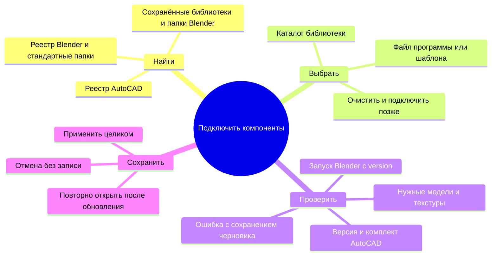

# Установка и проверка Windows

Опубликованный установщик Windows x64 называется
`GreenAtlas-0.1.122-Windows-x64-Setup-2.exe` и находится в
[релизе 0.1.122](https://github.com/Artyom-vv/green-atlas-dev/releases/tag/v0.1.122-windows-candidate-39121021418).
Он включает общее ядро `8f71df1a215c9f19ddf573288690ea33854c5c5d`;
исходник Windows-продукта: `2b64cb09bc98958970aa8bfb27080bed509e1cbd`.
SHA-256 EXE: `5ee9a17418b0a0802d9566f406b265da52f7d185cdac1eec69fe1e757700a5ba`.
Приёмка на рабочем компьютере выполняется по сценариям ниже. Состояние сборки описано в
[[03 Модули/Подготовка Windows и упаковка]].

## Настройка компонентов в следующем Windows-комплекте

Для Codex на отдельном Windows-ПК без AutoCAD и Blender предусмотрена
инструкция [локальной настройки и сборки](../../../WINDOWS-START-HERE.md).
Она описывает подготовку окружения, отдельную тестовую учётную запись и передачу
результатов без использования платных GitHub Actions.

Изменение 0.1.124 добавляет поиск и ручной выбор AutoCAD 2027, его шаблона,
Blender, Botaniq и PBR в native-мастере и в кнопке «Компоненты» приложения.
Опубликованный выше 0.1.122 остаётся предыдущей проверенной поставкой до
завершения нового Windows-прогона. Инструкции JSON ниже относятся к нему.



| Зона | Ответственность | Владелец состояния |
|---|---|---|
| Мастер установки | Нативные поля, поиск, выбор, проверка до установки | Черновик мастера |
| Диалог приложения | Повторное подключение без переустановки | Локальный черновик React |
| Общая проверка | Файлы AutoCAD, запуск Blender, профиль моделей и PBR | desktop/dependencies.py |
| Сохранение | Атомарная запись путей вне проектов | shared/tool_settings.py |
| Запуск задания | Чтение применённых путей при создании задания | CAD transport и rendering |

Сохранённые пути находятся в `%LOCALAPPDATA%\Green Atlas\external-tools.json`.
Это внутренний файл программы; пользователь работает через интерфейс.
Старые настройки и переменные сохраняются для совместимости, но выбранные
в интерфейсе пути имеют приоритет. Пустое поле возвращает автоматический поиск
и прежние настройки, если они были заданы. Отсутствие программ и библиотек не
блокирует установку и запуск окна. Рендер требует подключения Blender и ресурсов.

Системный picker Windows принимает только запрос текущего документа WebView2.
Из публичного API пути менять нельзя: используется приватная desktop-сессия.
При ошибке хотя бы одного заполненного поля предыдущая конфигурация целиком
сохраняется. Выбор родительского каталога Botaniq/PBR нормализуется при проверке.
Настройки применяются к новым заданиям; уже запущенное задание не перенастраивается.
Сообщения об отсутствии программ и библиотек направляют пользователя в «Компоненты»;
для обычной настройки переменные окружения и редактирование JSON не нужны.
Обновление и удаление сохраняют внешний файл настроек. Рабочие проекты, CAD и
содержимое библиотек эти действия не изменяют.

Приёмка: нестандартные пути с пробелами и кириллицей, неполный пакет, отмена
native picker, ошибочный Blender, проверка до сохранения, повторное открытие,
обновление и удаление с сохранением конфигурации. Настоящие CAD/Blender-сценарии
отличаются от проверки обнаружения и не считаются подтверждёнными файлами-заглушками.

Локальная Windows-приёмка 18 октября 2026 года подтвердила выбор и отмену для
всех пяти полей как в настройках приложения, так и в мастере установки. CAD-папка
и `.dwt` в этом сценарии являются тестовыми файлами только для проверки выбора;
перед сохранением восстанавливаются исходные значения. Тестовый x64
`blender.exe` отклоняется проверкой версии. Повреждённый или
16-разрядный EXE отклоняется до запуска понятным сообщением. Для повреждённого
файла frozen backend завершился без системного окна. Настоящий Blender не
запускался. Обновление и
удаление сохранили БД и настройки в отдельном обычном Windows-профиле.
Первый кадр страницы компонентов в новой локальной сборке полностью отрисован.
Setup 0.1.124 ещё не опубликован как релиз и не подтверждает
работу с настоящим AutoCAD или рендеринг.

## Перед установкой

Для установки и открытия библиотеки проектов нужны обычная учётная запись
Windows и место для локальных данных. AutoCAD и Blender этот запуск не блокируют.
Для нового CAD-проекта и выпуска нужен полный AutoCAD 2027.
Для финального изображения нужен Blender x64. Модели
растений и карты материалов рендера предоставляет пользователь отдельно:
одной установки Blender для этого недостаточно.

Установщик содержит приложение, Web-интерфейс, API, плагин AutoCAD, CAD worker,
необходимые библиотеки VC Runtime и автономный установщик WebView2 Runtime.
Python, Node.js, PowerShell и исходники конечному пользователю не требуются.

## Установка и первый запуск

1. Закрыть AutoCAD и Green Atlas.
2. Открыть `GreenAtlas-0.1.122-Windows-x64-Setup-2.exe` обычным двойным щелчком, без запуска от имени
   администратора. Пройти видимый мастер: приветствие, папки программы и проектов,
   ярлык рабочего стола, подтверждение и установка. Папка программы показана
   отдельно от папки рабочих проектов; ярлык меню «Пуск» создаётся для текущего пользователя.
3. Дождаться страницы завершения. «Готово» запускает Green Atlas, если оставлен
   соответствующий флажок. При необходимости Setup запускает включённый
   автономный WebView2 installer и повторно проверяет его версию.
   Если устаревший WebView2 установлен для всей машины, Setup объясняет причину
   и предлагает стандартный Windows UAC только для установщика Microsoft.
   Сам Green Atlas остаётся в обычном профиле. При отказе UAC или несовместимой
   версии установка приложения не завершается.
4. Открыть «Green Atlas» в меню «Пуск». Приложение показывает библиотеку проектов;
   на чистом профиле она пуста. Для этого запуска AutoCAD и Blender не нужны.
5. Закрыть и снова открыть приложение. Библиотека должна открыться без отдельного
   терминала, ввода адреса API или установки дополнительных сред выполнения.

## Первый проект из AutoCAD

1. Запустить AutoCAD 2027 после установки плагина.
2. Открыть рабочую копию DWG/DXF с доступными XREF. Проверить единицы, видимость
   чертежа и отсутствие ожидающих ответа диалогов AutoCAD.
3. Выполнить `GAOPEN` или соответствующую команду Green Atlas в AutoCAD.
4. Дождаться передачи в Green Atlas. Проверить слои, пропуски объектов, XREF,
   границу и назначения. Завершить подготовку карты.
5. Создать рабочий участок, добавить посадку, сохранить и открыть проект повторно.

Исходный чертёж остаётся у AutoCAD. Проектирование использует сохранённый
подготовленный снимок; новый проект из произвольной загрузки файла в Web
не создаётся. Подробности: [[03 Модули/Работа с CAD и DXF]].

## Blender и ресурсы оформления

Обычная установка Blender обнаруживается в каталоге
`C:\Program Files\Blender Foundation\Blender <версия>\blender.exe` либо через
системный PATH. Точную версию записывают в результат приёмки. Обнаружение программы
само по себе не подтверждает успешный рендер. Нестандартный путь можно явно задать
через пользовательскую переменную `GREEN_ATLAS_BLENDER`, затем полностью
перезапустить Green Atlas.

Текущая карта файлов рассчитана на структуру Botaniq 6.8. Blender читает `.blend`
напрямую. Установка дополнения в Blender не заменяет доступ к самим моделям,
библиотеке материалов и текстурам. Другая структура пакета требует проверки
совместимости его файлов.

### Настройка существующего пользовательского пакета

1. Найти каталог Botaniq, внутри которого находятся `blends_280` и `textures`.
   В `blends_280` должен быть `Library_Botaniq_Materials.blend` и выбранные модели
   деревьев, кустарника и травы.
2. Найти каталог PBR, содержащий карты асфальта, бетона и `grass005`.
3. Через проводник открыть `%LOCALAPPDATA%\Green Atlas` и создать, если нужно,
   этот каталог. Название здесь содержит пробел: это путь существующих настроек
   оформления, отдельный от рабочего профиля `GreenAtlas`.
4. Сохранить в нём UTF-8 файл `render-resources.json` с действительными путями.
   В примере оба каталога находятся внутри одного пользовательского пакета:

```json
{
  "schema": "green-atlas.render-resources/1",
  "botaniq_root": "D:/GreenAtlasAssets/botaniq_full",
  "pbr_root": "D:/GreenAtlasAssets/pbr"
}
```

Имена `schema`, `botaniq_root` и `pbr_root` обязательны. Значения в примере
заменяют своими путями; прямой слеш в Windows-путях допустим и не требует
экранирования JSON. Корни могут находиться на другом диске. Файл настроек
указывает на модели и не переносит их в установщик.

Ожидаемые карты PBR:

| Поверхность | Цвет | Шероховатость | Нормали OpenGL |
|---|---|---|---|
| Асфальт | `asphalt01_Diffuse.jpg` | `asphalt01_Rough.jpg` | `asphalt01_nor_gl.jpg` |
| Бетон | `concrete_Diffuse.jpg` | `concrete_Rough.jpg` | `concrete_nor_gl.jpg` |
| Газон | `grass005/Grass005_2K-JPG_Color.jpg` | `grass005/Grass005_2K-JPG_Roughness.jpg` | `grass005/Grass005_2K-JPG_NormalGL.jpg` |

После настройки полностью перезапустить Green Atlas. Открыть подготовленный
проект, перейти в 3D и запустить «Рендер». Первая подготовка локально создаёт
облегчённые модели для просмотра, затем строит изображение. После успешной
подготовки обновить 3D и проверить модели растений и материалы. Результат рендера
сохраняется через «Скачать PNG» с выбором файла.

На чистом профиле готового кеша производных моделей нет. До его первой успешной
подготовки текущий native-просмотр может показывать окружение без моделей
проектных растений. Кнопка подключения библиотеки и автоматическое заполнение
этого кеша при первом запуске пока не реализованы. Это ограничение проверяется
отдельно; наличие файлов Web-моделей не устраняет его автоматически.

## Данные и работа без сети

Программный комплект устанавливается в
`%APPDATA%\Autodesk\ApplicationPlugins\GreenAtlas.bundle`.
Рабочие данные находятся в `%LOCALAPPDATA%\GreenAtlas\Workspace`, передачи —
в `Transfers`, данные WebView2 — в `WebView2`, журналы оболочки — в `Logs` рядом
с Workspace. Обновление и удаление программного комплекта сохраняют рабочий
профиль и внешние модели.

Каталог растений, нормативные правила, шрифт CAD и ресурсы Web поставляются
локально. Основные локальные расчёты и работа с сохранёнными проектами
не требуют API-ключа. Без настроенного внешнего распознавания используются
локальные предложения по названиям слоёв, которые проверяет пользователь.

Поиск адреса требует сети и пользовательского ключа DaData; получение новой
внешней карты требует сети. Уже применённая карта сохраняется с проектом.
При первом поиске улицы локальное приложение предлагает «Настроить DaData»:
личный API-ключ вводится в окне адреса и сохраняется в
`%LOCALAPPDATA%\Green Atlas\Location\dadata.json`. Установщик не содержит
общего ключа и не удаляет этот файл при обновлении. OSM не требует ключа,
но текущий сценарий сначала подтверждает адрес через DaData и лишь затем
загружает улицу и здания OSM. Ключ не показывается повторно в интерфейсе.
Фотографии видов и ссылки на внешние источники могут быть недоступны без сети.
Эти функции не заменяют локальную расчётную геометрию.

## Приёмка на компьютере пользователя

| Проверка | Ожидаемый результат |
|---|---|
| Чистая установка обычным пользователем | Setup завершён; ярлык «Green Atlas» появился в меню «Пуск» |
| Первый и повторный запуск | Библиотека открывается; повторный запуск активирует свой экземпляр |
| AutoCAD 2027 и `GAOPEN` | Новый захват принят, слои и адресные замечания доступны |
| Подготовка, посадка, сохранение, повторное открытие | Один подготовленный снимок и сохранённые посадки используются повторно |
| Чистый 3D без пользовательских моделей | Отдельно зафиксирован фактический состав окружения и отсутствие готового native-кеша |
| Blender и настроенный пакет ресурсов | Подготовка завершилась, модели и материалы доступны, PNG сохраняется в выбранное место |
| Отмена рендера и закрытие приложения | Операция завершается, проект остаётся доступным после повторного запуска |
| Выпуск CAD | Создан новый результат, исходный DWG не перезаписан |
| Обновление, возврат предыдущей версии, удаление | Программная версия меняется; проекты, передачи и внешние модели сохраняются |

В результате проверки записывают версии Windows, AutoCAD, Blender и компонентов
Green Atlas, использованный пользовательский пакет ресурсов и исход каждого
сценария. Компиляция, проверка HTTP или установка того же payload повторно
не заменяют сквозную проверку AutoCAD, WebView2, рендера и обновления между
разными версиями.

В Windows CI комплект 0.1.122 на исходниках `2b64cb0` прошёл сборку, установку обычным
пользователем, видимый мастер, запуск API/WebView2 по «Готово», повторную установку
и удаление. Отдельно выполнено обновление 0.1.119 → 0.1.122: прежний установленный
EXE создал тестовый проект без CAD-основания, новый открыл его; байты базы
сохранились после обновления и удаления. Это не проверка миграции реального
подготовленного CAD-проекта.

Для того же EXE дополнительно выполнен переход 0.1.121 → 0.1.122:
старое приложение сохранило три посадки на собственном синтетическом подготовленном
снимке, новое прочитало те же объекты, выполнило Undo/Redo и повторное открытие.
При обновлении и удалении байты базы сохранились. Для этой дополнительной проверки
машинный WebView2 подготовлен заранее. Квитанция `upgrade-121-checks.json` находится
рядом с установщиком; десять release assets независимо сверены по SHA и доступны
для скачивания. Исходники приложения при повторной проверке не менялись.

Рендер и GLB ранее проверены в Windows Blender 4.5.11 на собственных синтетических
ресурсах, без Botaniq; код рендера в этом обновлении не менялся. Сквозная приёмка
AutoCAD 2027, пользовательских моделей, реальной CAD-миграции и холодного WebView2/UAC
остаётся отдельной проверкой на целевой машине.
