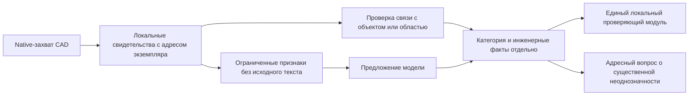

# Основания и технические решения

## Проверяемые утверждения

| Утверждение                                                                   | Основание в репозитории                                        |
| ----------------------------------------------------------------------------- | -------------------------------------------------------------- |
| Подготовленная геометрия подключена к приложению                              | apps/api/app/composition.py, native_query/project_runtime.py   |
| Проверки готового снимка не отправляют запросы AutoCAD                        | apps/api/app/native_query/measurement/prepared_provider.py                 |
| Основания физической подготовки, расчёта и подтверждающих сведений разделены  | apps/api/app/native_query/preparation/prepared_snapshot.py                 |
| Отклонённые пробы не резервируют место                                        | apps/api/app/planning/search/candidate_search.py                      |
| Правила и бюджеты вынесены в конфигурацию                                     | apps/api/app/regulations/placement_rules.json                  |
| Выпуск AUTOCAD_LIVE использует сохранённый CAD-архив и отдельный Core-процесс | apps/api/app/exporting/application.py, exporting/cad_writer.py |

Пути перечислены как справочные указатели для проверки кода.
Описание контрактов содержится в самой документации и не требует
открытия этих файлов.

## Технические решения

| Решение                          | Причина                                                       | Следствие                                              |
| -------------------------------- | ------------------------------------------------------------- | ------------------------------------------------------ |
| Чтение CAD через AutoCAD         | Сохранение смысла CAD-типов и экземпляров                     | Нет резервного чтения нового исходника другим парсером |
| Сохранённый расчётный снимок     | Повторные проверки без затрат на CAD-запрос каждой точки      | Нужны происхождение, точность и ключ актуальности      |
| Один модуль правил               | Согласованность ручного, автоматического и повторного расчёта | Изменение правил обновляет зависимые результаты        |
| Раздельный учёт областей и линий | Не вся геометрия имеет площадь                                | Читаемые линейные объекты не теряются                  |
| Явные допущения                  | Не все характеристики исходника доступны                      | Результат ограничен указанными основаниями             |
| Предпросмотр до сохранения       | Контроль изменений пользователем                              | Устаревший план не применяется без новой проверки      |
| Производная карта                | Быстрое отображение                                           | Видимость объекта не доказывает расчётную полноту      |

## Проверки в коде

Быстрые сценарии используют готовые pytest и Vitest. pytest-timeout ограничивает
отдельный тест вместе с фикстурами; режим `thread` завершает тестовый процесс и
выводит стеки при превышении времени. JUnit при жёстком завершении не
гарантируется, поэтому отдельно сохраняется stdout и stderr. Таймаут Vitest
отдельно задаётся для теста и его хуков. План и измерения:
[[04 Качество и показатели/Качество и показатели]].

```text
https://github.com/pytest-dev/pytest-timeout
https://vitest.dev/config/testtimeout.html
https://vitest.dev/config/hooktimeout.html
```

- apps/api/tests/test_prepared_geometry.py: сохранённый снимок и локальный расчёт.
- apps/api/tests/test_candidate_search.py: очередь кандидатов и принятое соседство.
- apps/api/tests/test_calculation_coverage.py: полнота расчётных данных.
- tools/autocad-bridge/desktop/test_frozen_runtime.py: состав ресурсов пакета.

Наличие теста не является сообщением о результате его последнего запуска.
Датированные измерения приведены отдельно:
[[04 Качество и показатели/Качество и показатели]].

## Реестр инженерных свидетельств

| Идентификатор | Дата       | Предмет                                                                           | Путь в репозитории                                                |
| ------------- | ---------- | --------------------------------------------------------------------------------- | ----------------------------------------------------------------- |
| E-01          | 2026-09-25 | Подготовленная геометрия и автономные проверки                                    | docs/implementation/2026-09-25-prepared-geometry-placement.md     |
| E-02          | 2026-09-26 | Пользовательский маршрут Кустанайской                                             | docs/audits/2026-09-26-kustanayskaya-user-flow.md                 |
| E-03          | 2026-09-26 | Ограничения больших снимков                                                       | docs/audits/2026-09-26-snapshot-size-diagnosis.md                 |
| E-04          | 2026-09-16 | Потери LibreDWG и ограничения извлечения геометрии ezdxf на контрольном исходнике | docs/implementation/2026-09-16-unpatched-cad-comparison/README.md |
| E-05          | 2026-09-25 | Обновлённый подбор и общий учёт полноты геометрии                                 | docs/implementation/2026-09-25-placement-queue-and-coverage.md    |

Эти инженерные журналы не входят в пользовательскую документацию.
Необходимые результаты и ограничения изложены на страницах качества
и статуса. Журналы нужны для углублённой проверки, а не для понимания сервиса.

Краткое нетехническое изложение истории:
[[08 Проблемы и решения/Проблемы и решения]].

## Численные правила

В конфигурации каждого нормативного источника указаны документ, редакция
и пункт. Рабочие допущения и технические бюджеты отделены от этих источников.
Описание их структуры: [[03 Модули/Геометрия и нормативы]].

## CAD и владение блокировкой

| Источник Autodesk 2027                       | Проверяемое требование                                                                                                                                |
| -------------------------------------------- | ----------------------------------------------------------------------------------------------------------------------------------------------------- |
| `AcDbDatabase::restoreOriginalXrefSymbols()` | Временное восстановление символов XREF требует блокировки документа и парного восстановления forwarding-символов                                      |
| `AcApDocManager::lockDocument()`             | Зарегистрированная команда обычно получает блокировку текущего документа автоматически; явная блокировка должна освобождаться только своим владельцем |
| `AcApDocument`                               | `myLockMode()` сообщает права текущего исполнения, а `lockMode()` описывает блокировки других контекстов                                              |
| `AcApDocument::lockMode()`                   | Учёт чужой или совокупной блокировки не означает владение правом записи текущим исполнением                                                           |

Адреса первоисточников сохранены как справочные сведения. Все используемые
требования изложены выше; чтение комплекта документации не требует интернета.

```text
https://help.autodesk.com/cloudhelp/2027/ENU/OARX-RefGuide/files/OARX-RefGuide-AcDbDatabase__restoreOriginalXrefSymbols.html
https://help.autodesk.com/cloudhelp/2027/ENU/OARX-RefGuide/files/OARX-RefGuide-AcApDocManager__lockDocument_AcApDocument__AcAp__DocLockMode_ACHAR__ACHAR__bool.html
https://help.autodesk.com/cloudhelp/2027/ENU/OARX-RefGuide/files/OARX-RefGuide-AcApDocument.html
https://help.autodesk.com/cloudhelp/2027/ENU/OARX-RefGuide/files/OARX-RefGuide-AcApDocument__lockMode_bool_const.html
```

Политика архива использует режимы `kWrite`, `kProtectedAutoWrite` и `kXWrite`
из локального SDK Autodesk 2027: их заимствование не вызывает повторного
`lockDocument()` и не освобождает блокировку вызывающей команды. Обычный
`kAutoWrite` не даёт защиты от вложенного изменения блокировки.
При отсутствии собственной устойчивой блокировки сохраняется явное получение
права записи и повторная проверка исходника. Если получение блокировки изменило
чертёж, архивирование отклоняется; это ограничение application context,
а не основание сбрасывать watcher или DBMOD.

Документация API задаёт правила владения. Она не доказывает, что конкретный
захват или CAD-архив прошёл проверку на реальном чертеже.

## Распознавание: причины вопросов и следующий маршрут

| Причина                                           | Наблюдение                                                                                                                | Решение                                                                                                                                                            |
| ------------------------------------------------- | ------------------------------------------------------------------------------------------------------------------------- | ------------------------------------------------------------------------------------------------------------------------------------------------------------------ |
| Не извлекалась имеющаяся информация               | Подписи и фактические атрибуты включены в производственный native-захват 0.1.48 и проверены на контрольных чертежах          | Использовать локальную сводку того же захвата; не дополнять старые архивы скрытым чтением CAD                                                                       |
| Не определена связь подписи с физическим объектом | Идентичность текстового экземпляра установлена, связь с трубой не проверена                                               | Хранить источник и проверять связь по native-адресам, связям блока, выноске либо области; близость сама по себе не подтверждение                                   |
| Нет поддержки расчётного представления            | Подтверждённый контекст с осью сохраняет причину неизвестного наружного размера                                           | Добавлять поддержку поверхности для native-экземпляра с подтверждённым размером; не переводить ось в наружную поверхность переименованием                          |
| Нет численного отступа в подключённой таблице     | Полные инженерные сведения не устраняют пустую ячейку таблицы                                                             | Определять применимое правило отдельно от распознавания; не запрашивать повторно те же CAD-сведения                                                                |
| Нет независимых правильных ответов                | Предложения модели и правила имён не образуют экспертного эталона                                                         | Собирать случаи с источником, ожидаемым решением и статусом проверки; измерять опасные исключения отдельно от объёма автоматизации                                 |
| Исключение смешанного состава зависело от имени   | Прежняя политика принимала TEXT и LINE как подписи при явном имени; в 0.1.57 этот случай остаётся на проверке             | Исключение требует подходящего состава объектов; имя и уверенность не заменяют его. Синтетический контроль не измеряет точность на размеченной улице              |

Маршрут ниже отделяет подключённую часть от следующей задачи. Native-захват,
локальная сводка и обезличенные признаки включены в установленный комплект
0.1.57/0.1.48. Связь подписи с физическим объектом и автоматическое получение
подтверждённых инженерных характеристик пока не реализованы.



Чтение подписей и атрибутов включено в обычный native-захват с отдельной
версией контракта, хешами и учётом пропусков. Проверены вложенные XREF,
наследование слоя 0, повторные вставки, фактическое значение и значение
по умолчанию, неиспользуемые блоки, повреждённый результат и сохранность
исходника. Исследовательская программа не стала вторым CAD-парсером приложения.

Локальный отбор признаков и полное основание кеша уже реализованы. Следующая
задача — применение решений с основаниями в backend. Изменение признаков
обновляет соответствующий кеш;
ручные назначения сохраняются. Результат распознавания должен применяться
по одному контракту независимо от того, открыта ли форма подготовки.
Сокращение очереди вопросов следует проверять по влиянию на выбранную область
работ: одинаковые названия разных XREF не разрешают массовое подтверждение.

При чтении `AcDbMText::contents(AcString&)` AutoCAD возвращает содержимое
объекта; форматирование не следует принимать за инженерный факт.
`AcDbAttribute::getMTextAttribute()` возвращает копию объекта, владение которой
остаётся у вызывающего кода. Значение определения атрибута не равно значению
его экземпляра. Основания API:

```text
https://help.autodesk.com/cloudhelp/2027/ENU/OARX-RefGuide/files/OARX-RefGuide-__OVERLOADED_contents_AcDbMText.html
https://help.autodesk.com/cloudhelp/2027/ENU/OARX-RefGuide/files/OARX-RefGuide-AcDbAttribute__getMTextAttribute_const.html
https://www.iso.org/standard/21274.html
https://tanstack.com/query/latest/docs/framework/react/guides/network-mode
```

ISO 6708 определяет DN как номинальное обозначение размера. Оно само по себе
не подтверждает наружный размер для нашего расчёта. Эта ссылка объясняет
различие величин, не устанавливает применимые российские отступы.
TanStack Query `networkMode: always` позволяет выполнять локальное чтение
при индикаторе отсутствия внешнего интернета; доступность модели из этого
не следует.

Политика ведения материалов: [[Правила документации]].

## Рабочие габариты растений

Карточка лиственницы европейской NC State Extension описывает ширину кроны
20–30 футов и быстрый рост. Она не содержит возрастного ряда корней
и не подтверждает применяемый каталогом диапазон 1,68–6,86 м. Выбор нижней
границы для размещения является политикой Green Atlas, а нормативные
отступы проверяются независимо: [[03 Модули/Геометрия и нормативы]].

```text
https://plants.ces.ncsu.edu/plants/larix-decidua/
```

## Приёмка семантических сведений и сравнения

7 октября производственный захват 0.1.48 проверен в установленном AutoCAD Core
на двух малых контрольных чертежах. Они покрывают повторные и вложенные XREF,
наследование слоя 0, фактические атрибуты и значения по умолчанию,
неиспользуемые определения и отказ длинной подписи. Полный контрольный захват
прошёл строгую проверку backend и публикацию дочерним импортером одной записью;
исходный DWG сохранил контрольную сумму. Это проверка контракта извлечения,
а не измерение точности разметки произвольной улицы.

Обезличенный запрос проверен по полным пакетам Кустанайской и Олимпийской,
включая второй проход. Проверены строгая схема и размер каждого пакета без
внешних запросов. Для Олимпийской второй проход близок к лимиту 64 КиБ;
адаптивное деление выполняется до резервирования бюджета.

Сравнение территории использует одну карту OpenLayers и одну камеру.
«До» скрывает применённый план, «После» показывает его. Исходная CAD-растительность
остаётся в обоих состояниях, черновик не входит в сравнение. Проверены
сохранность камеры, отсутствие редактирования, восстановление черновика
и инструмента, Escape и узкая ширина окна. Отдельной модели удаления
исходных CAD-деревьев в текущем плане нет.


## Упрощение HTTP и владельцы интерфейса

Документация FastAPI подтверждает точку расширения `APIRoute` для конкретного
роутера. Выбор оборачивать только endpoint, сохраняя ошибки зависимостей,
валидацию и sync thread pool, является решением Green Atlas. Его корректность
проверяется сравнением ответов, OpenAPI и отдельными контрактными сценариями,
а не следует автоматически из примера документации.

Рекомендации React требуют сохранять зависимости effects согласованными с
кодом. При выделении камеры, picking и черновиков уменьшение зависимостей
достигается разделением обязанностей. Отключение lint или копирование состояния
не является способом упростить координатор.

```text
https://fastapi.tiangolo.com/how-to/custom-request-and-route/
https://react.dev/learn/removing-effect-dependencies
```
