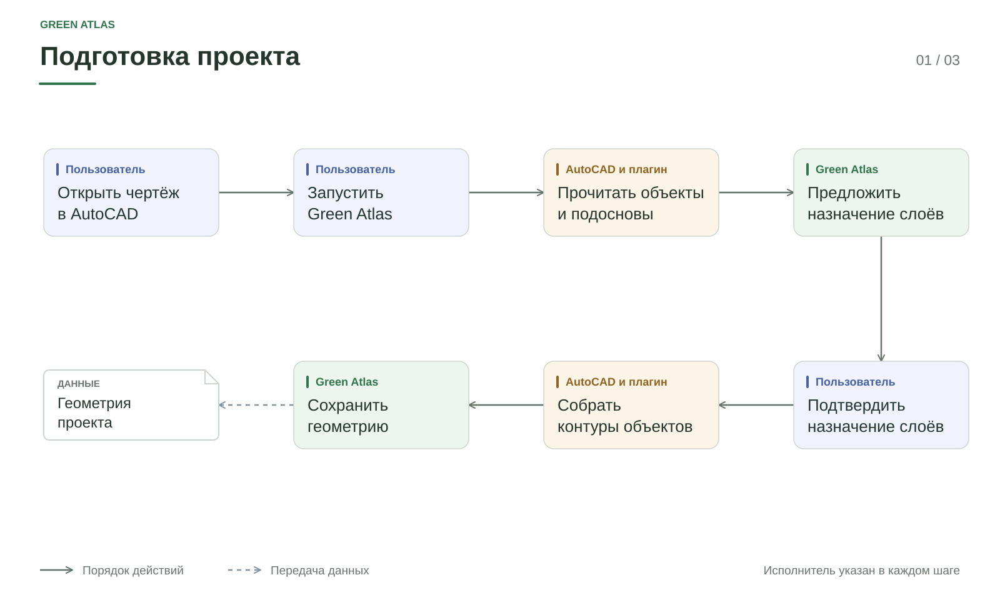
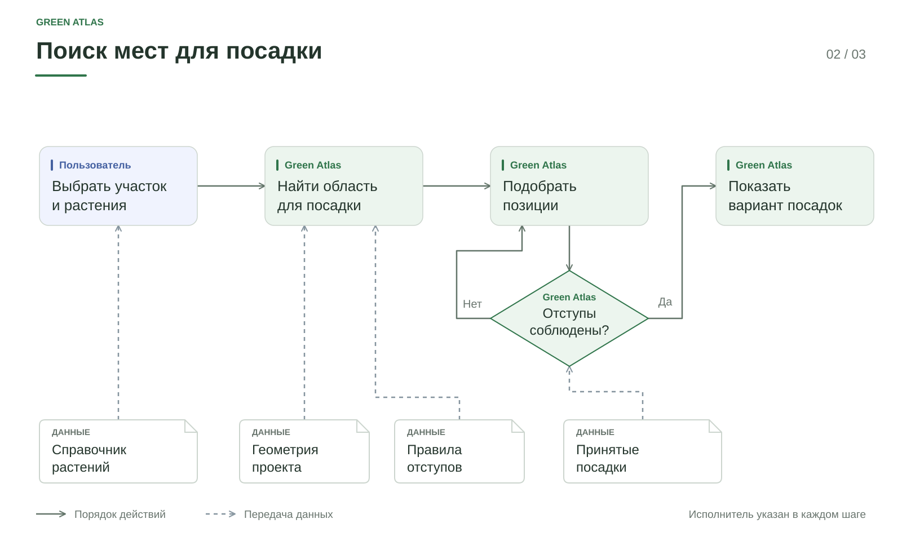
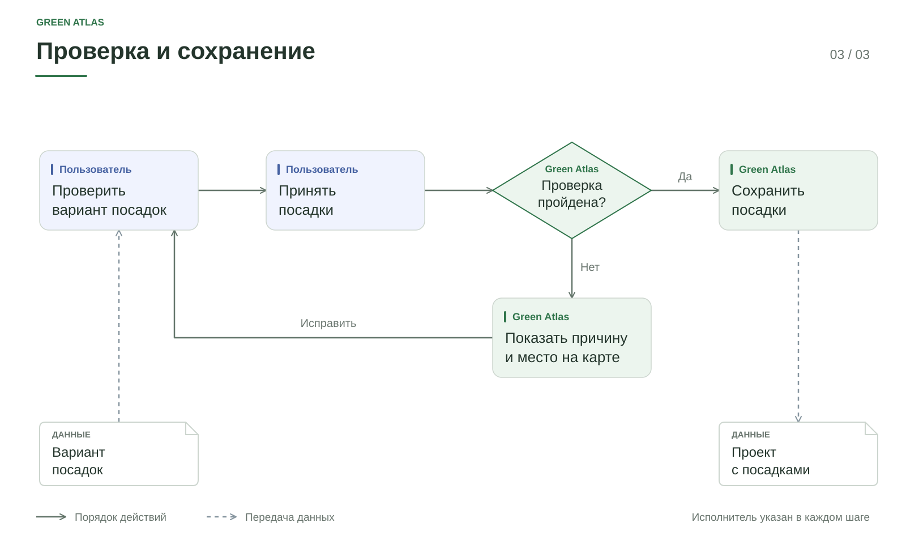

# Продукт и пользовательский путь

## 1. Подготовить чертёж

Откройте DWG/DXF в AutoCAD 2027 и выполните `GAOPEN`.
В Green Atlas проверьте XREF, назначения слоёв, границу и замечания.
Подготовьте карту. Пропуски не считаются свободным пространством.

## 2. Разместить растения

Создайте рабочий участок и выберите растения. Используйте одиночную посадку,
ряд, кисть или автоматическое размещение. Проверьте предпросмотр и примените
подходящий вариант. Изменение горизонта роста может выявить новые конфликты.

## 3. Проверить и сохранить

Откройте замечания, исправьте конфликты, сохраните план. Для просмотра
переключитесь в 3D; для детальных моделей и рендера настройте Blender и ресурсы.
Нажмите «Выпуск» для отдельного чертежа и сопроводительных файлов.

Сохранение плана и запись DWG — разные операции. Исходный чертёж не
перезаписывается. Черновой выпуск может содержать замечания; финальный
требует прохождения предусмотренных проверок.

[[05 Эксплуатация/Установка и проверка Windows|Установка]],
[[03 Модули/Проверка и выпуск|состав выпуска]].
