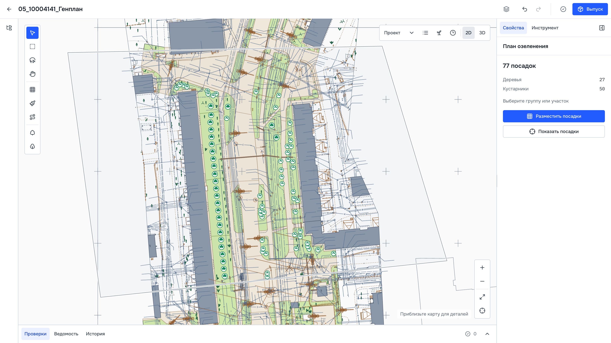
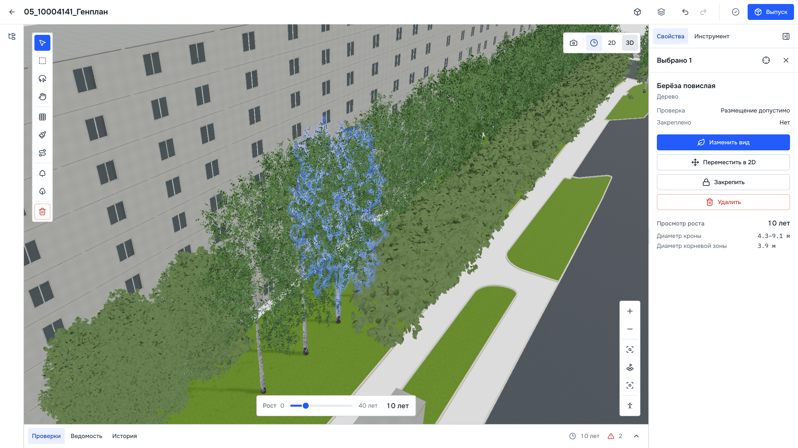

# Демонстрация и материалы Green Atlas

**[Папка на Яндекс Диске](https://disk.yandex.ru/d/vEO0vpO6jMGhDQ)**

Для текущей сдачи подготовлены два файла; они загружаются в корень этой папки:

| Файл | Содержимое |
|---|---|
| `atriune_Green-Atlas_demo-35s.mp4` | Демонстрация интерфейса, 35 секунд, Full HD, со звуком |
| `atriune_Green-Atlas_Botaniq-PBR.zip` | Модели растений и текстуры, 424 файла ресурсов, инструкция подключения |

Предыдущие материалы перенесены в подпапку `15.10.2026`.
[Как подключить ресурсы к Windows 0.1.130](../prototype/README.md#детальные-модели-и-рендер).

## Скриншоты сервиса

Кадры версии 0.1.130, размер 3200 × 1800. Сняты на отдельной копии проекта
Кустанайской; это интерфейс сервиса.

- [Посадки на CAD-подоснове, PNG](screenshots/atriune_Green-Atlas_01-planting.png).
- [3D с Botaniq и прогнозом роста, PNG](screenshots/atriune_Green-Atlas_02-3d-interface-v3.png).

Высоты и этажность OSM применены к 11 зданиям, ещё пять добавлены как соседние.
Остальные объёмы условные. Картографические данные не заменяют геодезию;
замечания исходного проекта сохранены.

[Установщик и запуск](../prototype/README.md), [PDF и PPTX](../presentation/README.md).
